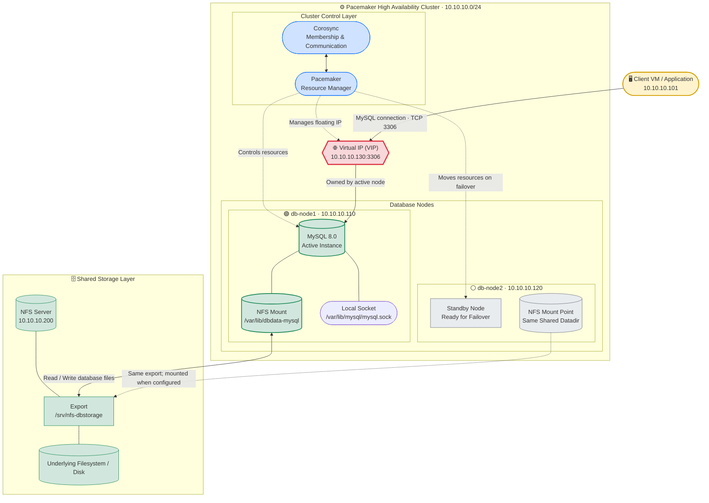

Below is the complete merged Markdown file. It preserves your original document and the updated working document, and only appends the new stickiness/node-preference section at the end.

# P1 - MySQL High Availability (NFS + Pacemaker) on Hyper-V

P1. Self-built setup notes. Builds on [01 - Hyper-V VM Setup](01-hyperv-vm-setup.md) and [06 - Pacemaker Cluster](06-pacemaker-cluster.md).

Status: written from documentation and adjusted for this setup. Package names, service names and some output may differ slightly. Where a step is most likely to differ, a note says so.

## Goal

Build a MySQL database that keeps running and keeps its data even if one database server dies.

You will build it in phases, learning one thing at a time:

| Phase | What you build | What you learn |
| --- | --- | --- |
| 0 | Base VM and an NFS server VM | Hyper-V VMs and networking |
| 1 | NFS server with a data disk | How shared storage works |
| 2 | One MySQL server using NFS | How MySQL stores data |
| 3 | A second DB node and a manual failover | What the cluster will automate |
| 4 | Pacemaker + Corosync cluster | How nodes work together |
| 5 | Cluster resources and a Virtual IP | How clients find the active DB |
| 6 | Failure tests | Automatic failover in action |
| 7 | Backups and next steps | What real systems add |

## Final Design

```text
                     Clients (Windows / apps)
                               |
                       VIP 10.10.10.200      <-- moves to the active node
                               |
                +--------------+--------------+
                |                             |
              db1                           db2
          10.10.10.101                  10.10.10.102
         (MySQL runs on                (MySQL runs on
          ONE node only)                ONE node only)
                \                             /
                 \____________  ____________/
                              \/
                             nfs1
                         10.10.10.50
                   data disk (MySQL files live here)
```

| VM | Role | eth0 (Default Switch, internet) | eth1 (vSwitch-Internal) |
| --- | --- | --- | --- |
| nfs1 | NFS storage server | DHCP | 10.10.10.50 |
| db1 | Database node 1 | DHCP | 10.10.10.101 |
| db2 | Database node 2 | DHCP | 10.10.10.102 |
| VIP | Floating client address | - | 10.10.10.200 |

## Key Words (Read Once)

| Term | Simple meaning |
| --- | --- |
| NFS | A way to share a folder over the network. Servers see it like a local folder |
| Shared storage | One storage place that several servers can use (not at the same time here) |
| Active node | The node currently running MySQL |
| Failover | Moving MySQL to the other node when the active one fails |
| VIP | Virtual IP. A floating address clients use. It follows MySQL |
| Corosync | Keeps the nodes talking and knowing who is alive |
| Pacemaker | The manager that decides where MySQL runs |
| Resource | Something the cluster manages (mount, MySQL, IP) |

## The Golden Rules (Read These)

Only ONE node may run MySQL on the shared folder at any time. Two MySQL servers writing to the same files will corrupt the data. Pacemaker enforces this for you later. Until then, you must enforce it.

MySQL files stay on the NFS share. The nodes only borrow them.

In the cluster, Pacemaker starts and stops MySQL. Never enable `mysqld` at boot, and never add the NFS mount to `/etc/fstab` on db1/db2.

## How to Read This Document

Run commands one at a time. Press Enter, read the result, then continue.

Every step has a `Run on:` marker. Always check which VM you are on.

Run everything as `root`.

Lines after `#` are notes for you. Do not type them.

Passwords in this document (`RootPass#123`, `AppPass#123`) are for this setup only. Never use them for real.

## Prerequisites

- Windows 10/11 Pro/Enterprise with Hyper-V, and the `vSwitch-Internal` switch from document 01 (Windows adapter `10.10.10.1`)
- AlmaLinux 10 ISO
- About 50 GB free disk space on the Windows host
- 4 GB RAM free per VM is ideal (2 GB each is the minimum)

---

# Phase 0 - Build the Base VM

## Step 0.1 - Build `db1` from Document 01

Follow document 01 to create one VM with two network adapters:

- First adapter: `Default Switch` → `eth0` (automatic IP, internet)
- Second adapter: `vSwitch-Internal` → `eth1` with the fixed IP `10.10.10.101`

Run on: db1

Set the hostname:

```bash
hostnamectl set-hostname db1
```

Check that the internet works:

```bash
ping -c 4 8.8.8.8
```

## Step 0.2 - Update and Install the NFS Tools

Run on: db1

```bash
dnf update -y
dnf install -y nfs-utils
```

Every VM in this setup needs `nfs-utils`. Installing it now means the clone gets it too.

## Step 0.3 - Clone `db1` into `nfs1`

Run on: db1, shut it down:

```bash
poweroff
```

Follow Appendix A (Clone a VM) at the end of this document.

New VM name: `nfs1`

New hostname: `nfs1`

New `eth1` IP: `10.10.10.50`

Start `db1` again afterwards.

---

# Phase 1 - Build the NFS Server

## Step 1.1 - Add a Data Disk to `nfs1`

MySQL's files should live on a separate disk, not on the OS disk.

In Hyper-V Manager, right-click `nfs1` → Settings.

Click SCSI Controller → Hard Drive → Add.

Click New → Next → choose VHDX → Next → Dynamically expanding → Next.

Name: `nfs1-data.vhdx`, Size: 10 GB → Next → Finish → OK.

This is a small test size. Real databases need much more.

## Step 1.2 - Find the New Disk

Run on: nfs1

```bash
lsblk
```

Expected: a disk, normally `sdb`, with `10G` and no partitions under it. The OS disk is `sda`.

Careful: the next step erases the disk. Be sure you pick the empty 10 GB disk, not `sda`.

## Step 1.3 - Format the Disk

Run on: nfs1

```bash
mkfs.xfs /dev/sdb
```

## Step 1.4 - Mount the Disk at `/srv/nfs`

Run on: nfs1

Create the mount folder:

```bash
mkdir -p /srv/nfs
```

Get the disk's unique ID:

```bash
blkid /dev/sdb
```

Copy the value after `UUID=` (without the quotes).

Add it to `/etc/fstab` so it mounts at every boot. Replace `PASTE-UUID-HERE` with your UUID:

```bash
echo "UUID=PASTE-UUID-HERE /srv/nfs xfs defaults 0 0" >> /etc/fstab
```

Reload and mount:

```bash
systemctl daemon-reload
mount -a
```

Check:

```bash
df -h /srv/nfs
```

Expected: a line showing about `10G` mounted on `/srv/nfs`.

## Step 1.5 - Create the Database Folder

Run on: nfs1

```bash
mkdir -p /srv/nfs/mysql
```

MySQL runs as the user `mysql`, whose ID number is 27 on AlmaLinux. `nfs1` does not have that user, so we use the number:

```bash
chown 27:27 /srv/nfs/mysql
chmod 750 /srv/nfs/mysql
```

Check:

```bash
ls -ld /srv/nfs/mysql
```

Expected: owner and group show as `27`.

## Step 1.6 - Share the Folder (Export)

Run on: nfs1

```bash
echo "/srv/nfs/mysql 10.10.10.0/24(rw,sync,no_subtree_check)" > /etc/exports
```

| Part | Meaning |
| --- | --- |
| /srv/nfs/mysql | The folder to share |
| 10.10.10.0/24 | Only machines on our internal network may connect |
| rw | Read and write |
| sync | Write to disk before replying. Safer for a database |
| no_subtree_check | Avoids a common NFS problem |

Check the file:

```bash
cat /etc/exports
```

Apply it:

```bash
exportfs -rav
```

Expected: `exporting 10.10.10.0/24:/srv/nfs/mysql`.

## Step 1.7 - Allow SELinux to Share It

Run on: nfs1

```bash
setsebool -P nfs_export_all_rw on
```

If this command is not found, run `dnf install -y policycoreutils-python-utils` first, then try again.

## Step 1.8 - Start the NFS Service

Run on: nfs1

```bash
systemctl enable --now nfs-server
systemctl status nfs-server
```

Look for `active (exited)` or `active (running)`. Press `q` to leave.

## Step 1.9 - Open the Firewall

Run on: nfs1

```bash
firewall-cmd --permanent --add-service=nfs
firewall-cmd --reload
```

Check:

```bash
exportfs -v
```

Expected: your folder with the options and `10.10.10.0/24`.

---

# Phase 2 - One MySQL Server Using NFS

Goal: a single working database whose files live on `nfs1`.

## Step 2.1 - Install MySQL

Run on: db1

```bash
dnf install -y mysql-server
```

Check the version:

```bash
mysql --version
```

The package name should be `mysql-server` and the service `mysqld`. If `dnf` says "no match", run `dnf search mysql-server` and use the name it shows.

## Step 2.2 - Open the MySQL Port

Run on: db1

```bash
firewall-cmd --permanent --add-service=mysql
firewall-cmd --reload
```

## Step 2.3 - Check SELinux

Run on: db1

```bash
getenforce
```

If it says `Permissive` (as set in document 01), continue. If it says `Enforcing`, SELinux may block MySQL from using NFS files. For this setup, set it to permissive:

```bash
setenforce 0
```

To make it permanent, use the `sed` command shown in the SELinux section of document 01.

## Step 2.4 - Test the NFS Share

Run on: db1

Ping the NFS server:

```bash
ping -c 3 10.10.10.50
```

Mount the share temporarily:

```bash
mount -t nfs4 10.10.10.50:/srv/nfs/mysql /mnt
```

Check that it is mounted:

```bash
df -h /mnt
```

Test writing as the mysql user (the folder belongs to user 27):

```bash
runuser -u mysql -- touch /mnt/testfile
runuser -u mysql -- ls -l /mnt
```

Expected: `testfile` is listed.

Clean up:

```bash
runuser -u mysql -- rm /mnt/testfile
umount /mnt
```

Why use `runuser`? NFS maps the `root` user to a harmless user ("root squash"), so even `root` on `db1` cannot read the MySQL folder. This is normal and good for security. Only the `mysql` user (ID 27) can.

## Step 2.5 - Mount the Share as MySQL's Data Folder

MySQL stores its data in `/var/lib/mysql`. We mount the NFS share on top of that folder.

Run on: db1

```bash
mount -t nfs4 -o hard,vers=4.2 10.10.10.50:/srv/nfs/mysql /var/lib/mysql
```

| Option | Meaning |
| --- | --- |
| hard | If NFS is unreachable, wait instead of returning errors. Prevents corrupted writes |
| vers=4.2 | Use NFS version 4.2 |

Check:

```bash
mount | grep mysql
```

Expected: a line showing `10.10.10.50:/srv/nfs/mysql on /var/lib/mysql`.

## Step 2.6 - Start MySQL

Run on: db1

```bash
systemctl start mysqld
```

The first start builds the database files, so wait up to a minute. Check:

```bash
systemctl status mysqld
```

Look for `active (running)`. Press `q`.

Do not run `systemctl enable mysqld`. In the cluster, Pacemaker starts MySQL.

## Step 2.7 - Secure MySQL and Create a Test Database

Run on: db1

Open the MySQL shell. On a fresh install the root user usually has no password:

```bash
mysql -u root
```

You will see a `mysql>` prompt. Type these one at a time, pressing Enter after each:

```sql
ALTER USER 'root'@'localhost' IDENTIFIED BY 'RootPass#123';
CREATE DATABASE appdb;
CREATE USER 'appuser'@'10.10.10.%' IDENTIFIED BY 'AppPass#123';
GRANT ALL PRIVILEGES ON appdb.* TO 'appuser'@'10.10.10.%';
CREATE TABLE appdb.notes (id INT AUTO_INCREMENT PRIMARY KEY, msg VARCHAR(100));
INSERT INTO appdb.notes (msg) VALUES ('Hello from db1');
SELECT * FROM appdb.notes;
```

Expected: one row with `Hello from db1`. Leave the shell:

```sql
EXIT;
```

| What we created | Purpose |
| --- | --- |
| root password | Protects the admin account |
| appdb | A test database |
| appuser | A user that may connect from any 10.10.10.x machine |
| notes table | A small table so we can see data survive failures |

Asked for a root password already? Then a temporary one was generated. Find it with `grep -i "temporary password" /var/log/mysqld.log`, log in with it, and change it with the `ALTER USER` line above.

## Step 2.8 - See Where the Data Really Lives

Run on: db1

```bash
runuser -u mysql -- ls /var/lib/mysql
```

You will see MySQL files (`mysql`, `appdb`, `ibdata1` and others).

Run on: nfs1

```bash
ls /srv/nfs/mysql
```

You see the same files. They live on `nfs1`. `db1` only borrows them.

## Step 2.9 - Connect from Another Machine

Run on: nfs1 (we use it as a client)

```bash
dnf install -y mysql
```

```bash
mysql -h 10.10.10.101 -u appuser -p appdb
```

Enter `AppPass#123`. At the `mysql>` prompt:

```sql
SELECT * FROM notes;
EXIT;
```

If it works, a remote client can use your database.

## Step 2.10 - Prove the Data Survives a Restart

Run on: db1

Stop MySQL and unmount the share:

```bash
systemctl stop mysqld
umount /var/lib/mysql
```

Check the folder is empty locally (the data is not on db1):

```bash
ls /var/lib/mysql
```

Mount again and start:

```bash
mount -t nfs4 -o hard,vers=4.2 10.10.10.50:/srv/nfs/mysql /var/lib/mysql
systemctl start mysqld
mysql -u root -p -e "SELECT * FROM appdb.notes;"
```

Enter `RootPass#123`. Your row is still there. This is the idea behind the whole setup: the data is separate from the server that runs MySQL.

---

# Phase 3 - Add a Second Node and Fail Over by Hand

First you will move MySQL between nodes manually. This shows exactly what Pacemaker will later do automatically.

## Step 3.1 - Prepare `db1`

Run on: db1

Stop MySQL and release the share:

```bash
systemctl stop mysqld
umount /var/lib/mysql
```

Make sure it never starts by itself:

```bash
systemctl disable mysqld
```

## Step 3.2 - Install the Cluster Software on `db1`

We install it before cloning, so `db2` gets it too.

Run on: db1

```bash
dnf install -y dnf-plugins-core
dnf config-manager --set-enabled highavailability
dnf install -y pacemaker pcs
```

Open the cluster firewall:

```bash
firewall-cmd --permanent --add-service=high-availability
firewall-cmd --reload
```

Start the pcs helper service:

```bash
systemctl enable --now pcsd
```

## Step 3.3 - Clone `db1` into `db2`

Run on: db1, shut down:

```bash
poweroff
```

Follow Appendix A (Clone a VM).

New VM name: `db2`

New hostname: `db2`

New `eth1` IP: `10.10.10.102`

Start `db1` again.

`db2` already has MySQL, the NFS tools, the cluster software and the firewall rules, because it is a copy of `db1`.

## Step 3.4 - Let All VMs Find Each Other by Name

Run on: db1, db2 and nfs1 (all three commands on each VM)

```bash
echo "10.10.10.50 nfs1" >> /etc/hosts
echo "10.10.10.101 db1" >> /etc/hosts
echo "10.10.10.102 db2" >> /etc/hosts
```

Run each `echo` only once per VM. Duplicates are harmless but untidy.

## Step 3.5 - Test the Connections

Run on: db1

```bash
ping -c 2 db2
ping -c 2 nfs1
```

Run on: db2

```bash
ping -c 2 db1
ping -c 2 nfs1
```

All must reply.

## Step 3.6 - Manual Failover: Run MySQL on `db1`

Run on: db1

```bash
mount -t nfs4 -o hard,vers=4.2 10.10.10.50:/srv/nfs/mysql /var/lib/mysql
systemctl start mysqld
```

Add a row:

```bash
mysql -u root -p -e "INSERT INTO appdb.notes (msg) VALUES ('Written on db1');"
```

## Step 3.7 - Manual Failover: Stop `db1`, Start `db2`

Run on: db1 (stop MySQL first)

```bash
systemctl stop mysqld
umount /var/lib/mysql
```

Run on: db2

```bash
mount -t nfs4 -o hard,vers=4.2 10.10.10.50:/srv/nfs/mysql /var/lib/mysql
systemctl start mysqld
mysql -u root -p -e "SELECT * FROM appdb.notes;"
```

Expected: all rows, including `Written on db1`. Add one more:

```bash
mysql -u root -p -e "INSERT INTO appdb.notes (msg) VALUES ('Written on db2');"
```

Now stop `db2`:

```bash
systemctl stop mysqld
umount /var/lib/mysql
```

What you just did by hand: stop MySQL → unmount → mount on the other node → start MySQL. In Phase 5, Pacemaker does exactly this automatically and also moves the VIP.

Never start MySQL on both nodes at the same time. If you do, stop one immediately.

---

# Phase 4 - Build the Pacemaker Cluster

Both nodes must have `mysqld` stopped and `/var/lib/mysql` unmounted before you continue. Check on both:

```bash
systemctl is-active mysqld
```

Expected: `inactive`.

```bash
mount | grep mysql
```

Expected: no output.

## Step 4.1 - Set the Cluster User Password

Run on: db1 and db2

```bash
passwd hacluster
```

Use the same password on both nodes. Write it down.

## Step 4.2 - Make the Nodes Trust Each Other

Run on: db1 only

```bash
pcs host auth db1 db2 -u hacluster
```

Enter the password. Expected: `db1: Authorized` and `db2: Authorized`.

## Step 4.3 - Create and Start the Cluster

Run on: db1 only

```bash
pcs cluster setup dbcluster db1 db2
```

Expected last line: `Cluster has been successfully set up.`

Start it:

```bash
pcs cluster start --all
```

Start it automatically at boot:

```bash
pcs cluster enable --all
```

If `pcs cluster start --all` shows `HTTP error: 400`: make sure `hostname` on each VM really is `db1` / `db2`, that `getent hosts db2` shows `10.10.10.102`, then run `systemctl restart pcsd` on both and try again. You can also run `pcs cluster start` on the failing node itself.

## Step 4.4 - Verify the Cluster

Run on: db1

```bash
pcs status
```

Expected: Online: [ db1 db2 ].

```bash
corosync-cfgtool -s
```

Expected: each node shows `connected`, and the addresses are `10.10.10.x`.

```bash
pcs status corosync
```

Expected: both nodes listed under membership.

## Step 4.5 - Turn Off Fencing (Setup Only)

Run on: db1 only

```bash
pcs property set stonith-enabled=false
```

Important: fencing protects your data from two nodes writing at once. This setup relies on you not breaking the rules, because fencing is off. Real clusters must use fencing. See document 06, Part G, to learn it.

---

# Phase 5 - Add the Resources and the Virtual IP

We create three resources and group them so they start in order and always run on the same node:

- `nfs-mysql` - mounts the NFS share at `/var/lib/mysql`
- `pcs-mysql` - starts MySQL
- `vip-db` - the floating IP clients use (last, so clients connect only after MySQL is up)

Run on: db1 only

## Step 5.1 - The NFS Mount Resource

```bash
pcs resource create nfs-mysql Filesystem \
  device="10.10.10.50:/srv/nfs/mysql" \
  directory="/var/lib/mysql" \
  fstype="nfs4" \
  options="hard,vers=4.2" \
  op start timeout=60s \
  op stop timeout=60s \
  op monitor interval=10s timeout=30s
```

| Part | Meaning |
| --- | --- |
| nfs-mysql | Name of the resource |
| Filesystem | The agent that mounts and unmounts things |
| device, directory, fstype | The same share and folder you mounted by hand |
| op start / stop timeout | Allow up to one minute (NFS can be slow) |

## Step 5.2 - The MySQL Resource

```bash
pcs resource create pcs-mysql systemd:mysqld \
  op start timeout=60s \
  op stop timeout=60s \
  op monitor interval=10s timeout=30s
```

`systemd:mysqld` means "manage the normal `mysqld` service".

## Step 5.3 - The Virtual IP Resource

```bash
pcs resource create vip-db ocf:heartbeat:IPaddr2 \
  ip=10.10.10.200 \
  cidr_netmask=24 \
  nic=eth1 \
  op start timeout=60s \
  op stop timeout=60s \
  op monitor interval=10s timeout=30s
```

## Step 5.4 - Group Them in the Right Order

```bash
pcs resource group add dbgroup nfs-mysql pcs-mysql vip-db
```

The order in the command is the start order. Stopping happens in reverse.

## Step 5.5 - Check

```bash
pcs status
```

Expected after about a minute:

```text
Resource Group: dbgroup
  * nfs-mysql     (ocf:heartbeat:Filesystem):  Started db1
  * pcs-mysql     (systemd:mysqld):            Started db1
  * vip-db        (ocf:heartbeat:IPaddr2):     Started db1
```

All three must be Started on the same node.

On the active node verify the pieces:

```bash
mount | grep mysql
ip -br a
```

Expected: the NFS mount is present, and `eth1` shows both its own IP and `10.10.10.200`.

## Step 5.6 - Connect Using the VIP

Run on: nfs1 (as a client)

```bash
mysql -h 10.10.10.200 -u appuser -p appdb -e "SELECT * FROM notes;"
```

Enter `AppPass#123`. You see all rows. Clients only need to know the VIP, never which node is active.

From Windows: you can use a tool like MySQL Workbench or HeidiSQL with host `10.10.10.200`, user `appuser`.

---

# Phase 6 - Break Things and Watch It Recover

Keep a connection ready:

```bash
mysql -h 10.10.10.200 -u appuser -p appdb
```

Find the active node first with `pcs status`.

## Test 1 - Planned Move (Standby)

Run on: db1

```bash
pcs node standby db1
pcs status
```

Expected: the whole `dbgroup` moves to `db2`. Reconnect through the VIP and run:

```sql
SELECT * FROM appdb.notes;
```

Add a row to prove it is writable:

```sql
INSERT INTO appdb.notes (msg) VALUES ('Written after standby');
```

Bring `db1` back:

```bash
pcs node unstandby db1
```

## Test 2 - Crash a Node

In Hyper-V Manager, right-click the VM that currently runs `dbgroup` → Turn Off (not Shut Down).

On the surviving node:

```bash
pcs status
```

Expected after roughly 30 to 120 seconds:

- The failed node is OFFLINE.
- `dbgroup` is Started on the survivor.
- Your data is still there through the VIP.

Why can it take a while? NFS keeps a lock "lease" (about 90 seconds) for a crashed client. MySQL may fail to start at first, with a message like `Unable to lock ./ibdata1`. Pacemaker retries. If it stays failed, run `pcs resource cleanup` after waiting two minutes.

Start the powered-off VM again. It rejoins on its own because of `pcs cluster enable --all`.

## Test 3 - Crash Only MySQL

Run on: the active node

```bash
systemctl stop mysqld
```

Watch:

```bash
pcs status
```

Within about 30 seconds Pacemaker notices and restarts it. Clear old error messages:

```bash
pcs resource cleanup
```

## Test 4 - Lose the NFS Server (See the Weak Point)

Run on: nfs1

```bash
systemctl stop nfs-server
```

Now try a query through the VIP. It hangs. That is the `hard` mount protecting your data by waiting.

Bring it back:

```bash
systemctl start nfs-server
```

The query completes. If the cluster marked resources failed, run `pcs resource cleanup`.

The lesson: `nfs1` is now a single point of failure. If it stays down, both database nodes are useless. The weakest link is the storage.

## Test 5 - Confirm No Data Was Lost

```bash
mysql -h 10.10.10.200 -u appuser -p appdb -e "SELECT * FROM notes;"
```

Expected: every row you ever inserted.

---

# Phase 7 - Backups and Next Steps

## Step 7.1 - Take a Backup

HA is not a backup. A deleted table is deleted on both nodes. Run on the active node:

```bash
mysqldump -u root -p --all-databases > /root/all-databases.sql
```

Copy the file somewhere off these VMs, for example to your Windows PC with MobaXterm.

## What to Learn Next

- Fencing (STONITH): turn `stonith-enabled` back on with a real device. See document 06, Part G.
- Highly available storage: make `nfs1` redundant (DRBD plus a second storage node), or use replicated storage.
- Replication instead of shared storage: MySQL's own replication or InnoDB Cluster, which does not share files at all and is how many production systems work.
- A third node or quorum device so quorum works properly.
- Monitoring and alerts: know about a failover when it happens.

---

# Appendix A - Clone a VM (Hyper-V)

Use this whenever the document says "clone". You need the source VM shut down first.

## A.1 - Export and Import in Hyper-V

Right-click the source VM → Export… → choose a folder → Export.

In the right-hand menu click Import Virtual Machine… → Next.

Choose the exported folder → Next → select the VM → Next.

Choose Copy the virtual machine (create a new unique ID) → Next → Next → Finish.

Right-click the imported VM → Rename to the new name.

Check Settings → Network Adapter. Order must be: first = `Default Switch`, second = `vSwitch-Internal`.

MAC address: if you set a fixed MAC address on the source adapters, change them on the clone. Two VMs must never share one.

Start the clone, and log in on the Hyper-V console (not SSH).

## A.2 - Give the Clone Its Own Identity

Run on: the clone

Set its hostname (use `nfs1` or `db2`):

```bash
hostnamectl set-hostname NEW_NAME
```

Change its internal IP (use `10.10.10.50` for `nfs1`, `10.10.10.102` for `db2`):

```bash
nmcli connection modify eth1 ipv4.addresses NEW_IP/24
nmcli connection down eth1
nmcli connection up eth1
```

Create a new unique machine ID (the clone has the source's):

```bash
rm -f /etc/machine-id
systemd-machine-id-setup
reboot
```

After reboot, verify:

```bash
hostname
ip -br a
```

Expected: the new hostname, `eth1` with the new IP, and `eth0` with a `172.x.x.x` address.

---

# Command Cheat Sheet

| Task | Command |
| --- | --- |
| Cluster overview | `pcs status` |
| Move work off a node / back | `pcs node standby db1` / `pcs node unstandby db1` |
| Clear failures | `pcs resource cleanup` |
| Move the group by hand | `pcs resource move dbgroup db2` |
| Remove the move preference | `pcs resource clear dbgroup` |
| Show resource setup | `pcs resource config` |
| Is MySQL running? | `systemctl is-active mysqld` |
| Is the NFS share mounted? | `mount | grep mysql` |
| What does the NFS server share? | `exportfs -v` (on nfs1) |
| Is the VIP here? | `ip -br a` |
| MySQL error log | `tail -n 50 /var/log/mysqld.log` |
| Cluster log | `journalctl -u pacemaker -n 50` |

---

# Troubleshooting

| Problem | Likely cause | Fix |
| --- | --- | --- |
| `mount: access denied` or `No such file` | Export or firewall wrong | On nfs1: `exportfs -v`, check Step 1.6 and 1.9 |
| `mount.nfs4: Connection timed out` | Cannot reach nfs1 | `ping nfs1`; check the firewall allows `nfs` |
| `touch: Permission denied` on the share | Wrong owner, or tried as root | Redo Step 1.5; test with `runuser -u mysql` |
| `ls /var/lib/mysql` says Permission denied (as root) | Root squash | Normal. Use `runuser -u mysql -- ls ...` |
| `mysqld` fails to start | SELinux, permissions or lock | `tail -n 50 /var/log/mysqld.log`; check `getenforce` |
| `Unable to lock ./ibdata1` after a crash | NFS lock lease not expired yet | Wait 2 minutes, then `pcs resource cleanup` |
| Cannot log in as root | Password not set, or temporary password | See the note in Step 2.7 |
| Remote client: `Host is not allowed to connect` | User host does not match the client | The user was created for `10.10.10.%`. Connect from a `10.10.10.x` machine |
| Remote client: connection refused | Firewall or MySQL not running | Check `firewall-cmd --list-services` on the active node |
| `pcs cluster start --all` gives `HTTP error: 400` | Hostname or name resolution wrong | See the note in Step 4.3 |
| Resources show `Stopped` or `Failed` | Earlier failure, or mount problem | `pcs status`, then `pcs resource cleanup` |
| `nfs-mysql` fails to start | NFS unreachable or already mounted | `mount | grep mysql` and `umount /var/lib/mysql` on the failing node, then `pcs resource cleanup` |
| MySQL running on both nodes | Started manually | Stop one immediately: `systemctl stop mysqld`, then `pcs resource cleanup` |
| VIP not reachable | VIP on another node, or wrong NIC | `pcs status`; `ip -br a` on the active node |

---

# Checklist

## Phases 0-2

- [ ] `db1` has internet on `eth0` and `10.10.10.101` on `eth1`
- [ ] `nfs1` has a separate 10 GB data disk mounted at `/srv/nfs`
- [ ] `/srv/nfs/mysql` is owned by user `27` and exported to `10.10.10.0/24`
- [ ] `db1` can mount the share and run MySQL on it
- [ ] `appdb.notes` data survives `stop`, `umount`, `mount`, `start`

## Phase 3

- [ ] `db2` cloned with its own hostname, IP and machine ID
- [ ] Manual failover moved MySQL from `db1` to `db2` with data intact
- [ ] `mysqld` is disabled at boot on both DB nodes

## Phases 4-5

- [ ] `pcs status` shows both nodes Online
- [ ] `stonith-enabled` is `false` (setup only)
- [ ] `dbgroup` is Started on one node
- [ ] The VIP `10.10.10.200` appears on that node
- [ ] You can query the database through the VIP

## Phase 6

- [ ] Standby test moved everything and the data was still there
- [ ] Power-off test failed over automatically
- [ ] Stopping `mysqld` was repaired by Pacemaker
- [ ] You saw what happens when `nfs1` goes down

## Phase 7

- [ ] A backup file exists and is stored off the VMs

---
---

# P1 - MySQL High Availability (NFS + Pacemaker) - Updated Working Document

**Last updated:** 2026-10-16  
**Status:** Updated from the original document and modified to match the working environment used in this setup.  
**Purpose:** This is the single reference file to recreate the MySQL HA setup from scratch, including the issues encountered and the fixes applied.

---

## 1. Goal

Build a highly available MySQL database using:

- Two database nodes managed by Pacemaker/Corosync
- One NFS server providing shared MySQL storage
- One Virtual IP (VIP) that clients use to connect to MySQL
- Automatic/manual failover of MySQL between the two DB nodes

The database must remain accessible through the VIP even if the active MySQL node fails or is moved to the other node.

---

## 2. Final Architecture

```text
                         Clients / Apps
                               |
                       VIP 10.10.10.130
                               |
                +--------------+--------------+
                |                             |
           db-node1                      db-node2
         10.10.10.110                  10.10.10.120
        MySQL runs here                MySQL runs here
        ONLY when active               ONLY when active
                \                             /
                 \___________   ____________/
                             \ /
                             nfs1
                         10.10.10.200
                  Shared NFS storage:
                  /srv/nfs-dbstorage
```

### VM / Host Summary

| Hostname | Role | Internal IP | Notes |
|---|---|---:|---|
| `nfs1` | NFS storage server | `10.10.10.200` | Exports `/srv/nfs-dbstorage` |
| `db-node1` | Pacemaker DB node 1 | `10.10.10.110` | Runs MySQL when active |
| `db-node2` | Pacemaker DB node 2 | `10.10.10.120` | Runs MySQL when active |
| `db-node` | Test/client VM | `10.10.10.101` | Used to test VIP connectivity |
| VIP | Floating MySQL address | `10.10.10.130` | Moves with MySQL resource group |

### Resource Names Used in This Setup

| Resource | Type | Purpose |
|---|---|---|
| `vip-db` | `IPaddr2` | Virtual IP `10.10.10.130` |
| `nfs-mysql` | `Filesystem` | Mounts NFS share at `/var/lib/dbdata-mysql` |
| `pcs-mysql` | `mysql` OCF agent | Starts/stops custom MySQL binary |
| `dbgroup` | Resource group | Groups VIP, filesystem, and MySQL together |

---

## 3. Important Differences From the Original Document

This updated document reflects the actual working environment used in this setup.

### Original document assumed:

- MySQL installed from distro package
- Binary at `/usr/sbin/mysqld`
- NFS server at `10.10.10.50`
- NFS export at `/srv/nfs/mysql`
- MySQL datadir at `/var/lib/mysql`
- VIP at `10.10.10.200`
- Node names `db1` and `db2`

### This updated setup uses:

- Custom MySQL binary:

```text
/usr/local/mysql-8.0.46-linux-glibc2.28-x86_64/bin/mysqld
```

- MySQL client binary:

```text
/usr/local/mysql-8.0.46-linux-glibc2.28-x86_64/bin/mysql
```

- NFS server:

```text
10.10.10.200
```

- NFS export:

```text
/srv/nfs-dbstorage
```

- MySQL datadir on NFS:

```text
/var/lib/dbdata-mysql
```

- Local MySQL socket directory:

```text
/var/lib/mysql
```

- MySQL PID file:

```text
/run/mysqld/mysqld.pid
```

- MySQL error log:

```text
/var/log/mysql/error.log
```

- VIP:

```text
10.10.10.130
```

- Node names:

```text
db-node1
db-node2
```

- Client/test machine:

```text
db-node / 10.10.10.101
```

---

## 4. Golden Rules

1. **Only one node may run MySQL against the shared NFS datadir at a time.**
2. **Pacemaker must control MySQL.**
   - Do **not** enable `mysqld` at boot on DB nodes.
   - Do **not** manually start `mysqld` while the cluster resource is active.
3. **Do not add the NFS mount to `/etc/fstab` on DB nodes.**
   - Pacemaker’s `nfs-mysql` resource manages the mount.
   - If both nodes mount it automatically, you risk split-brain/data corruption.
4. **The VIP must be in the same subnet as the DB nodes.**
   - Here: `10.10.10.0/24`
5. **MySQL permissions are stored in the shared datadir.**
   - Grants only need to be done once on the active cluster-managed MySQL instance.
6. **If connecting through the VIP fails with `ERROR 1130`, check which node actually owns the VIP and run grants on that node’s cluster-managed MySQL instance.**

---

## 5. Prerequisites

- Hyper-V or another virtualization platform
- AlmaLinux 10 or compatible RHEL-family OS
- Three VMs minimum:
  - `nfs1`
  - `db-node1`
  - `db-node2`
- Optional fourth VM/client:
  - `db-node` at `10.10.10.101`
- Internal network subnet:
  - `10.10.10.0/24`
- Root access on all VMs
- MySQL 8.0 generic Linux binary extracted on DB nodes:

```text
/usr/local/mysql-8.0.46-linux-glibc2.28-x86_64
```

---

# Phase 0 - Base VM and Network Setup

## Step 0.1 - Set Hostnames

Run on each VM.

### On NFS server:

```bash
hostnamectl set-hostname nfs1
```

### On DB node 1:

```bash
hostnamectl set-hostname db-node1
```

### On DB node 2:

```bash
hostnamectl set-hostname db-node2
```

### On client/test VM:

```bash
hostnamectl set-hostname db-node
```

Verify:

```bash
hostname
```

---

## Step 0.2 - Configure Static IPs on Internal Interface

Adjust interface name if yours is not `eth1`.

### On `nfs1`:

```bash
nmcli connection modify eth1 ipv4.addresses 10.10.10.200/24
nmcli connection modify eth1 ipv4.method manual
nmcli connection down eth1
nmcli connection up eth1
```

### On `db-node1`:

```bash
nmcli connection modify eth1 ipv4.addresses 10.10.10.110/24
nmcli connection modify eth1 ipv4.method manual
nmcli connection down eth1
nmcli connection up eth1
```

### On `db-node2`:

```bash
nmcli connection modify eth1 ipv4.addresses 10.10.10.120/24
nmcli connection modify eth1 ipv4.method manual
nmcli connection down eth1
nmcli connection up eth1
```

### On client `db-node`:

```bash
nmcli connection modify eth1 ipv4.addresses 10.10.10.101/24
nmcli connection modify eth1 ipv4.method manual
nmcli connection down eth1
nmcli connection up eth1
```

Verify:

```bash
ip -br a
```

---

## Step 0.3 - Populate `/etc/hosts` on All Machines

Run on all VMs:

```bash
cat >> /etc/hosts <<'EOF'
10.10.10.101 db-node
10.10.10.110 db-node1
10.10.10.120 db-node2
10.10.10.130 db-vip
10.10.10.200 nfs1
EOF
```

Verify:

```bash
getent hosts db-node1
getent hosts db-node2
getent hosts nfs1
getent hosts db-node
```

---

## Step 0.4 - Install Basic Tools

Run on all VMs:

```bash
dnf update -y
dnf install -y nfs-utils firewalld
```

On DB nodes, also install cluster tools later.

---

# Phase 1 - Build the NFS Server

## Step 1.1 - Add Data Disk to `nfs1`

In Hyper-V:

- Add a new VHDX disk to `nfs1`
- Example size: 10 GB
- Example name: `nfs1-data.vhdx`

After adding the disk, boot `nfs1`.

Find the disk:

```bash
lsblk
```

Usually:

- `sda` = OS disk
- `sdb` = new 10 GB data disk

Be careful not to format the OS disk.

---

## Step 1.2 - Format the Data Disk

```bash
mkfs.xfs /dev/sdb
```

---

## Step 1.3 - Mount Data Disk at `/srv/nfs`

```bash
mkdir -p /srv/nfs
blkid /dev/sdb
```

Copy the UUID and add it to `/etc/fstab`:

```bash
echo "UUID=PASTE-UUID-HERE /srv/nfs xfs defaults 0 0" >> /etc/fstab
```

Reload and mount:

```bash
systemctl daemon-reload
mount -a
```

Verify:

```bash
df -h /srv/nfs
```

---

## Step 1.4 - Create MySQL NFS Export Directory

```bash
mkdir -p /srv/nfs-dbstorage
```

MySQL runs as user `mysql`, usually UID `27` on AlmaLinux/RHEL-like systems.

Set ownership:

```bash
chown 27:27 /srv/nfs-dbstorage
chmod 750 /srv/nfs-dbstorage
```

Verify:

```bash
ls -ld /srv/nfs-dbstorage
```

Expected owner/group may display as `27` if the NFS server does not have a local `mysql` user.

---

## Step 1.5 - Export the NFS Share

```bash
echo "/srv/nfs-dbstorage 10.10.10.0/24(rw,sync,no_subtree_check)" > /etc/exports
```

Apply exports:

```bash
exportfs -rav
```

Verify:

```bash
exportfs -v
```

Expected output should include:

```text
/srv/nfs-dbstorage 10.10.10.0/24(rw,sync,no_subtree_check)
```

---

## Step 1.6 - Allow SELinux NFS Sharing

```bash
setsebool -P nfs_export_all_rw on
```

If command not found:

```bash
dnf install -y policycoreutils-python-utils
setsebool -P nfs_export_all_rw on
```

---

## Step 1.7 - Start NFS Service

```bash
systemctl enable --now nfs-server
systemctl status nfs-server
```

---

## Step 1.8 - Open Firewall for NFS

```bash
firewall-cmd --permanent --add-service=nfs
firewall-cmd --reload
```

Verify:

```bash
firewall-cmd --list-services
```

---

# Phase 2 - Install and Configure MySQL on DB Nodes

This phase is done primarily on `db-node1`, then repeated/prepared on `db-node2`.

Because this setup uses a custom MySQL binary, the standard distro `mysql-server` package is not used.

---

## Step 2.1 - Install Required Libraries

MySQL generic binaries often need libraries such as `libaio` and NUMA support.

Run on both DB nodes:

```bash
dnf install -y libaio numactl-libs
```

If your MySQL binary requires additional compatibility libraries, install what your specific tarball needs.

---

## Step 2.2 - Ensure MySQL User and Group Exist

Run on both DB nodes:

```bash
getent group mysql
getent passwd mysql
```

If missing:

```bash
groupadd -r mysql
useradd -r -g mysql -s /sbin/nologin -d /home/mysql mysql
```

Even though `mysql` is a `nologin` user, the OS still needs a valid home directory for some operations.

Create the home directory:

```bash
mkdir -p /home/mysql
chown mysql:mysql /home/mysql
chmod 700 /home/mysql
```

This fixes errors like:

```text
runuser: warning: cannot change directory to /home/mysql: No such file or directory
```

---

## Step 2.3 - Create Local MySQL Directories

Run on both DB nodes:

```bash
mkdir -p /var/lib/dbdata-mysql
mkdir -p /var/lib/mysql
mkdir -p /run/mysqld
mkdir -p /var/log/mysql
```

Set ownership:

```bash
chown -R mysql:mysql /var/lib/dbdata-mysql
chown -R mysql:mysql /var/lib/mysql
chown -R mysql:mysql /run/mysqld
chown -R mysql:mysql /var/log/mysql
```

Permissions:

```bash
chmod 750 /var/lib/dbdata-mysql
chmod 755 /var/lib/mysql
chmod 755 /run/mysqld
chmod 750 /var/log/mysql
```

### Important

- `/var/lib/dbdata-mysql` is the NFS-mounted shared datadir.
- `/var/lib/mysql` is local and used for the MySQL socket.
- Do **not** put the socket on NFS unless you specifically understand the locking implications.

---

## Step 2.4 - Make `/run/mysqld` Persistent Across Reboots

`/run` is cleared on reboot.

Create a tmpfiles rule on both DB nodes:

```bash
cat > /etc/tmpfiles.d/mysqld.conf <<'EOF'
d /run/mysqld 0755 mysql mysql -
EOF
```

Apply immediately:

```bash
systemd-tmpfiles --create
```

---

## Step 2.5 - Create `/etc/my.cnf`

Run on both DB nodes:

```bash
cat > /etc/my.cnf <<'EOF'
[client]
socket=/var/lib/mysql/mysql.sock

[mysqld]
user=mysql
basedir=/usr/local/mysql-8.0.46-linux-glibc2.28-x86_64
datadir=/var/lib/dbdata-mysql
socket=/var/lib/mysql/mysql.sock
pid-file=/run/mysqld/mysqld.pid
log-error=/var/log/mysql/error.log
EOF
```

### Notes

- `datadir=/var/lib/dbdata-mysql` matches the NFS mount point.
- `socket=/var/lib/mysql/mysql.sock` is local.
- `pid-file=/run/mysqld/mysqld.pid` must be writable by `mysql`.
- Do **not** hardcode `bind-address=10.10.10.130` in `my.cnf` for manual startup, because the VIP may not exist yet. Pacemaker will pass the bind address through the resource.

---

## Step 2.6 - Mount NFS Manually for Initialization

Run on `db-node1`:

```bash
mount -t nfs4 -o hard,vers=4.2 10.10.10.200:/srv/nfs-dbstorage /var/lib/dbdata-mysql
```

Verify:

```bash
df -h /var/lib/dbdata-mysql
mount | grep dbdata-mysql
```

---

## Step 2.7 - Initialize MySQL Datadir

Only do this if `/var/lib/dbdata-mysql` is empty.

Check:

```bash
ls -la /var/lib/dbdata-mysql
```

If empty, initialize:

```bash
/usr/local/mysql-8.0.46-linux-glibc2.28-x86_64/bin/mysqld \
  --initialize-insecure \
  --user=mysql \
  --basedir=/usr/local/mysql-8.0.46-linux-glibc2.28-x86_64 \
  --datadir=/var/lib/dbdata-mysql \
  --socket=/var/lib/mysql/mysql.sock \
  --pid-file=/run/mysqld/mysqld.pid \
  --log-error=/var/log/mysql/error.log
```

`--initialize-insecure` creates a root user with no password, which is acceptable for an initial setup.

If the datadir already contains MySQL system tables, skip initialization.

---

## Step 2.8 - Start MySQL Manually for Initial Configuration

Run on `db-node1`:

```bash
/usr/local/mysql-8.0.46-linux-glibc2.28-x86_64/bin/mysqld \
  --defaults-file=/etc/my.cnf \
  --user=mysql &
```

Wait a few seconds, then check:

```bash
ps -ef | grep mysqld
tail -n 50 /var/log/mysql/error.log
```

---

## Step 2.9 - Set Root Password and Create Initial Database

Connect locally using the socket:

```bash
/usr/local/mysql-8.0.46-linux-glibc2.28-x86_64/bin/mysql \
  --socket=/var/lib/mysql/mysql.sock \
  -u root
```

Inside MySQL, run:

```sql
ALTER USER 'root'@'localhost' IDENTIFIED BY '123';

CREATE DATABASE IF NOT EXISTS appdb;

USE appdb;

CREATE TABLE IF NOT EXISTS notes (
  id INT AUTO_INCREMENT PRIMARY KEY,
  msg VARCHAR(255),
  created_at TIMESTAMP DEFAULT CURRENT_TIMESTAMP
);

INSERT INTO appdb.notes (msg) VALUES ('Initial row created during setup');

CREATE USER IF NOT EXISTS 'root'@'10.10.10.%' IDENTIFIED BY '123';
GRANT ALL PRIVILEGES ON *.* TO 'root'@'10.10.10.%' WITH GRANT OPTION;

CREATE USER IF NOT EXISTS 'root'@'db-node1' IDENTIFIED BY '123';
GRANT ALL PRIVILEGES ON *.* TO 'root'@'db-node1' WITH GRANT OPTION;

CREATE USER IF NOT EXISTS 'root'@'db-node2' IDENTIFIED BY '123';
GRANT ALL PRIVILEGES ON *.* TO 'root'@'db-node2' WITH GRANT OPTION;

CREATE USER IF NOT EXISTS 'root'@'db-node' IDENTIFIED BY '123';
GRANT ALL PRIVILEGES ON *.* TO 'root'@'db-node' WITH GRANT OPTION;

CREATE USER IF NOT EXISTS 'root'@'10.10.10.101' IDENTIFIED BY '123';
GRANT ALL PRIVILEGES ON *.* TO 'root'@'10.10.10.101' WITH GRANT OPTION;

CREATE USER IF NOT EXISTS 'root'@'10.10.10.110' IDENTIFIED BY '123';
GRANT ALL PRIVILEGES ON *.* TO 'root'@'10.10.10.110' WITH GRANT OPTION;

CREATE USER IF NOT EXISTS 'root'@'10.10.10.120' IDENTIFIED BY '123';
GRANT ALL PRIVILEGES ON *.* TO 'root'@'10.10.10.120' WITH GRANT OPTION;

CREATE USER IF NOT EXISTS 'root'@'10.10.10.130' IDENTIFIED BY '123';
GRANT ALL PRIVILEGES ON *.* TO 'root'@'10.10.10.130' WITH GRANT OPTION;

FLUSH PRIVILEGES;

EXIT;
```

### Why both hostname and IP grants?

MySQL authenticates based on:

```text
'user'@'host'
```

Depending on name resolution, MySQL may see the client as:

- an IP address, e.g. `10.10.10.101`
- a hostname, e.g. `db-node`
- a reverse-resolved hostname, e.g. `db-node1`

This setup hit:

```text
ERROR 1130 (HY000): Host 'db-node1' is not allowed to connect to this MySQL server
```

even after IP-based grants existed, because MySQL resolved the client IP to a hostname.

For this setup, creating both hostname and IP entries is simplest.

For production, prefer:

- a dedicated application user,
- limited privileges,
- specific hosts,
- strong passwords,
- possibly `skip_name_resolve=ON` with IP-based grants.

---

## Step 2.10 - Stop Manual MySQL

Shutdown cleanly:

```bash
/usr/local/mysql-8.0.46-linux-glibc2.28-x86_64/bin/mysqladmin \
  --socket=/var/lib/mysql/mysql.sock \
  -u root \
  -p123 shutdown
```

Verify:

```bash
ps -ef | grep mysqld
```

There should be no running `mysqld`.

---

## Step 2.11 - Unmount NFS

```bash
umount /var/lib/dbdata-mysql
```

Verify:

```bash
mount | grep dbdata-mysql
```

No output is expected.

---

## Step 2.12 - Disable Any Distro/systemd MySQL Service

If a `mysqld` systemd unit exists, disable it so it does not start independently of Pacemaker.

Run on both DB nodes:

```bash
systemctl disable --now mysqld 2>/dev/null || true
```

Check:

```bash
systemctl is-enabled mysqld 2>/dev/null || echo "not enabled"
systemctl is-active mysqld 2>/dev/null || echo "not active"
```

Expected:

```text
disabled
inactive
```

or not installed.

---

# Phase 3 - Prepare Second DB Node and Test Manual Failover

At this point, `db-node1` has:

- MySQL binary
- `/etc/my.cnf`
- local directories
- NFS client tools
- disabled standalone `mysqld`

Prepare `db-node2` with the same software and configuration.

---

## Step 3.1 - Ensure `db-node2` Has the Same MySQL Binary

On `db-node2`, verify:

```bash
ls -l /usr/local/mysql-8.0.46-linux-glibc2.28-x86_64/bin/mysqld
ls -l /usr/local/mysql-8.0.46-linux-glibc2.28-x86_64/bin/mysql
```

If not present, copy/install the same MySQL binary layout as on `db-node1`.

---

## Step 3.2 - Ensure `db-node2` Has Same Directories and Config

Verify on `db-node2`:

```bash
cat /etc/my.cnf
ls -ld /var/lib/dbdata-mysql
ls -ld /var/lib/mysql
ls -ld /run/mysqld
ls -ld /var/log/mysql
id mysql
```

If needed, repeat Phase 2 directory/user/config steps on `db-node2`.

---

## Step 3.3 - Manual Failover Test: Run MySQL on `db-node1`

Run on `db-node1`:

```bash
mount -t nfs4 -o hard,vers=4.2 10.10.10.200:/srv/nfs-dbstorage /var/lib/dbdata-mysql
```

Start MySQL manually:

```bash
/usr/local/mysql-8.0.46-linux-glibc2.28-x86_64/bin/mysqld \
  --defaults-file=/etc/my.cnf \
  --user=mysql &
```

Insert a row:

```bash
/usr/local/mysql-8.0.46-linux-glibc2.28-x86_64/bin/mysql \
  -u root \
  -p123 \
  -e "INSERT INTO appdb.notes (msg) VALUES ('Written on db1');"
```

### Common mistake

Do not paste the full shell command into the MySQL prompt.

Wrong:

```sql
mysql> "INSERT INTO appdb.notes (msg) VALUES ('Written on db1');"
```

Correct if already inside MySQL prompt:

```sql
INSERT INTO appdb.notes (msg) VALUES ('Written on db1');
```

Correct from shell:

```bash
mysql -u root -p123 -e "INSERT INTO appdb.notes (msg) VALUES ('Written on db1');"
```

---

## Step 3.4 - Manual Failover Test: Move MySQL to `db-node2`

Stop MySQL on `db-node1`:

```bash
/usr/local/mysql-8.0.46-linux-glibc2.28-x86_64/bin/mysqladmin \
  --socket=/var/lib/mysql/mysql.sock \
  -u root \
  -p123 shutdown
```

Unmount NFS on `db-node1`:

```bash
umount /var/lib/dbdata-mysql
```

On `db-node2`:

```bash
mount -t nfs4 -o hard,vers=4.2 10.10.10.200:/srv/nfs-dbstorage /var/lib/dbdata-mysql
```

Start MySQL:

```bash
/usr/local/mysql-8.0.46-linux-glibc2.28-x86_64/bin/mysqld \
  --defaults-file=/etc/my.cnf \
  --user=mysql &
```

Verify data:

```bash
/usr/local/mysql-8.0.46-linux-glibc2.28-x86_64/bin/mysql \
  -u root \
  -p123 \
  -e "SELECT * FROM appdb.notes;"
```

You should see:

```text
Written on db1
```

Insert another row:

```bash
/usr/local/mysql-8.0.46-linux-glibc2.28-x86_64/bin/mysql \
  -u root \
  -p123 \
  -e "INSERT INTO appdb.notes (msg) VALUES ('Written on db2');"
```

Stop MySQL and unmount on `db-node2`:

```bash
/usr/local/mysql-8.0.46-linux-glibc2.28-x86_64/bin/mysqladmin \
  --socket=/var/lib/mysql/mysql.sock \
  -u root \
  -p123 shutdown

umount /var/lib/dbdata-mysql
```

This proves the concept:

```text
stop MySQL -> unmount NFS -> mount NFS on other node -> start MySQL -> data survives
```

Pacemaker will automate this in Phase 5.

---

# Phase 4 - Build the Pacemaker/Corosync Cluster

Ensure both DB nodes have:

- MySQL stopped
- NFS unmounted
- `mysqld` disabled

Check on both nodes:

```bash
ps -ef | grep mysqld
mount | grep dbdata-mysql
systemctl is-active mysqld 2>/dev/null || true
```

Expected:

- no active `mysqld`
- no NFS mount
- systemd `mysqld` inactive/disabled

---

## Step 4.1 - Install Pacemaker and PCS

Run on both DB nodes:

```bash
dnf install -y dnf-plugins-core
dnf config-manager --set-enabled highavailability
dnf install -y pacemaker pcs
```

Open cluster firewall:

```bash
firewall-cmd --permanent --add-service=high-availability
firewall-cmd --reload
```

Start `pcsd`:

```bash
systemctl enable --now pcsd
```

---

## Step 4.2 - Set `hacluster` Password

Run on both DB nodes:

```bash
passwd hacluster
```

Use the same password on both nodes.

---

## Step 4.3 - Authenticate Nodes

Run on `db-node1` only:

```bash
pcs host auth db-node1 db-node2 -u hacluster
```

Expected:

```text
db-node1: Authorized
db-node2: Authorized
```

---

## Step 4.4 - Create Cluster

Run on `db-node1` only:

```bash
pcs cluster setup dbcluster db-node1 db-node2
```

Expected:

```text
Cluster has been successfully set up.
```

Start cluster:

```bash
pcs cluster start --all
```

Enable at boot:

```bash
pcs cluster enable --all
```

---

## Step 4.5 - Verify Cluster

Run on `db-node1`:

```bash
pcs status
```

Expected:

```text
Online: [ db-node1 db-node2 ]
```

Check Corosync links:

```bash
corosync-cfgtool -s
```

Expected:

- transport `knet`
- link address in `10.10.10.x`
- other node shown as `connected`

Example:

```text
Local node ID 1, transport knet
LINK ID 0 udp
	addr = 10.10.10.110
	status:
		nodeid:          1:	localhost
		nodeid:          2:	connected
```

Check Corosync membership:

```bash
pcs status corosync
```

Expected: both nodes listed under membership.

Inspect config if needed:

```bash
cat /etc/corosync/corosync.conf
```

Expected nodelist example:

```text
nodelist {
    node {
        ring0_addr: 10.10.10.110
        name: db-node1
        nodeid: 1
    }

    node {
        ring0_addr: 10.10.10.120
        name: db-node2
        nodeid: 2
    }
}
```

If the IPs are correct and `corosync-cfgtool -s` shows connected, you usually do not need to change `ring0_addr`.

---

## Step 4.6 - Set Cluster Properties

Run on `db-node1` only:

```bash
pcs property set stonith-enabled=false
pcs property set no-quorum-policy=ignore
pcs resource defaults update resource-stickiness=1000
```

### Notes

- `stonith-enabled=false` is for this setup only.
- Real clusters should use fencing/STONITH.
- Newer PCS versions use:

```bash
pcs resource defaults update ...
```

instead of old syntax:

```bash
pcs resource defaults ...
```

### Optional production-style settings

Do **not** run these in this setup unless you have a real fencing device and/or QDevice.

```bash
pcs property set stonith-enabled=true
pcs property set no-quorum-policy=stop
pcs resource defaults update resource-stickiness=INFINITY
```

### Small notes

- **STONITH / fencing**  
  Forces a failed/unreachable node to power off or reset before the other node takes over.  
  This prevents **split-brain**, where both nodes try to use the same NFS data and corrupt MySQL.  
  Requires a fence agent, for example IPMI, iLO, iDRAC, VMware, or cloud fencing.  
  If you do not have fencing configured, keep:

  ```bash
  stonith-enabled=false
  ```

- **Quorum**  
  Quorum means enough nodes agree the cluster is healthy.  
  In a 2-node cluster, if one node dies, the remaining node may lose quorum.  
  For this setup we use:

  ```bash
  no-quorum-policy=ignore
  ```

  For production, safer setting is:

  ```bash
  no-quorum-policy=stop
  ```

  But with only 2 nodes, production usually adds a **QDevice** as a third tie-breaker vote.

- **Resource stickiness**  
  Stickiness controls whether resources prefer to stay on the node where they are already running.  
  This setup value:

  ```bash
  resource-stickiness=1000
  ```

  Maximum value:

  ```bash
  resource-stickiness=INFINITY
  ```

  If your PCS version rejects `INFINITY`, use:

  ```bash
  pcs resource defaults update resource-stickiness=1000000
  ```

  High stickiness prevents unnecessary movement/flapping, but it does **not** automatically force resources back to `db-node1` after failover. To move them back manually:

  ```bash
  pcs resource move dbgroup db-node1
  pcs resource clear dbgroup
  ```

---

# Phase 5 - Add Cluster Resources and VIP

Run all resource creation commands on `db-node1` only.

Pacemaker propagates configuration to the other node.

Do **not** run `pcs resource create` on both nodes.

---

## Step 5.1 - Create Virtual IP Resource

```bash
pcs resource create vip-db IPaddr2 \
  ip=10.10.10.130 \
  cidr_netmask=24 \
  op start timeout=60s \
  op stop timeout=60s \
  op monitor interval=10s timeout=30s
```

### VIP selection rules

The VIP must:

- be in the same subnet as DB nodes
- not conflict with existing static IPs
- not be assigned to another machine
- ideally be outside DHCP ranges

Used here:

```text
10.10.10.130
```

Existing nodes:

```text
db-node1 = 10.10.10.110
db-node2 = 10.10.10.120
client   = 10.10.10.101
nfs1     = 10.10.10.200
```

---

## Step 5.2 - Create NFS Filesystem Resource

Use this because storage is NFS, not a local block device like `/dev/xvde`.

```bash
pcs resource create nfs-mysql Filesystem \
  device="10.10.10.200:/srv/nfs-dbstorage" \
  directory="/var/lib/dbdata-mysql" \
  fstype="nfs4" \
  options="rw,hard,vers=4.2" \
  op start timeout=60s \
  op stop timeout=60s \
  op monitor interval=10s timeout=30s
```

### Do not use this if you are using NFS:

```bash
device=/dev/xvde
```

That is for shared block storage, not NFS.

---

## Step 5.3 - Create MySQL Resource

This uses the custom MySQL binary and client binary.

```bash
pcs resource create pcs-mysql mysql \
  binary="/usr/local/mysql-8.0.46-linux-glibc2.28-x86_64/bin/mysqld" \
  client_binary="/usr/local/mysql-8.0.46-linux-glibc2.28-x86_64/bin/mysql" \
  config="/etc/my.cnf" \
  datadir="/var/lib/dbdata-mysql" \
  pid="/run/mysqld/mysqld.pid" \
  socket="/var/lib/mysql/mysql.sock" \
  user=mysql \
  group=mysql \
  additional_parameters="--bind-address=10.10.10.130 --user=mysql" \
  op start timeout=60s \
  op stop timeout=60s \
  op monitor interval=10s timeout=30s
```

### Important parameters

| Parameter | Meaning |
|---|---|
| `binary` | Path to `mysqld` |
| `client_binary` | Path to `mysql` client used by the OCF agent for monitoring |
| `config` | MySQL config file |
| `datadir` | Shared NFS datadir |
| `pid` | PID file location |
| `socket` | Local socket path |
| `additional_parameters` | Extra MySQL startup options |
| `--bind-address=10.10.10.130` | Makes MySQL listen on the VIP |

### Common error

```text
ocf-exit-reason:Setup problem: couldn't find command: mysql
```

Fix by setting:

```bash
client_binary="/usr/local/mysql-8.0.46-linux-glibc2.28-x86_64/bin/mysql"
```

or ensuring MySQL binaries are in system `PATH`.

---

## Step 5.4 - Group Resources in Correct Order

Order matters:

1. VIP starts first
2. NFS mounts second
3. MySQL starts last

```bash
pcs resource group add dbgroup vip-db
pcs resource group add dbgroup nfs-mysql
pcs resource group add dbgroup pcs-mysql
```

You can also add multiple resources one by one. Do not use invalid syntax like:

```bash
pcs resource group add dbgroup ip- 10.95.204.138 nfs-mysql pcs-mysql
```

That is wrong because:

- resource names cannot contain spaces
- the VIP resource name is `vip-db`
- resources should be added one at a time or with correct naming

---

## Step 5.5 - Verify Resource Configuration

```bash
pcs resource config dbgroup
```

Expected resources:

```text
vip-db
nfs-mysql
pcs-mysql
```

Expected `pcs-mysql` attributes include:

```text
binary=/usr/local/mysql-8.0.46-linux-glibc2.28-x86_64/bin/mysqld
client_binary=/usr/local/mysql-8.0.46-linux-glibc2.28-x86_64/bin/mysql
config=/etc/my.cnf
datadir=/var/lib/dbdata-mysql
pid=/run/mysqld/mysqld.pid
socket=/var/lib/mysql/mysql.sock
user=mysql
group=mysql
additional_parameters="--bind-address=10.10.10.130 --user=mysql"
```

Check cluster status:

```bash
pcs status
```

Expected:

```text
Resource Group: dbgroup
  vip-db       (ocf:heartbeat:IPaddr2):    Started db-node1
  nfs-mysql    (ocf:heartbeat:Filesystem): Started db-node1
  pcs-mysql    (ocf:heartbeat:mysql):      Started db-node1
```

Or all on `db-node2`, depending on where the group is active.

---

## Step 5.6 - Open MySQL Firewall on DB Nodes

Run on both DB nodes:

```bash
firewall-cmd --permanent --add-service=mysql
firewall-cmd --reload
```

Verify:

```bash
firewall-cmd --list-services
```

Expected output should include:

```text
mysql
high-availability
```

---

# Phase 6 - Connect Using the VIP

## Step 6.1 - Find Which Node Owns the VIP

Run on either DB node:

```bash
pcs status | grep dbgroup
```

Or check directly:

```bash
ip -br a | grep 10.10.10.130
```

The node showing `10.10.10.130` is the active MySQL node.

---

## Step 6.2 - Test VIP Reachability

From another machine:

```bash
ping -c 3 10.10.10.130
```

Expected: replies.

If ping fails:

- check `pcs status`
- check `ip -br a` on active node
- check firewall
- check VIP subnet

---

## Step 6.3 - Connect to MySQL Through VIP

From client VM `db-node` (`10.10.10.101`):

Install MySQL client if needed:

```bash
dnf install -y mysql
```

Then:

```bash
mysql -h 10.10.10.130 -u root -p123 -e "SELECT @@hostname;"
```

Expected:

```text
+------------+
| @@hostname |
+------------+
| db-node1   |
+------------+
```

or:

```text
| db-node2   |
```

depending on which node currently owns the VIP and MySQL resource.

---

## Step 6.4 - Insert and Select Data Through VIP

```bash
mysql -h 10.10.10.130 -u root -p123 -e "INSERT INTO appdb.notes (msg) VALUES ('Written through VIP');"
```

```bash
mysql -h 10.10.10.130 -u root -p123 -e "SELECT * FROM appdb.notes;"
```

You should see all rows, including rows written directly on nodes and through the VIP.

---

# Phase 7 - Connectivity Problems Encountered and Fixes

This section documents the real issues faced during the setup.

---

## Problem 1: Pasting Shell Command Inside MySQL Prompt

### Symptom

```sql
mysql> "INSERT INTO appdb.notes (msg) VALUES ('Written on db1');"
ERROR 1064 (42000): You have an error in your SQL syntax...
```

### Cause

The full shell command was pasted into the MySQL interactive prompt:

```bash
mysql -u root -p -e "INSERT ..."
```

MySQL tried to parse the double quotes and shell syntax as SQL.

### Fix

If already inside `mysql>`, run only SQL:

```sql
INSERT INTO appdb.notes (msg) VALUES ('Written on db1');
```

If in bash shell, run:

```bash
mysql -u root -p123 -e "INSERT INTO appdb.notes (msg) VALUES ('Written on db1');"
```

---

## Problem 2: Unknown Database `appdb`

### Symptom

```text
ERROR 1049 (42000): Unknown database 'appdb'
```

### Cause

The database had not been created yet.

### Fix

Inside MySQL:

```sql
CREATE DATABASE appdb;
USE appdb;
CREATE TABLE notes (
  id INT AUTO_INCREMENT PRIMARY KEY,
  msg VARCHAR(255),
  created_at TIMESTAMP DEFAULT CURRENT_TIMESTAMP
);
```

Then insert:

```sql
INSERT INTO appdb.notes (msg) VALUES ('Written on db1');
```

---

## Problem 3: Old PCS Syntax for Resource Defaults

### Symptom

```text
Error: This command has been replaced with 'pcs resource defaults update'.
```

### Cause

Newer PCS versions changed syntax.

### Fix

Use:

```bash
pcs resource defaults update resource-stickiness=1000
```

Not:

```bash
pcs resource defaults resource-stickiness=1000
```

---

## Problem 4: Using Block Device Filesystem Resource with NFS

### Symptom/Confusion

Command attempted:

```bash
pcs resource create nfs-mysql Filesystem device=/dev/xvde directory=/var/lib/dbdata-mysql fstype=ext4
```

### Cause

`/dev/xvde` is a block device. This setup uses NFS.

### Fix

Use NFS filesystem resource:

```bash
pcs resource create nfs-mysql Filesystem \
  device="10.10.10.200:/srv/nfs-dbstorage" \
  directory="/var/lib/dbdata-mysql" \
  fstype="nfs4" \
  options="rw,hard,vers=4.2" \
  op start timeout=60s \
  op stop timeout=60s \
  op monitor interval=10s timeout=30s
```

---

## Problem 5: VIP Chosen From Wrong Subnet

### Bad example

```text
10.95.204.138
```

while DB nodes are on:

```text
10.10.10.0/24
```

### Fix

Use an IP in the same subnet:

```text
10.10.10.130
```

---

## Problem 6: MySQL OCF Agent Could Not Find `mysql` Client

### Symptom

```text
ocf-exit-reason:Setup problem: couldn't find command: mysql
```

### Cause

MySQL is installed in a custom path:

```text
/usr/local/mysql-8.0.46-linux-glibc2.28-x86_64/bin
```

The OCF agent could not find the `mysql` client in normal `PATH`.

### Fix

Add `client_binary` to the resource:

```bash
client_binary="/usr/local/mysql-8.0.46-linux-glibc2.28-x86_64/bin/mysql"
```

If resource already exists:

```bash
pcs resource update pcs-mysql client_binary="/usr/local/mysql-8.0.46-linux-glibc2.28-x86_64/bin/mysql"
```

Or delete and recreate:

```bash
pcs resource delete pcs-mysql
pcs resource create pcs-mysql mysql ...
```

---

## Problem 7: Resource Already Exists

### Symptom

```text
Error: 'pcs-mysql' already exists
```

### Cause

The resource was already created during a previous attempt.

### Fix

Update it:

```bash
pcs resource update pcs-mysql client_binary="/usr/local/mysql-8.0.46-linux-glibc2.28-x86_64/bin/mysql"
```

Or delete and recreate:

```bash
pcs resource delete pcs-mysql
pcs resource create pcs-mysql mysql ...
```

---

## Problem 8: `runuser: warning: cannot change directory to /home/mysql`

### Symptom

```text
runuser: warning: cannot change directory to /home/mysql: No such file or directory
```

### Cause

The `mysql` user has `/sbin/nologin` shell for security, but the system still expects a valid home directory.

### Fix

Run on both DB nodes:

```bash
mkdir -p /home/mysql
chown mysql:mysql /home/mysql
chmod 700 /home/mysql
```

This does not allow login. It only satisfies the OS/user directory requirement.

---

## Problem 9: MySQL Resource Shows Started but MySQL Not Actually Running

### Symptom

`pcs status` shows resources started, but local MySQL is not running or connections fail.

### Diagnosis

Check:

```bash
pcs status
ps -ef | grep mysqld
tail -n 100 /var/log/mysql/error.log
```

### Common causes

- datadir not initialized
- wrong datadir path
- permissions on `/var/lib/dbdata-mysql`
- missing `/run/mysqld`
- missing `/var/lib/mysql` socket directory
- SELinux blocking access
- another `mysqld` already running
- VIP not available when MySQL tries to bind

### Fixes

Ensure directories exist:

```bash
mkdir -p /var/lib/dbdata-mysql
mkdir -p /var/lib/mysql
mkdir -p /run/mysqld
mkdir -p /var/log/mysql
chown -R mysql:mysql /var/lib/dbdata-mysql /var/lib/mysql /run/mysqld /var/log/mysql
```

Ensure NFS is mounted by cluster:

```bash
mount | grep dbdata-mysql
```

Check error log:

```bash
tail -n 100 /var/log/mysql/error.log
```

Clean up failed resource state:

```bash
pcs resource cleanup
```

---

## Problem 10: `ERROR 2003` Can’t Connect to MySQL Server on VIP

### Symptom

```text
ERROR 2003 (HY000): Can't connect to MySQL server on '10.10.10.130:3306' (113)
```

### Possible causes

- VIP not active
- firewall blocking 3306
- MySQL not running
- MySQL bound only to localhost
- MySQL bound to old VIP
- resource group failed to start

### Diagnosis

On active node:

```bash
ip -br a | grep 10.10.10.130
ss -lntp | grep 3306
systemctl status firewalld
firewall-cmd --list-services
pcs status
```

### Fixes

Open firewall:

```bash
firewall-cmd --permanent --add-service=mysql
firewall-cmd --reload
```

Ensure MySQL resource binds to VIP:

```bash
pcs resource config pcs-mysql | grep additional_parameters
```

Expected:

```text
additional_parameters="--bind-address=10.10.10.130 --user=mysql"
```

If VIP changed:

```bash
pcs resource update pcs-mysql additional_parameters="--bind-address=NEW_VIP --user=mysql"
```

---

## Problem 11: `ERROR 1130` Host Not Allowed to Connect

### Symptom

```text
ERROR 1130 (HY000): Host 'db-node1' is not allowed to connect to this MySQL server
```

or:

```text
ERROR 1130 (HY000): Host '10.10.10.101' is not allowed to connect to this MySQL server
```

### Root cause

MySQL authenticates using:

```text
'user'@'host'
```

The host part may be:

- hostname
- IP address
- reverse-resolved hostname

If the client connects from `10.10.10.110`, MySQL may resolve it to `db-node1` and check for:

```text
'root'@'db-node1'
```

If that account does not exist, access is denied.

### Critical mistake made during setup

Grants were accidentally applied to a local standalone MySQL instance on `db-node1`, while the VIP was actually pointing to the cluster-managed MySQL instance on `db-node2`.

Result:

- grants appeared to be added
- VIP connection still failed
- because the VIP reached a different MySQL instance

### Correct procedure

1. Find which node owns the VIP:

```bash
ip -br a | grep 10.10.10.130
pcs status
```

2. Log in to the **cluster-managed MySQL** on that active node.

Use local socket on the active node:

```bash
mysql -u root -p123
```

or explicitly:

```bash
/usr/local/mysql-8.0.46-linux-glibc2.28-x86_64/bin/mysql \
  --socket=/var/lib/mysql/mysql.sock \
  -u root -p123
```

3. Create grants for all expected clients.

Setup-wide fix:

```sql
CREATE USER IF NOT EXISTS 'root'@'db-node1' IDENTIFIED BY '123';
CREATE USER IF NOT EXISTS 'root'@'db-node2' IDENTIFIED BY '123';
CREATE USER IF NOT EXISTS 'root'@'db-node' IDENTIFIED BY '123';

CREATE USER IF NOT EXISTS 'root'@'10.10.10.101' IDENTIFIED BY '123';
CREATE USER IF NOT EXISTS 'root'@'10.10.10.110' IDENTIFIED BY '123';
CREATE USER IF NOT EXISTS 'root'@'10.10.10.120' IDENTIFIED BY '123';
CREATE USER IF NOT EXISTS 'root'@'10.10.10.130' IDENTIFIED BY '123';
CREATE USER IF NOT EXISTS 'root'@'10.10.10.%' IDENTIFIED BY '123';

GRANT ALL PRIVILEGES ON *.* TO 'root'@'db-node1' WITH GRANT OPTION;
GRANT ALL PRIVILEGES ON *.* TO 'root'@'db-node2' WITH GRANT OPTION;
GRANT ALL PRIVILEGES ON *.* TO 'root'@'db-node' WITH GRANT OPTION;

GRANT ALL PRIVILEGES ON *.* TO 'root'@'10.10.10.101' WITH GRANT OPTION;
GRANT ALL PRIVILEGES ON *.* TO 'root'@'10.10.10.110' WITH GRANT OPTION;
GRANT ALL PRIVILEGES ON *.* TO 'root'@'10.10.10.120' WITH GRANT OPTION;
GRANT ALL PRIVILEGES ON *.* TO 'root'@'10.10.10.130' WITH GRANT OPTION;
GRANT ALL PRIVILEGES ON *.* TO 'root'@'10.10.10.%' WITH GRANT OPTION;

FLUSH PRIVILEGES;
```

Because the datadir is shared on NFS, these grants persist across failover.

### Security note

`'root'@'10.10.10.%'` is convenient for this setup but not production-safe.

For production:

- create a dedicated app user
- grant only required database/object privileges
- restrict hosts precisely
- use strong passwords
- consider TLS
- avoid remote root

---

## Problem 12: Standalone `mysqld` Running on a Cluster Node

### Symptom

- MySQL appears running
- grants do not affect VIP
- cluster resource conflicts
- possible split-brain risk

### Cause

A manually started or systemd-enabled `mysqld` was running outside Pacemaker.

### Fix

On the affected node:

```bash
systemctl stop mysqld
systemctl disable mysqld
```

If a manual process is running:

```bash
ps -ef | grep mysqld
```

Stop it cleanly using MySQL admin if possible:

```bash
/usr/local/mysql-8.0.46-linux-glibc2.28-x86_64/bin/mysqladmin \
  --socket=/var/lib/mysql/mysql.sock \
  -u root -p123 shutdown
```

Then clean cluster state:

```bash
pcs resource cleanup
pcs status
```

### Rule

Only Pacemaker should start MySQL.

---

## Problem 13: `systemctl stop mysqld` Did Not Trigger Failover

### Symptom

Stopping MySQL with systemd did not move resources as expected.

### Cause

Pacemaker manages the resource through the OCF MySQL agent, not necessarily through systemd. Also, manually stopping services can confuse resource state.

### Correct failover test commands

Planned move:

```bash
pcs resource move dbgroup db-node2
```

Standby node:

```bash
pcs node standby db-node1
```

Clear manual constraint after test:

```bash
pcs resource clear dbgroup
```

or:

```bash
pcs node unstandby db-node1
```

---

# Phase 8 - Failover Tests

## Test 1 - Planned Move Using Resource Move

Find current active node:

```bash
pcs status
```

Move group to the other node:

```bash
pcs resource move dbgroup db-node2
```

Wait, then check:

```bash
pcs status
ip -br a | grep 10.10.10.130
```

Expected:

- `dbgroup` started on `db-node2`
- VIP `10.10.10.130` on `db-node2`

Test connectivity:

```bash
mysql -h 10.10.10.130 -u root -p123 -e "SELECT @@hostname;"
```

Expected:

```text
db-node2
```

Clear the manual move:

```bash
pcs resource clear dbgroup
```

---

## Test 2 - Standby Node

Put active node into standby:

```bash
pcs node standby db-node1
```

Check:

```bash
pcs status
```

Expected:

- resources move to `db-node2`

Test VIP:

```bash
mysql -h 10.10.10.130 -u root -p123 -e "SELECT @@hostname;"
```

Bring node back:

```bash
pcs node unstandby db-node1
```

---

## Test 3 - Crash Active Node

In Hyper-V:

- Turn off the VM currently running `dbgroup`
- Do not use graceful shutdown for this test

On surviving node:

```bash
pcs status
```

Wait 30-120 seconds.

Expected:

- failed node OFFLINE
- `dbgroup` started on survivor

Test:

```bash
mysql -h 10.10.10.130 -u root -p123 -e "SELECT @@hostname;"
```

Possible NFS lock delay:

After a hard crash, NFS may hold locks briefly. MySQL may fail initially with errors like:

```text
Unable to lock ./ibdata1
```

Wait about 2 minutes, then:

```bash
pcs resource cleanup
pcs status
```

Start the powered-off VM again. It should rejoin because cluster was enabled at boot.

---

## Test 4 - Stop MySQL Process Only

On active node:

```bash
pcs status
```

Identify active node, then stop MySQL through the resource agent or simulate failure.

If using OCF resource, avoid direct `systemctl stop mysqld`.

You can test resource recovery by moving or cleaning up. If MySQL crashes, Pacemaker should restart it.

Check:

```bash
pcs status
journalctl -u pacemaker -n 100 --no-pager
```

Clear failures if needed:

```bash
pcs resource cleanup
```

---

## Test 5 - NFS Server Failure

On `nfs1`:

```bash
systemctl stop nfs-server
```

Try:

```bash
mysql -h 10.10.10.130 -u root -p123 -e "SELECT 1;"
```

Expected:

- query may hang because NFS mount uses `hard`
- this protects data by waiting instead of returning partial errors

Restore NFS:

```bash
systemctl start nfs-server
```

Then:

```bash
pcs resource cleanup
pcs status
```

Lesson:

- NFS server is a single point of failure in this setup.
- Real production needs highly available storage or replication.

---

# Final Architecture Visualization

After completing all phases, your environment will look like this. This diagram shows the relationship between the Client, the Pacemaker Cluster (with its Active/Passive nodes), and the Shared NFS Storage.



---

# Phase 9 - Useful Verification Commands

## Cluster Status

```bash
pcs status
```

## Resource Config

```bash
pcs resource config dbgroup
pcs resource config pcs-mysql
pcs resource config nfs-mysql
pcs resource config vip-db
```

## Check VIP Location

```bash
ip -br a | grep 10.10.10.130
```

## Check NFS Mount

```bash
mount | grep dbdata-mysql
df -h /var/lib/dbdata-mysql
```

## Check MySQL Process

```bash
ps -ef | grep mysqld
```

## Check MySQL Listening Port

```bash
ss -lntp | grep 3306
```

## Check MySQL Error Log

```bash
tail -n 100 /var/log/mysql/error.log
```

## Check Pacemaker Logs

```bash
journalctl -u pacemaker -n 100 --no-pager
```

## Check Corosync

```bash
corosync-cfgtool -s
pcs status corosync
```

## Test VIP Connection

```bash
mysql -h 10.10.10.130 -u root -p123 -e "SELECT @@hostname, @@version;"
```

## Insert Test Row Through VIP

```bash
mysql -h 10.10.10.130 -u root -p123 -e "INSERT INTO appdb.notes (msg) VALUES ('VIP test row');"
```

## Read Rows

```bash
mysql -h 10.10.10.130 -u root -p123 -e "SELECT * FROM appdb.notes;"
```

---

# Phase 10 - Backup

High availability is not backup.

If someone drops a table, it is dropped on shared storage.

Take a logical backup from the active node:

```bash
/usr/local/mysql-8.0.46-linux-glibc2.28-x86_64/bin/mysqldump \
  -u root \
  -p123 \
  --all-databases \
  > /root/all-databases.sql
```

Copy the backup off the VMs, for example to Windows using MobaXterm/SCP.

---

# Phase 11 - Production Notes

This setup uses shortcuts for simplicity.

For production:

1. **Enable fencing/STONITH**
   - Do not run real clusters with `stonith-enabled=false`.

2. **Use strong passwords**
   - Do not use `123`.

3. **Do not grant remote root**
   - Create a dedicated application user.
   - Grant only required privileges.

4. **Restrict hosts precisely**
   - Avoid `'user'@'%'` unless necessary.
   - Prefer specific IPs or subnets with `skip_name_resolve`.

5. **Use highly available storage**
   - Single NFS server is a SPOF.
   - Consider DRBD, Ceph, replicated storage, or MySQL replication/InnoDB Cluster.

6. **Use monitoring and alerting**
   - Know when failover happens.

7. **Test backups and restores**
   - HA does not protect against logical data loss.

8. **Avoid manual service starts**
   - Pacemaker should own MySQL and NFS mount.

---

# Phase 12 - Condensed Recreation Command Set

If the environment already exists and you only need the core commands, use this section.

## NFS Server

```bash
mkfs.xfs /dev/sdb
mkdir -p /srv/nfs
blkid /dev/sdb
echo "UUID=PASTE-UUID-HERE /srv/nfs xfs defaults 0 0" >> /etc/fstab
systemctl daemon-reload
mount -a

mkdir -p /srv/nfs-dbstorage
chown 27:27 /srv/nfs-dbstorage
chmod 750 /srv/nfs-dbstorage

echo "/srv/nfs-dbstorage 10.10.10.0/24(rw,sync,no_subtree_check)" > /etc/exports
exportfs -rav

setsebool -P nfs_export_all_rw on
systemctl enable --now nfs-server

firewall-cmd --permanent --add-service=nfs
firewall-cmd --reload
```

## DB Nodes Base Setup

```bash
dnf install -y nfs-utils libaio numactl-libs pacemaker pcs firewalld

groupadd -r mysql 2>/dev/null || true
useradd -r -g mysql -s /sbin/nologin -d /home/mysql mysql 2>/dev/null || true

mkdir -p /home/mysql
chown mysql:mysql /home/mysql
chmod 700 /home/mysql

mkdir -p /var/lib/dbdata-mysql
mkdir -p /var/lib/mysql
mkdir -p /run/mysqld
mkdir -p /var/log/mysql

chown -R mysql:mysql /var/lib/dbdata-mysql /var/lib/mysql /run/mysqld /var/log/mysql

cat > /etc/tmpfiles.d/mysqld.conf <<'EOF'
d /run/mysqld 0755 mysql mysql -
EOF
systemd-tmpfiles --create

cat > /etc/my.cnf <<'EOF'
[client]
socket=/var/lib/mysql/mysql.sock

[mysqld]
user=mysql
basedir=/usr/local/mysql-8.0.46-linux-glibc2.28-x86_64
datadir=/var/lib/dbdata-mysql
socket=/var/lib/mysql/mysql.sock
pid-file=/run/mysqld/mysqld.pid
log-error=/var/log/mysql/error.log
EOF

firewall-cmd --permanent --add-service=mysql
firewall-cmd --permanent --add-service=high-availability
firewall-cmd --reload

systemctl disable --now mysqld 2>/dev/null || true
systemctl enable --now pcsd
```

## Cluster Setup

```bash
passwd hacluster

pcs host auth db-node1 db-node2 -u hacluster

pcs cluster setup dbcluster db-node1 db-node2
pcs cluster start --all
pcs cluster enable --all

pcs property set stonith-enabled=false
pcs property set no-quorum-policy=ignore
pcs resource defaults update resource-stickiness=1000
```

## Resources

```bash
pcs resource create vip-db IPaddr2 \
  ip=10.10.10.130 \
  cidr_netmask=24 \
  op start timeout=60s \
  op stop timeout=60s \
  op monitor interval=10s timeout=30s

pcs resource create nfs-mysql Filesystem \
  device="10.10.10.200:/srv/nfs-dbstorage" \
  directory="/var/lib/dbdata-mysql" \
  fstype="nfs4" \
  options="rw,hard,vers=4.2" \
  op start timeout=60s \
  op stop timeout=60s \
  op monitor interval=10s timeout=30s

pcs resource create pcs-mysql mysql \
  binary="/usr/local/mysql-8.0.46-linux-glibc2.28-x86_64/bin/mysqld" \
  client_binary="/usr/local/mysql-8.0.46-linux-glibc2.28-x86_64/bin/mysql" \
  config="/etc/my.cnf" \
  datadir="/var/lib/dbdata-mysql" \
  pid="/run/mysqld/mysqld.pid" \
  socket="/var/lib/mysql/mysql.sock" \
  user=mysql \
  group=mysql \
  additional_parameters="--bind-address=10.10.10.130 --user=mysql" \
  op start timeout=60s \
  op stop timeout=60s \
  op monitor interval=10s timeout=30s

pcs resource group add dbgroup vip-db
pcs resource group add dbgroup nfs-mysql
pcs resource group add dbgroup pcs-mysql
```

## Verify

```bash
pcs status
pcs resource config dbgroup
ip -br a | grep 10.10.10.130
mount | grep dbdata-mysql
ss -lntp | grep 3306
```

## VIP Test

```bash
mysql -h 10.10.10.130 -u root -p123 -e "SELECT @@hostname;"
mysql -h 10.10.10.130 -u root -p123 -e "INSERT INTO appdb.notes (msg) VALUES ('Final VIP test');"
mysql -h 10.10.10.130 -u root -p123 -e "SELECT * FROM appdb.notes;"
```

---

# Final Checklist

## NFS

- [ ] Data disk formatted and mounted at `/srv/nfs`
- [ ] `/srv/nfs-dbstorage` exists
- [ ] `/srv/nfs-dbstorage` owned by UID/GID `27`
- [ ] `/etc/exports` contains `/srv/nfs-dbstorage 10.10.10.0/24(rw,sync,no_subtree_check)`
- [ ] `exportfs -v` shows export
- [ ] NFS service running
- [ ] Firewall allows NFS

## MySQL Nodes

- [ ] Custom MySQL binary exists
- [ ] `mysql` user exists
- [ ] `/home/mysql` exists
- [ ] `/var/lib/dbdata-mysql` exists
- [ ] `/var/lib/mysql` exists
- [ ] `/run/mysqld` exists
- [ ] `/var/log/mysql` exists
- [ ] `/etc/my.cnf` matches datadir/socket/pid/log paths
- [ ] Standalone `mysqld` disabled
- [ ] NFS mount not in `/etc/fstab`
- [ ] Firewall allows MySQL

## Cluster

- [ ] `pcs status` shows both nodes online
- [ ] `corosync-cfgtool -s` shows connected
- [ ] `stonith-enabled=false` for this setup
- [ ] `no-quorum-policy=ignore`
- [ ] `resource-stickiness=1000`
- [ ] `vip-db`, `nfs-mysql`, `pcs-mysql` exist
- [ ] All resources grouped in `dbgroup`
- [ ] Group starts in order: VIP -> filesystem -> MySQL

## Connectivity

- [ ] VIP pings successfully
- [ ] MySQL listens on VIP port 3306
- [ ] Client can connect using VIP
- [ ] `SELECT @@hostname` returns active node
- [ ] Inserts through VIP succeed
- [ ] Failover preserves access through VIP
- [ ] Grants applied to cluster-managed MySQL instance, not standalone instance

---

# Quick Troubleshooting Table

| Symptom | Likely Cause | Fix |
|---|---|---|
| `ERROR 1064` in MySQL prompt | Shell command pasted into SQL prompt | Run only SQL inside `mysql>` |
| `ERROR 1049 Unknown database` | Database not created | `CREATE DATABASE appdb;` |
| `pcs resource defaults` error | New PCS syntax | Use `pcs resource defaults update` |
| `couldn't find command: mysql` | MySQL client not in PATH | Set `client_binary` |
| `runuser: cannot change directory to /home/mysql` | Missing home dir | Create `/home/mysql` |
| `ERROR 2003 Can't connect` | VIP/firewall/MySQL not running | Check `ip a`, firewall, `pcs status` |
| `ERROR 1130 Host not allowed` | Missing MySQL host grant | Add hostname/IP grants on active node |
| Grants do not fix VIP access | Grants applied to wrong MySQL instance | Confirm VIP owner and use cluster-managed instance |
| MySQL starts on both nodes | Manual/systemd start | Stop one immediately, disable standalone `mysqld` |
| `systemctl stop mysqld` does not failover | Pacemaker not managing that process | Use `pcs resource move` or `pcs node standby` |
| NFS mount fails | NFS server/firewall/export wrong | Check `exportfs -v`, ping NFS, firewall |
| MySQL fails after crash with lock error | NFS lock lease not expired | Wait 2 minutes, then `pcs resource cleanup` |
| VIP unreachable | VIP not started or wrong subnet | Check `pcs status`, `ip -br a`, subnet |
| Resource shows Failed | Previous failure state | `pcs resource cleanup` |

---

# Appendix B - Pacemaker Resource Stickiness and Node Preference (Additive Section)

This appendix is added without removing anything from the original document or the updated working document.

It uses the resource group name:

```text
dbgroup
```

This matches the rest of this document.

---

## B.1 - Why This Section Exists

In a two-node MySQL HA cluster, you may see this behavior:

1. MySQL is running on `db-node1`.
2. `db-node1` fails.
3. Pacemaker moves `dbgroup` to `db-node2`.
4. `db-node1` comes back online.
5. Pacemaker moves `dbgroup` back to `db-node1`.

That automatic move-back can cause an unnecessary interruption.

For this setup, the preferred behavior is usually:

> If MySQL fails over to `db-node2`, keep it on `db-node2` until an administrator manually moves it back or `db-node2` itself fails.

This is controlled by **resource stickiness**.

---

## B.2 - Recommended Setting for This Setup

Keep resource stickiness at:

```text
resource-stickiness=1000
```

This is a strong stability setting for a two-node lab/setup cluster.

Apply it with:

```bash
pcs resource defaults update resource-stickiness=1000
```

Verify it:

```bash
pcs resource defaults
```

Expected output should include:

```text
resource-stickiness=1000
```

If your version of `pcs` uses older syntax, the command may be:

```bash
pcs resource defaults resource-stickiness=1000
```

However, in newer PCS versions, use:

```bash
pcs resource defaults update resource-stickiness=1000
```

---

## B.3 - What Stickiness Means

Resource stickiness tells Pacemaker how strongly a resource should remain on the node where it is currently running.

| Value | Meaning |
|---|---|
| `0` | No preference to stay. Pacemaker may move resources freely. |
| `100` | Mild preference to stay. Resources may still move back after recovery. |
| `1000` | Strong preference to stay. Recommended for this setup. |
| `INFINITY` | Absolute preference. Usually not recommended unless you fully understand the consequences. |

For this MySQL HA setup, use:

```text
resource-stickiness=1000
```

This means:

> Keep `dbgroup` on the node where it is currently running unless that node fails or an administrator explicitly moves it.

---

## B.4 - Apply Stickiness Globally

To apply stickiness to all resources in the cluster:

```bash
pcs resource defaults update resource-stickiness=1000
```

This is the simplest method and is recommended for this document.

Verify:

```bash
pcs resource defaults
```

Expected:

```text
resource-stickiness=1000
```

---

## B.5 - Apply Stickiness Directly to `dbgroup`

If you want to make sure the MySQL group itself has stickiness, you can also set it directly on the group:

```bash
pcs resource meta dbgroup resource-stickiness=1000
```

Verify the group configuration:

```bash
pcs resource config dbgroup
```

Look for:

```text
resource-stickiness=1000
```

This is optional if the global default is already set, but it can be useful for clarity.

---

## B.6 - Test That Stickiness Works

### Step 1 - Check current active node

```bash
pcs status
```

Note where `dbgroup` is running.

Example:

```text
Resource Group: dbgroup
  vip-db       (ocf:heartbeat:IPaddr2):    Started db-node1
  nfs-mysql    (ocf:heartbeat:Filesystem): Started db-node1
  pcs-mysql    (ocf:heartbeat:mysql):      Started db-node1
```

### Step 2 - Put the active node into standby

If `dbgroup` is on `db-node1`:

```bash
pcs node standby db-node1
```

Wait for the resources to move to `db-node2`.

Check:

```bash
pcs status
```

Expected:

```text
dbgroup should now be started on db-node2.
```

### Step 3 - Bring the original node back online

```bash
pcs node unstandby db-node1
```

### Step 4 - Check whether resources moved back

```bash
pcs status
```

With correct stickiness, the expected behavior is:

```text
dbgroup remains on db-node2
```

It should **not** automatically jump back to `db-node1`.

---

## B.7 - If Resources Still Move Back, Check for Hidden Location Constraints

Sometimes Pacemaker appears to ignore stickiness because there is a hidden location constraint.

These constraints are often created when someone runs:

```bash
pcs resource move dbgroup db-node2
```

That command can create a temporary constraint similar to:

```text
cli-prefer-dbgroup
```

If that constraint has a score of:

```text
INFINITY
```

then Pacemaker will force `dbgroup` to stay on or prefer that node, regardless of normal stickiness behavior.

Check location constraints:

```bash
pcs constraint location --full
```

Example problematic output:

```text
Location Constraints:
  Started resource 'dbgroup' prefers node 'db-node2' with score INFINITY (id: cli-prefer-dbgroup)
```

If you see this and you do not want to force `dbgroup` to a specific node, delete the constraint:

```bash
pcs constraint delete cli-prefer-dbgroup
```

Then clear any leftover manual move state:

```bash
pcs resource clear dbgroup
```

Verify again:

```bash
pcs constraint location --full
pcs resource defaults
pcs status
```

Expected:

```text
No unwanted cli-prefer-dbgroup constraint
resource-stickiness=1000
dbgroup running on one node only
```

---

## B.8 - Important Rule About Manual Moves

If you manually move the group:

```bash
pcs resource move dbgroup db-node2
```

Pacemaker may create a preference constraint.

After testing, if you want normal cluster behavior to return, clear it:

```bash
pcs resource clear dbgroup
```

Then check:

```bash
pcs constraint location --full
```

If a `cli-prefer-dbgroup` constraint remains and you do not want it, delete it:

```bash
pcs constraint delete cli-prefer-dbgroup
```

---

## B.9 - If You Want Pacemaker to Prefer One Node

Sometimes you may want the cluster to prefer one node, for example `db-node1`, when it is healthy.

There are two different meanings of “prefer”:

### Option A - Prefer a node, but do not force resources back

Use a preference score lower than stickiness.

Example:

```bash
pcs constraint location dbgroup prefers db-node1=500
```

Because stickiness is `1000`, this usually means:

- If `dbgroup` is not running anywhere yet, Pacemaker may prefer to start it on `db-node1`.
- If `dbgroup` is already running on `db-node2`, stickiness may keep it there.
- This is softer and safer.

Check:

```bash
pcs constraint location --full
```

Remove later:

```bash
pcs constraint delete <constraint-id>
```

You can find the constraint ID from:

```bash
pcs constraint location --full
```

---

### Option B - Strongly prefer a node and allow move-back

If you want `db-node1` to win over stickiness when it is healthy, use a score higher than stickiness.

Example:

```bash
pcs constraint location dbgroup prefers db-node1=2000
```

This means:

- `db-node1` is preferred strongly.
- If `db-node1` is online, Pacemaker may move `dbgroup` back to `db-node1`.
- If `db-node1` fails, `dbgroup` can still fail over to `db-node2`.

This is useful if you want a preferred primary node but still allow failover.

Check:

```bash
pcs constraint location --full
```

Remove later:

```bash
pcs constraint delete <constraint-id>
```

---

### Option C - Force one node strictly

You can use:

```bash
pcs constraint location dbgroup prefers db-node1=INFINITY
```

But this is dangerous for HA.

It may prevent failover because Pacemaker may refuse to run the resource anywhere else.

Do not use `INFINITY` unless you specifically understand the consequence.

For this setup, avoid:

```text
INFINITY
```

unless you are intentionally testing strict placement.

---

## B.10 - Recommended Configuration for This Document

For this MySQL HA setup, the recommended configuration is:

```bash
pcs property set stonith-enabled=false
pcs property set no-quorum-policy=ignore
pcs resource defaults update resource-stickiness=1000
```

Do not add a node preference unless you intentionally want one.

If you do want a soft preferred node, use:

```bash
pcs constraint location dbgroup prefers db-node1=500
```

If you want `db-node1` to become preferred again after recovery, use:

```bash
pcs constraint location dbgroup prefers db-node1=2000
```

But for simple stability, keep only:

```text
resource-stickiness=1000
```

---

## B.11 - Verification Commands

Check global stickiness:

```bash
pcs resource defaults
```

Expected:

```text
resource-stickiness=1000
```

Check group configuration:

```bash
pcs resource config dbgroup
```

Check location constraints:

```bash
pcs constraint location --full
```

Check cluster status:

```bash
pcs status
```

Check VIP location:

```bash
ip -br a | grep 10.10.10.130
```

Check NFS mount:

```bash
mount | grep dbdata-mysql
```

Check MySQL process:

```bash
ps -ef | grep mysqld
```

Check MySQL listening port:

```bash
ss -lntp | grep 3306
```

---

## B.12 - Troubleshooting Stickiness Problems

### Problem: Resources keep moving back to the original node

Likely cause:

```text
resource-stickiness is too low or not applied
```

Fix:

```bash
pcs resource defaults update resource-stickiness=1000
```

Verify:

```bash
pcs resource defaults
```

---

### Problem: Resources are forced to one node unexpectedly

Likely cause:

A hidden location constraint exists, often created by `pcs resource move`.

Check:

```bash
pcs constraint location --full
```

Look for something like:

```text
cli-prefer-dbgroup
```

If present and unwanted, delete it:

```bash
pcs constraint delete cli-prefer-dbgroup
```

Then clear manual move state:

```bash
pcs resource clear dbgroup
```

---

### Problem: Stickiness is set, but the resource still moves

Check whether there is a location constraint with a higher score.

Example:

```bash
pcs constraint location --full
```

If you see:

```text
prefers node 'db-node1' with score 2000
```

and your stickiness is only:

```text
1000
```

then the location preference can win.

Decide which behavior you want:

- Want stability? Remove the location preference.
- Want preferred node? Increase stickiness or lower the preference score.

---

### Problem: You want one preferred node but still want failover

Use a finite preference score.

Example:

```bash
pcs constraint location dbgroup prefers db-node1=2000
```

Keep stickiness:

```bash
pcs resource defaults update resource-stickiness=1000
```

This allows `db-node1` to be preferred when healthy, but `db-node2` can still take over if `db-node1` fails.

Do not use `INFINITY` unless you want strict placement.

---

## B.13 - Small Note to Add Inside Phase 4

If you want to reference this appendix from the main cluster setup phase, add this note after the cluster properties section:

```markdown
### Note - Resource Stickiness

For this setup, keep resources stable after failover:

```bash
pcs resource defaults update resource-stickiness=1000
```

This prevents `dbgroup` from automatically moving back to the original node after that node recovers.

See Appendix B for details about stickiness, hidden location constraints, and optional node preference.
```

---

## B.14 - Small Note to Add Inside Phase 5 Verification

Add these commands to the resource verification section:

```bash
pcs resource defaults
pcs constraint location --full
pcs resource config dbgroup
```

Expected:

```text
resource-stickiness=1000
No unwanted cli-prefer-dbgroup constraint unless intentionally configured
dbgroup contains vip-db, nfs-mysql, and pcs-mysql
```

---

## B.15 - Checklist Additions

Add these items to your final checklist:

```markdown
## Resource Placement and Stickiness

- [ ] `pcs resource defaults` shows `resource-stickiness=1000`
- [ ] `dbgroup` does not automatically move back after the original node recovers
- [ ] No unwanted location constraint is forcing `dbgroup` to one node
- [ ] If a preferred node is configured, the constraint score is intentional and documented
- [ ] After using `pcs resource move`, temporary constraints are cleared or deleted
- [ ] `pcs constraint location --full` has been checked during troubleshooting
```

---

## B.16 - Quick Troubleshooting Table Additions

Add these rows to your quick troubleshooting table:

| Symptom | Likely Cause | Fix |
|---|---|---|
| Resources move back to original node after recovery | Low or missing resource stickiness | `pcs resource defaults update resource-stickiness=1000` |
| Resource forced to one node unexpectedly | Hidden location constraint from `pcs resource move` | `pcs constraint location --full`, then delete unwanted `cli-prefer-dbgroup` |
| Stickiness set but resource still moves | Location preference score is higher than stickiness | Check `pcs constraint location --full`; adjust preference or stickiness |
| Want preferred node but still allow failover | Need finite location preference | `pcs constraint location dbgroup prefers db-node1=2000` |
| Want soft preference only | Use preference lower than stickiness | `pcs constraint location dbgroup prefers db-node1=500` |
| Failover blocked by placement rule | `INFINITY` location constraint used | Remove or reduce the constraint unless strict placement is required |