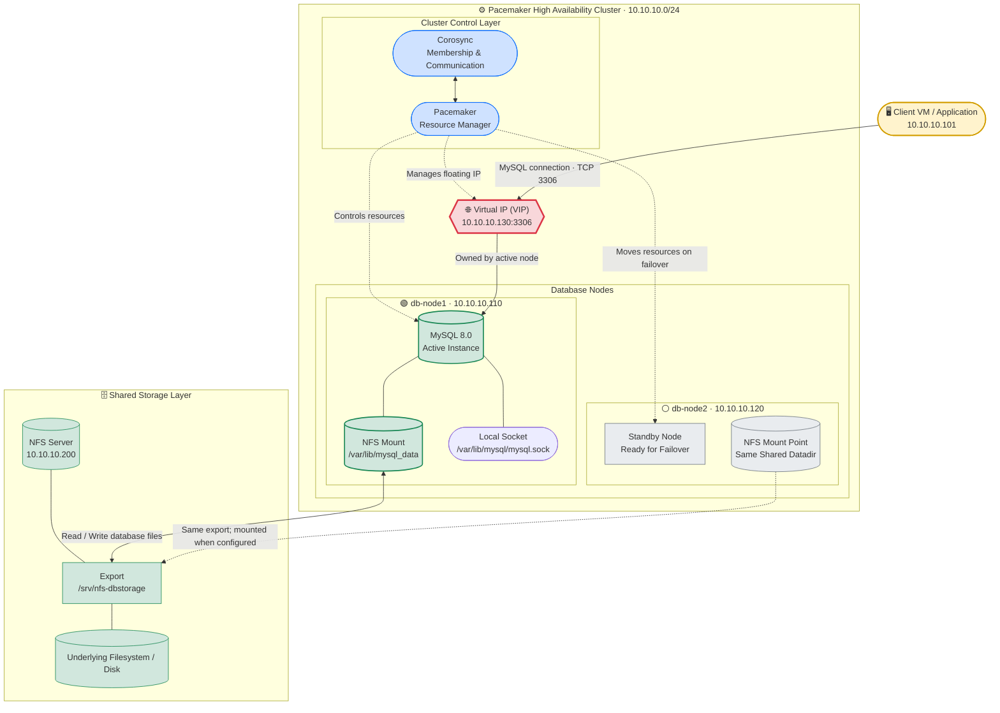

# P1 - MySQL High Availability Lab (NFS + Pacemaker) - Updated Working Runbook

**Last updated:** 2026-10-16  
**Status:** Updated from the original beginner guide and modified to match the working lab environment used in this project.  
**Purpose:** This is the single reference file to recreate the MySQL HA lab from scratch, including the issues encountered and the fixes applied.

---

## 1. Goal

Build a highly available MySQL database using:

- Two database nodes managed by Pacemaker/Corosync
- One NFS server providing shared MySQL storage
- One Virtual IP (VIP) that clients use to connect to MySQL
- Automatic/manual failover of MySQL between the two DB nodes

The database must remain accessible through the VIP even if the active MySQL node fails or is moved to the other node.

---

## 2. Final Lab Architecture

```text
                         Clients / Apps
                               |
                       VIP 10.10.10.130
                               |
                +--------------+--------------+
                |                             |
           db-node1                      db-node2
         10.10.10.110                  10.10.10.120
        MySQL runs here                MySQL runs here
        ONLY when active               ONLY when active
                \                             /
                 \___________   ____________/
                             \ /
                             nfs1
                         10.10.10.200
                  Shared NFS storage:
                  /srv/nfs-dbstorage
```


### VM / Host Summary

| Hostname | Role | Internal IP | Notes |
|---|---|---:|---|
| `nfs1` | NFS storage server | `10.10.10.200` | Exports `/srv/nfs-dbstorage` |
| `db-node1` | Pacemaker DB node 1 | `10.10.10.110` | Runs MySQL when active |
| `db-node2` | Pacemaker DB node 2 | `10.10.10.120` | Runs MySQL when active |
| `db-node` | Test/client VM | `10.10.10.101` | Used to test VIP connectivity |
| VIP | Floating MySQL address | `10.10.10.130` | Moves with MySQL resource group |

### Resource Names Used in This Lab

| Resource | Type | Purpose |
|---|---|---|
| `vip-db` | `IPaddr2` | Virtual IP `10.10.10.130` |
| `fs-mysql` | `Filesystem` | Mounts NFS share at `/var/lib/mysql_data` |
| `p_mysql` | `mysql` OCF agent | Starts/stops custom MySQL binary |
| `webdb-group` | Resource group | Groups VIP, filesystem, and MySQL together |

---

## 3. Important Differences From the Original Guide

This updated runbook reflects the actual working environment used in this lab.

### Original guide assumed:

- MySQL installed from distro package
- Binary at `/usr/sbin/mysqld`
- NFS server at `10.10.10.50`
- NFS export at `/srv/nfs/mysql`
- MySQL datadir at `/var/lib/mysql`
- VIP at `10.10.10.200`
- Node names `db1` and `db2`

### This updated lab uses:

- Custom MySQL binary:

```text
/usr/local/mysql-8.0.46-linux-glibc2.28-x86_64/bin/mysqld
```

- MySQL client binary:

```text
/usr/local/mysql-8.0.46-linux-glibc2.28-x86_64/bin/mysql
```

- NFS server:

```text
10.10.10.200
```

- NFS export:

```text
/srv/nfs-dbstorage
```

- MySQL datadir on NFS:

```text
/var/lib/mysql_data
```

- Local MySQL socket directory:

```text
/var/lib/mysql
```

- MySQL PID file:

```text
/run/mysqld/mysqld.pid
```

- MySQL error log:

```text
/var/log/mysql/error.log
```

- VIP:

```text
10.10.10.130
```

- Node names:

```text
db-node1
db-node2
```

- Client/test machine:

```text
db-node / 10.10.10.101
```

---

## 4. Golden Rules

1. **Only one node may run MySQL against the shared NFS datadir at a time.**
2. **Pacemaker must control MySQL.**
   - Do **not** enable `mysqld` at boot on DB nodes.
   - Do **not** manually start `mysqld` while the cluster resource is active.
3. **Do not add the NFS mount to `/etc/fstab` on DB nodes.**
   - Pacemaker’s `fs-mysql` resource manages the mount.
   - If both nodes mount it automatically, you risk split-brain/data corruption.
4. **The VIP must be in the same subnet as the DB nodes.**
   - Here: `10.10.10.0/24`
5. **MySQL permissions are stored in the shared datadir.**
   - Grants only need to be done once on the active cluster-managed MySQL instance.
6. **If connecting through the VIP fails with `ERROR 1130`, check which node actually owns the VIP and run grants on that node’s cluster-managed MySQL instance.**

---

## 5. Prerequisites

- Hyper-V or another virtualization platform
- AlmaLinux 10 or compatible RHEL-family OS
- Three VMs minimum:
  - `nfs1`
  - `db-node1`
  - `db-node2`
- Optional fourth VM/client:
  - `db-node` at `10.10.10.101`
- Internal network subnet:
  - `10.10.10.0/24`
- Root access on all VMs
- MySQL 8.0 generic Linux binary extracted on DB nodes:

```text
/usr/local/mysql-8.0.46-linux-glibc2.28-x86_64
```

---

# Phase 0 - Base VM and Network Setup

## Step 0.1 - Set Hostnames

Run on each VM.

### On NFS server:

```bash
hostnamectl set-hostname nfs1
```

### On DB node 1:

```bash
hostnamectl set-hostname db-node1
```

### On DB node 2:

```bash
hostnamectl set-hostname db-node2
```

### On client/test VM:

```bash
hostnamectl set-hostname db-node
```

Verify:

```bash
hostname
```

---

## Step 0.2 - Configure Static IPs on Internal Interface

Adjust interface name if yours is not `eth1`.

### On `nfs1`:

```bash
nmcli connection modify eth1 ipv4.addresses 10.10.10.200/24
nmcli connection modify eth1 ipv4.method manual
nmcli connection down eth1
nmcli connection up eth1
```

### On `db-node1`:

```bash
nmcli connection modify eth1 ipv4.addresses 10.10.10.110/24
nmcli connection modify eth1 ipv4.method manual
nmcli connection down eth1
nmcli connection up eth1
```

### On `db-node2`:

```bash
nmcli connection modify eth1 ipv4.addresses 10.10.10.120/24
nmcli connection modify eth1 ipv4.method manual
nmcli connection down eth1
nmcli connection up eth1
```

### On client `db-node`:

```bash
nmcli connection modify eth1 ipv4.addresses 10.10.10.101/24
nmcli connection modify eth1 ipv4.method manual
nmcli connection down eth1
nmcli connection up eth1
```

Verify:

```bash
ip -br a
```

---

## Step 0.3 - Populate `/etc/hosts` on All Machines

Run on all VMs:

```bash
cat >> /etc/hosts <<'EOF'
10.10.10.101 db-node
10.10.10.110 db-node1
10.10.10.120 db-node2
10.10.10.130 db-vip
10.10.10.200 nfs1
EOF
```

Verify:

```bash
getent hosts db-node1
getent hosts db-node2
getent hosts nfs1
getent hosts db-node
```

---

## Step 0.4 - Install Basic Tools

Run on all VMs:

```bash
dnf update -y
dnf install -y nfs-utils firewalld
```

On DB nodes, also install cluster tools later.

---

# Phase 1 - Build the NFS Server

## Step 1.1 - Add Data Disk to `nfs1`

In Hyper-V:

- Add a new VHDX disk to `nfs1`
- Example size: 10 GB
- Example name: `nfs1-data.vhdx`

After adding the disk, boot `nfs1`.

Find the disk:

```bash
lsblk
```

Usually:

- `sda` = OS disk
- `sdb` = new 10 GB data disk

Be careful not to format the OS disk.

---

## Step 1.2 - Format the Data Disk

```bash
mkfs.xfs /dev/sdb
```

---

## Step 1.3 - Mount Data Disk at `/srv/nfs`

```bash
mkdir -p /srv/nfs
blkid /dev/sdb
```

Copy the UUID and add it to `/etc/fstab`:

```bash
echo "UUID=PASTE-UUID-HERE /srv/nfs xfs defaults 0 0" >> /etc/fstab
```

Reload and mount:

```bash
systemctl daemon-reload
mount -a
```

Verify:

```bash
df -h /srv/nfs
```

---

## Step 1.4 - Create MySQL NFS Export Directory

```bash
mkdir -p /srv/nfs-dbstorage
```

MySQL runs as user `mysql`, usually UID `27` on AlmaLinux/RHEL-like systems.

Set ownership:

```bash
chown 27:27 /srv/nfs-dbstorage
chmod 750 /srv/nfs-dbstorage
```

Verify:

```bash
ls -ld /srv/nfs-dbstorage
```

Expected owner/group may display as `27` if the NFS server does not have a local `mysql` user.

---

## Step 1.5 - Export the NFS Share

```bash
echo "/srv/nfs-dbstorage 10.10.10.0/24(rw,sync,no_subtree_check)" > /etc/exports
```

Apply exports:

```bash
exportfs -rav
```

Verify:

```bash
exportfs -v
```

Expected output should include:

```text
/srv/nfs-dbstorage 10.10.10.0/24(rw,sync,no_subtree_check)
```

---

## Step 1.6 - Allow SELinux NFS Sharing

```bash
setsebool -P nfs_export_all_rw on
```

If command not found:

```bash
dnf install -y policycoreutils-python-utils
setsebool -P nfs_export_all_rw on
```

---

## Step 1.7 - Start NFS Service

```bash
systemctl enable --now nfs-server
systemctl status nfs-server
```

---

## Step 1.8 - Open Firewall for NFS

```bash
firewall-cmd --permanent --add-service=nfs
firewall-cmd --reload
```

Verify:

```bash
firewall-cmd --list-services
```

---

# Phase 2 - Install and Configure MySQL on DB Nodes

This phase is done primarily on `db-node1`, then repeated/prepared on `db-node2`.

Because this lab uses a custom MySQL binary, the standard distro `mysql-server` package is not used.

---

## Step 2.1 - Install Required Libraries

MySQL generic binaries often need libraries such as `libaio` and NUMA support.

Run on both DB nodes:

```bash
dnf install -y libaio numactl-libs
```

If your MySQL binary requires additional compatibility libraries, install what your specific tarball needs.

---

## Step 2.2 - Ensure MySQL User and Group Exist

Run on both DB nodes:

```bash
getent group mysql
getent passwd mysql
```

If missing:

```bash
groupadd -r mysql
useradd -r -g mysql -s /sbin/nologin -d /home/mysql mysql
```

Even though `mysql` is a `nologin` user, the OS still needs a valid home directory for some operations.

Create the home directory:

```bash
mkdir -p /home/mysql
chown mysql:mysql /home/mysql
chmod 700 /home/mysql
```

This fixes errors like:

```text
runuser: warning: cannot change directory to /home/mysql: No such file or directory
```

---

## Step 2.3 - Create Local MySQL Directories

Run on both DB nodes:

```bash
mkdir -p /var/lib/mysql_data
mkdir -p /var/lib/mysql
mkdir -p /run/mysqld
mkdir -p /var/log/mysql
```

Set ownership:

```bash
chown -R mysql:mysql /var/lib/mysql_data
chown -R mysql:mysql /var/lib/mysql
chown -R mysql:mysql /run/mysqld
chown -R mysql:mysql /var/log/mysql
```

Permissions:

```bash
chmod 750 /var/lib/mysql_data
chmod 755 /var/lib/mysql
chmod 755 /run/mysqld
chmod 750 /var/log/mysql
```

### Important

- `/var/lib/mysql_data` is the NFS-mounted shared datadir.
- `/var/lib/mysql` is local and used for the MySQL socket.
- Do **not** put the socket on NFS unless you specifically understand the locking implications.

---

## Step 2.4 - Make `/run/mysqld` Persistent Across Reboots

`/run` is cleared on reboot.

Create a tmpfiles rule on both DB nodes:

```bash
cat > /etc/tmpfiles.d/mysqld.conf <<'EOF'
d /run/mysqld 0755 mysql mysql -
EOF
```

Apply immediately:

```bash
systemd-tmpfiles --create
```

---

## Step 2.5 - Create `/etc/my.cnf`

Run on both DB nodes:

```bash
cat > /etc/my.cnf <<'EOF'
[client]
socket=/var/lib/mysql/mysql.sock

[mysqld]
user=mysql
basedir=/usr/local/mysql-8.0.46-linux-glibc2.28-x86_64
datadir=/var/lib/mysql_data
socket=/var/lib/mysql/mysql.sock
pid-file=/run/mysqld/mysqld.pid
log-error=/var/log/mysql/error.log
EOF
```

### Notes

- `datadir=/var/lib/mysql_data` matches the NFS mount point.
- `socket=/var/lib/mysql/mysql.sock` is local.
- `pid-file=/run/mysqld/mysqld.pid` must be writable by `mysql`.
- Do **not** hardcode `bind-address=10.10.10.130` in `my.cnf` for manual startup, because the VIP may not exist yet. Pacemaker will pass the bind address through the resource.

---

## Step 2.6 - Mount NFS Manually for Initialization

Run on `db-node1`:

```bash
mount -t nfs4 -o hard,vers=4.2 10.10.10.200:/srv/nfs-dbstorage /var/lib/mysql_data
```

Verify:

```bash
df -h /var/lib/mysql_data
mount | grep mysql_data
```

---

## Step 2.7 - Initialize MySQL Datadir

Only do this if `/var/lib/mysql_data` is empty.

Check:

```bash
ls -la /var/lib/mysql_data
```

If empty, initialize:

```bash
/usr/local/mysql-8.0.46-linux-glibc2.28-x86_64/bin/mysqld \
  --initialize-insecure \
  --user=mysql \
  --basedir=/usr/local/mysql-8.0.46-linux-glibc2.28-x86_64 \
  --datadir=/var/lib/mysql_data \
  --socket=/var/lib/mysql/mysql.sock \
  --pid-file=/run/mysqld/mysqld.pid \
  --log-error=/var/log/mysql/error.log
```

`--initialize-insecure` creates a root user with no password, which is acceptable for a lab initial setup.

If the datadir already contains MySQL system tables, skip initialization.

---

## Step 2.8 - Start MySQL Manually for Initial Configuration

Run on `db-node1`:

```bash
/usr/local/mysql-8.0.46-linux-glibc2.28-x86_64/bin/mysqld \
  --defaults-file=/etc/my.cnf \
  --user=mysql &
```

Wait a few seconds, then check:

```bash
ps -ef | grep mysqld
tail -n 50 /var/log/mysql/error.log
```

---

## Step 2.9 - Set Root Password and Create Lab Database

Connect locally using the socket:

```bash
/usr/local/mysql-8.0.46-linux-glibc2.28-x86_64/bin/mysql \
  --socket=/var/lib/mysql/mysql.sock \
  -u root
```

Inside MySQL, run:

```sql
ALTER USER 'root'@'localhost' IDENTIFIED BY '123';

CREATE DATABASE IF NOT EXISTS labdb;

USE labdb;

CREATE TABLE IF NOT EXISTS notes (
  id INT AUTO_INCREMENT PRIMARY KEY,
  msg VARCHAR(255),
  created_at TIMESTAMP DEFAULT CURRENT_TIMESTAMP
);

INSERT INTO labdb.notes (msg) VALUES ('Initial row created during setup');

CREATE USER IF NOT EXISTS 'root'@'10.10.10.%' IDENTIFIED BY '123';
GRANT ALL PRIVILEGES ON *.* TO 'root'@'10.10.10.%' WITH GRANT OPTION;

CREATE USER IF NOT EXISTS 'root'@'db-node1' IDENTIFIED BY '123';
GRANT ALL PRIVILEGES ON *.* TO 'root'@'db-node1' WITH GRANT OPTION;

CREATE USER IF NOT EXISTS 'root'@'db-node2' IDENTIFIED BY '123';
GRANT ALL PRIVILEGES ON *.* TO 'root'@'db-node2' WITH GRANT OPTION;

CREATE USER IF NOT EXISTS 'root'@'db-node' IDENTIFIED BY '123';
GRANT ALL PRIVILEGES ON *.* TO 'root'@'db-node' WITH GRANT OPTION;

CREATE USER IF NOT EXISTS 'root'@'10.10.10.101' IDENTIFIED BY '123';
GRANT ALL PRIVILEGES ON *.* TO 'root'@'10.10.10.101' WITH GRANT OPTION;

CREATE USER IF NOT EXISTS 'root'@'10.10.10.110' IDENTIFIED BY '123';
GRANT ALL PRIVILEGES ON *.* TO 'root'@'10.10.10.110' WITH GRANT OPTION;

CREATE USER IF NOT EXISTS 'root'@'10.10.10.120' IDENTIFIED BY '123';
GRANT ALL PRIVILEGES ON *.* TO 'root'@'10.10.10.120' WITH GRANT OPTION;

CREATE USER IF NOT EXISTS 'root'@'10.10.10.130' IDENTIFIED BY '123';
GRANT ALL PRIVILEGES ON *.* TO 'root'@'10.10.10.130' WITH GRANT OPTION;

FLUSH PRIVILEGES;

EXIT;
```

### Why both hostname and IP grants?

MySQL authenticates based on:

```text
'user'@'host'
```

Depending on name resolution, MySQL may see the client as:

- an IP address, e.g. `10.10.10.101`
- a hostname, e.g. `db-node`
- a reverse-resolved hostname, e.g. `db-node1`

This lab hit:

```text
ERROR 1130 (HY000): Host 'db-node1' is not allowed to connect to this MySQL server
```

even after IP-based grants existed, because MySQL resolved the client IP to a hostname.

For a lab, creating both hostname and IP entries is simplest.

For production, prefer:

- a dedicated application user,
- limited privileges,
- specific hosts,
- strong passwords,
- possibly `skip_name_resolve=ON` with IP-based grants.

---

## Step 2.10 - Stop Manual MySQL

Shutdown cleanly:

```bash
/usr/local/mysql-8.0.46-linux-glibc2.28-x86_64/bin/mysqladmin \
  --socket=/var/lib/mysql/mysql.sock \
  -u root \
  -p123 shutdown
```

Verify:

```bash
ps -ef | grep mysqld
```

There should be no running `mysqld`.

---

## Step 2.11 - Unmount NFS

```bash
umount /var/lib/mysql_data
```

Verify:

```bash
mount | grep mysql_data
```

No output is expected.

---

## Step 2.12 - Disable Any Distro/systemd MySQL Service

If a `mysqld` systemd unit exists, disable it so it does not start independently of Pacemaker.

Run on both DB nodes:

```bash
systemctl disable --now mysqld 2>/dev/null || true
```

Check:

```bash
systemctl is-enabled mysqld 2>/dev/null || echo "not enabled"
systemctl is-active mysqld 2>/dev/null || echo "not active"
```

Expected:

```text
disabled
inactive
```

or not installed.

---

# Phase 3 - Prepare Second DB Node and Test Manual Failover

At this point, `db-node1` has:

- MySQL binary
- `/etc/my.cnf`
- local directories
- NFS client tools
- disabled standalone `mysqld`

Prepare `db-node2` with the same software and configuration.

---

## Step 3.1 - Ensure `db-node2` Has the Same MySQL Binary

On `db-node2`, verify:

```bash
ls -l /usr/local/mysql-8.0.46-linux-glibc2.28-x86_64/bin/mysqld
ls -l /usr/local/mysql-8.0.46-linux-glibc2.28-x86_64/bin/mysql
```

If not present, copy/install the same MySQL binary layout as on `db-node1`.

---

## Step 3.2 - Ensure `db-node2` Has Same Directories and Config

Verify on `db-node2`:

```bash
cat /etc/my.cnf
ls -ld /var/lib/mysql_data
ls -ld /var/lib/mysql
ls -ld /run/mysqld
ls -ld /var/log/mysql
id mysql
```

If needed, repeat Phase 2 directory/user/config steps on `db-node2`.

---

## Step 3.3 - Manual Failover Test: Run MySQL on `db-node1`

Run on `db-node1`:

```bash
mount -t nfs4 -o hard,vers=4.2 10.10.10.200:/srv/nfs-dbstorage /var/lib/mysql_data
```

Start MySQL manually:

```bash
/usr/local/mysql-8.0.46-linux-glibc2.28-x86_64/bin/mysqld \
  --defaults-file=/etc/my.cnf \
  --user=mysql &
```

Insert a row:

```bash
/usr/local/mysql-8.0.46-linux-glibc2.28-x86_64/bin/mysql \
  -u root \
  -p123 \
  -e "INSERT INTO labdb.notes (msg) VALUES ('Written on db1');"
```

### Common mistake

Do not paste the full shell command into the MySQL prompt.

Wrong:

```sql
mysql> "INSERT INTO labdb.notes (msg) VALUES ('Written on db1');"
```

Correct if already inside MySQL prompt:

```sql
INSERT INTO labdb.notes (msg) VALUES ('Written on db1');
```

Correct from shell:

```bash
mysql -u root -p123 -e "INSERT INTO labdb.notes (msg) VALUES ('Written on db1');"
```

---

## Step 3.4 - Manual Failover Test: Move MySQL to `db-node2`

Stop MySQL on `db-node1`:

```bash
/usr/local/mysql-8.0.46-linux-glibc2.28-x86_64/bin/mysqladmin \
  --socket=/var/lib/mysql/mysql.sock \
  -u root \
  -p123 shutdown
```

Unmount NFS on `db-node1`:

```bash
umount /var/lib/mysql_data
```

On `db-node2`:

```bash
mount -t nfs4 -o hard,vers=4.2 10.10.10.200:/srv/nfs-dbstorage /var/lib/mysql_data
```

Start MySQL:

```bash
/usr/local/mysql-8.0.46-linux-glibc2.28-x86_64/bin/mysqld \
  --defaults-file=/etc/my.cnf \
  --user=mysql &
```

Verify data:

```bash
/usr/local/mysql-8.0.46-linux-glibc2.28-x86_64/bin/mysql \
  -u root \
  -p123 \
  -e "SELECT * FROM labdb.notes;"
```

You should see:

```text
Written on db1
```

Insert another row:

```bash
/usr/local/mysql-8.0.46-linux-glibc2.28-x86_64/bin/mysql \
  -u root \
  -p123 \
  -e "INSERT INTO labdb.notes (msg) VALUES ('Written on db2');"
```

Stop MySQL and unmount on `db-node2`:

```bash
/usr/local/mysql-8.0.46-linux-glibc2.28-x86_64/bin/mysqladmin \
  --socket=/var/lib/mysql/mysql.sock \
  -u root \
  -p123 shutdown

umount /var/lib/mysql_data
```

This proves the concept:

```text
stop MySQL -> unmount NFS -> mount NFS on other node -> start MySQL -> data survives
```

Pacemaker will automate this in Phase 5.

---

# Phase 4 - Build the Pacemaker/Corosync Cluster

Ensure both DB nodes have:

- MySQL stopped
- NFS unmounted
- `mysqld` disabled

Check on both nodes:

```bash
ps -ef | grep mysqld
mount | grep mysql_data
systemctl is-active mysqld 2>/dev/null || true
```

Expected:

- no active `mysqld`
- no NFS mount
- systemd `mysqld` inactive/disabled

---

## Step 4.1 - Install Pacemaker and PCS

Run on both DB nodes:

```bash
dnf install -y dnf-plugins-core
dnf config-manager --set-enabled highavailability
dnf install -y pacemaker pcs
```

Open cluster firewall:

```bash
firewall-cmd --permanent --add-service=high-availability
firewall-cmd --reload
```

Start `pcsd`:

```bash
systemctl enable --now pcsd
```

---

## Step 4.2 - Set `hacluster` Password

Run on both DB nodes:

```bash
passwd hacluster
```

Use the same password on both nodes.

---

## Step 4.3 - Authenticate Nodes

Run on `db-node1` only:

```bash
pcs host auth db-node1 db-node2 -u hacluster
```

Expected:

```text
db-node1: Authorized
db-node2: Authorized
```

---

## Step 4.4 - Create Cluster

Run on `db-node1` only:

```bash
pcs cluster setup dbcluster db-node1 db-node2
```

Expected:

```text
Cluster has been successfully set up.
```

Start cluster:

```bash
pcs cluster start --all
```

Enable at boot:

```bash
pcs cluster enable --all
```

---

## Step 4.5 - Verify Cluster

Run on `db-node1`:

```bash
pcs status
```

Expected:

```text
Online: [ db-node1 db-node2 ]
```

Check Corosync links:

```bash
corosync-cfgtool -s
```

Expected:

- transport `knet`
- link address in `10.10.10.x`
- other node shown as `connected`

Example:

```text
Local node ID 1, transport knet
LINK ID 0 udp
	addr = 10.10.10.110
	status:
		nodeid:          1:	localhost
		nodeid:          2:	connected
```

Check Corosync membership:

```bash
pcs status corosync
```

Expected: both nodes listed under membership.

Inspect config if needed:

```bash
cat /etc/corosync/corosync.conf
```

Expected nodelist example:

```text
nodelist {
    node {
        ring0_addr: 10.10.10.110
        name: db-node1
        nodeid: 1
    }

    node {
        ring0_addr: 10.10.10.120
        name: db-node2
        nodeid: 2
    }
}
```

If the IPs are correct and `corosync-cfgtool -s` shows connected, you usually do not need to change `ring0_addr`.

---

## Step 4.6 - Set Lab Cluster Properties

Run on `db-node1` only:

```bash
pcs property set stonith-enabled=false
pcs property set no-quorum-policy=ignore
pcs resource defaults update resource-stickiness=100
```

### Notes

- `stonith-enabled=false` is for the lab only.
- Real clusters should use fencing/STONITH.
- Newer PCS versions use:

```bash
pcs resource defaults update ...
```

instead of old syntax:

```bash
pcs resource defaults ...
```

---

# Phase 5 - Add Cluster Resources and VIP

Run all resource creation commands on `db-node1` only.

Pacemaker propagates configuration to the other node.

Do **not** run `pcs resource create` on both nodes.

---

## Step 5.1 - Create Virtual IP Resource

```bash
pcs resource create vip-db IPaddr2 \
  ip=10.10.10.130 \
  cidr_netmask=24 \
  op monitor interval=10s
```

### VIP selection rules

The VIP must:

- be in the same subnet as DB nodes
- not conflict with existing static IPs
- not be assigned to another machine
- ideally be outside DHCP ranges

Used here:

```text
10.10.10.130
```

Existing nodes:

```text
db-node1 = 10.10.10.110
db-node2 = 10.10.10.120
client   = 10.10.10.101
nfs1     = 10.10.10.200
```

---

## Step 5.2 - Create NFS Filesystem Resource

Use this because storage is NFS, not a local block device like `/dev/xvde`.

```bash
pcs resource create fs-mysql Filesystem \
  device="10.10.10.200:/srv/nfs-dbstorage" \
  directory="/var/lib/mysql_data" \
  fstype="nfs4" \
  options="rw,hard,vers=4.2" \
  op monitor interval=20s timeout=40s \
  op start timeout=120s \
  op stop timeout=120s
```

### Do not use this if you are using NFS:

```bash
device=/dev/xvde
```

That is for shared block storage, not NFS.

---

## Step 5.3 - Create MySQL Resource

This uses the custom MySQL binary and client binary.

```bash
pcs resource create p_mysql mysql \
  binary="/usr/local/mysql-8.0.46-linux-glibc2.28-x86_64/bin/mysqld" \
  client_binary="/usr/local/mysql-8.0.46-linux-glibc2.28-x86_64/bin/mysql" \
  config="/etc/my.cnf" \
  datadir="/var/lib/mysql_data" \
  pid="/run/mysqld/mysqld.pid" \
  socket="/var/lib/mysql/mysql.sock" \
  user=mysql \
  group=mysql \
  additional_parameters="--bind-address=10.10.10.130 --user=mysql" \
  op start timeout=120s \
  op stop timeout=120s \
  op monitor interval=20s timeout=30s
```

### Important parameters

| Parameter | Meaning |
|---|---|
| `binary` | Path to `mysqld` |
| `client_binary` | Path to `mysql` client used by the OCF agent for monitoring |
| `config` | MySQL config file |
| `datadir` | Shared NFS datadir |
| `pid` | PID file location |
| `socket` | Local socket path |
| `additional_parameters` | Extra MySQL startup options |
| `--bind-address=10.10.10.130` | Makes MySQL listen on the VIP |

### Common error

```text
ocf-exit-reason:Setup problem: couldn't find command: mysql
```

Fix by setting:

```bash
client_binary="/usr/local/mysql-8.0.46-linux-glibc2.28-x86_64/bin/mysql"
```

or ensuring MySQL binaries are in system `PATH`.

---

## Step 5.4 - Group Resources in Correct Order

Order matters:

1. VIP starts first
2. NFS mounts second
3. MySQL starts last

```bash
pcs resource group add webdb-group vip-db
pcs resource group add webdb-group fs-mysql
pcs resource group add webdb-group p_mysql
```

You can also add multiple resources one by one. Do not use invalid syntax like:

```bash
pcs resource group add webdb-group ip- 10.95.204.138 fs-mysql p_mysql
```

That is wrong because:

- resource names cannot contain spaces
- the VIP resource name is `vip-db`
- resources should be added one at a time or with correct naming

---

## Step 5.5 - Verify Resource Configuration

```bash
pcs resource config webdb-group
```

Expected resources:

```text
vip-db
fs-mysql
p_mysql
```

Expected `p_mysql` attributes include:

```text
binary=/usr/local/mysql-8.0.46-linux-glibc2.28-x86_64/bin/mysqld
client_binary=/usr/local/mysql-8.0.46-linux-glibc2.28-x86_64/bin/mysql
config=/etc/my.cnf
datadir=/var/lib/mysql_data
pid=/run/mysqld/mysqld.pid
socket=/var/lib/mysql/mysql.sock
user=mysql
group=mysql
additional_parameters="--bind-address=10.10.10.130 --user=mysql"
```

Check cluster status:

```bash
pcs status
```

Expected:

```text
Resource Group: webdb-group
  vip-db       (ocf:heartbeat:IPaddr2):    Started db-node1
  fs-mysql     (ocf:heartbeat:Filesystem): Started db-node1
  p_mysql      (ocf:heartbeat:mysql):      Started db-node1
```

Or all on `db-node2`, depending on where the group is active.

---

## Step 5.6 - Open MySQL Firewall on DB Nodes

Run on both DB nodes:

```bash
firewall-cmd --permanent --add-service=mysql
firewall-cmd --reload
```

Verify:

```bash
firewall-cmd --list-services
```

Expected output should include:

```text
mysql
high-availability
```

---

# Phase 6 - Connect Using the VIP

## Step 6.1 - Find Which Node Owns the VIP

Run on either DB node:

```bash
pcs status | grep webdb-group
```

Or check directly:

```bash
ip -br a | grep 10.10.10.130
```

The node showing `10.10.10.130` is the active MySQL node.

---

## Step 6.2 - Test VIP Reachability

From another machine:

```bash
ping -c 3 10.10.10.130
```

Expected: replies.

If ping fails:

- check `pcs status`
- check `ip -br a` on active node
- check firewall
- check VIP subnet

---

## Step 6.3 - Connect to MySQL Through VIP

From client VM `db-node` (`10.10.10.101`):

Install MySQL client if needed:

```bash
dnf install -y mysql
```

Then:

```bash
mysql -h 10.10.10.130 -u root -p123 -e "SELECT @@hostname;"
```

Expected:

```text
+------------+
| @@hostname |
+------------+
| db-node1   |
+------------+
```

or:

```text
| db-node2   |
```

depending on which node currently owns the VIP and MySQL resource.

---

## Step 6.4 - Insert and Select Data Through VIP

```bash
mysql -h 10.10.10.130 -u root -p123 -e "INSERT INTO labdb.notes (msg) VALUES ('Written through VIP');"
```

```bash
mysql -h 10.10.10.130 -u root -p123 -e "SELECT * FROM labdb.notes;"
```

You should see all rows, including rows written directly on nodes and through the VIP.

---

# Phase 7 - Connectivity Problems Encountered and Fixes

This section documents the real issues faced during the lab.

---

## Problem 1: Pasting Shell Command Inside MySQL Prompt

### Symptom

```sql
mysql> "INSERT INTO labdb.notes (msg) VALUES ('Written on db1');"
ERROR 1064 (42000): You have an error in your SQL syntax...
```

### Cause

The full shell command was pasted into the MySQL interactive prompt:

```bash
mysql -u root -p -e "INSERT ..."
```

MySQL tried to parse the double quotes and shell syntax as SQL.

### Fix

If already inside `mysql>`, run only SQL:

```sql
INSERT INTO labdb.notes (msg) VALUES ('Written on db1');
```

If in bash shell, run:

```bash
mysql -u root -p123 -e "INSERT INTO labdb.notes (msg) VALUES ('Written on db1');"
```

---

## Problem 2: Unknown Database `labdb`

### Symptom

```text
ERROR 1049 (42000): Unknown database 'labdb'
```

### Cause

The database had not been created yet.

### Fix

Inside MySQL:

```sql
CREATE DATABASE labdb;
USE labdb;
CREATE TABLE notes (
  id INT AUTO_INCREMENT PRIMARY KEY,
  msg VARCHAR(255),
  created_at TIMESTAMP DEFAULT CURRENT_TIMESTAMP
);
```

Then insert:

```sql
INSERT INTO labdb.notes (msg) VALUES ('Written on db1');
```

---

## Problem 3: Old PCS Syntax for Resource Defaults

### Symptom

```text
Error: This command has been replaced with 'pcs resource defaults update'.
```

### Cause

Newer PCS versions changed syntax.

### Fix

Use:

```bash
pcs resource defaults update resource-stickiness=100
```

Not:

```bash
pcs resource defaults resource-stickiness=100
```

---

## Problem 4: Using Block Device Filesystem Resource with NFS

### Symptom/Confusion

Command attempted:

```bash
pcs resource create fs-mysql Filesystem device=/dev/xvde directory=/var/lib/mysql_data fstype=ext4
```

### Cause

`/dev/xvde` is a block device. This lab uses NFS.

### Fix

Use NFS filesystem resource:

```bash
pcs resource create fs-mysql Filesystem \
  device="10.10.10.200:/srv/nfs-dbstorage" \
  directory="/var/lib/mysql_data" \
  fstype="nfs4" \
  options="rw,hard,vers=4.2" \
  op monitor interval=20s timeout=40s \
  op start timeout=120s \
  op stop timeout=120s
```

---

## Problem 5: VIP Chosen From Wrong Subnet

### Bad example

```text
10.95.204.138
```

while DB nodes are on:

```text
10.10.10.0/24
```

### Fix

Use an IP in the same subnet:

```text
10.10.10.130
```

---

## Problem 6: MySQL OCF Agent Could Not Find `mysql` Client

### Symptom

```text
ocf-exit-reason:Setup problem: couldn't find command: mysql
```

### Cause

MySQL is installed in a custom path:

```text
/usr/local/mysql-8.0.46-linux-glibc2.28-x86_64/bin
```

The OCF agent could not find the `mysql` client in normal `PATH`.

### Fix

Add `client_binary` to the resource:

```bash
client_binary="/usr/local/mysql-8.0.46-linux-glibc2.28-x86_64/bin/mysql"
```

If resource already exists:

```bash
pcs resource update p_mysql client_binary="/usr/local/mysql-8.0.46-linux-glibc2.28-x86_64/bin/mysql"
```

Or delete and recreate:

```bash
pcs resource delete p_mysql
pcs resource create p_mysql mysql ...
```

---

## Problem 7: Resource Already Exists

### Symptom

```text
Error: 'p_mysql' already exists
```

### Cause

The resource was already created during a previous attempt.

### Fix

Update it:

```bash
pcs resource update p_mysql client_binary="/usr/local/mysql-8.0.46-linux-glibc2.28-x86_64/bin/mysql"
```

Or delete and recreate:

```bash
pcs resource delete p_mysql
pcs resource create p_mysql mysql ...
```

---

## Problem 8: `runuser: warning: cannot change directory to /home/mysql`

### Symptom

```text
runuser: warning: cannot change directory to /home/mysql: No such file or directory
```

### Cause

The `mysql` user has `/sbin/nologin` shell for security, but the system still expects a valid home directory.

### Fix

Run on both DB nodes:

```bash
mkdir -p /home/mysql
chown mysql:mysql /home/mysql
chmod 700 /home/mysql
```

This does not allow login. It only satisfies the OS/user directory requirement.

---

## Problem 9: MySQL Resource Shows Started but MySQL Not Actually Running

### Symptom

`pcs status` shows resources started, but local MySQL is not running or connections fail.

### Diagnosis

Check:

```bash
pcs status
ps -ef | grep mysqld
tail -n 100 /var/log/mysql/error.log
```

### Common causes

- datadir not initialized
- wrong datadir path
- permissions on `/var/lib/mysql_data`
- missing `/run/mysqld`
- missing `/var/lib/mysql` socket directory
- SELinux blocking access
- another `mysqld` already running
- VIP not available when MySQL tries to bind

### Fixes

Ensure directories exist:

```bash
mkdir -p /var/lib/mysql_data
mkdir -p /var/lib/mysql
mkdir -p /run/mysqld
mkdir -p /var/log/mysql
chown -R mysql:mysql /var/lib/mysql_data /var/lib/mysql /run/mysqld /var/log/mysql
```

Ensure NFS is mounted by cluster:

```bash
mount | grep mysql_data
```

Check error log:

```bash
tail -n 100 /var/log/mysql/error.log
```

Clean up failed resource state:

```bash
pcs resource cleanup
```

---

## Problem 10: `ERROR 2003` Can’t Connect to MySQL Server on VIP

### Symptom

```text
ERROR 2003 (HY000): Can't connect to MySQL server on '10.10.10.130:3306' (113)
```

### Possible causes

- VIP not active
- firewall blocking 3306
- MySQL not running
- MySQL bound only to localhost
- MySQL bound to old VIP
- resource group failed to start

### Diagnosis

On active node:

```bash
ip -br a | grep 10.10.10.130
ss -lntp | grep 3306
systemctl status firewalld
firewall-cmd --list-services
pcs status
```

### Fixes

Open firewall:

```bash
firewall-cmd --permanent --add-service=mysql
firewall-cmd --reload
```

Ensure MySQL resource binds to VIP:

```bash
pcs resource config p_mysql | grep additional_parameters
```

Expected:

```text
additional_parameters="--bind-address=10.10.10.130 --user=mysql"
```

If VIP changed:

```bash
pcs resource update p_mysql additional_parameters="--bind-address=NEW_VIP --user=mysql"
```

---

## Problem 11: `ERROR 1130` Host Not Allowed to Connect

### Symptom

```text
ERROR 1130 (HY000): Host 'db-node1' is not allowed to connect to this MySQL server
```

or:

```text
ERROR 1130 (HY000): Host '10.10.10.101' is not allowed to connect to this MySQL server
```

### Root cause

MySQL authenticates using:

```text
'user'@'host'
```

The host part may be:

- hostname
- IP address
- reverse-resolved hostname

If the client connects from `10.10.10.110`, MySQL may resolve it to `db-node1` and check for:

```text
'root'@'db-node1'
```

If that account does not exist, access is denied.

### Critical mistake made in lab

Grants were accidentally applied to a local standalone MySQL instance on `db-node1`, while the VIP was actually pointing to the cluster-managed MySQL instance on `db-node2`.

Result:

- grants appeared to be added
- VIP connection still failed
- because the VIP reached a different MySQL instance

### Correct procedure

1. Find which node owns the VIP:

```bash
ip -br a | grep 10.10.10.130
pcs status
```

2. Log in to the **cluster-managed MySQL** on that active node.

Use local socket on the active node:

```bash
mysql -u root -p123
```

or explicitly:

```bash
/usr/local/mysql-8.0.46-linux-glibc2.28-x86_64/bin/mysql \
  --socket=/var/lib/mysql/mysql.sock \
  -u root -p123
```

3. Create grants for all expected clients.

Lab-wide fix:

```sql
CREATE USER IF NOT EXISTS 'root'@'db-node1' IDENTIFIED BY '123';
CREATE USER IF NOT EXISTS 'root'@'db-node2' IDENTIFIED BY '123';
CREATE USER IF NOT EXISTS 'root'@'db-node' IDENTIFIED BY '123';

CREATE USER IF NOT EXISTS 'root'@'10.10.10.101' IDENTIFIED BY '123';
CREATE USER IF NOT EXISTS 'root'@'10.10.10.110' IDENTIFIED BY '123';
CREATE USER IF NOT EXISTS 'root'@'10.10.10.120' IDENTIFIED BY '123';
CREATE USER IF NOT EXISTS 'root'@'10.10.10.130' IDENTIFIED BY '123';
CREATE USER IF NOT EXISTS 'root'@'10.10.10.%' IDENTIFIED BY '123';

GRANT ALL PRIVILEGES ON *.* TO 'root'@'db-node1' WITH GRANT OPTION;
GRANT ALL PRIVILEGES ON *.* TO 'root'@'db-node2' WITH GRANT OPTION;
GRANT ALL PRIVILEGES ON *.* TO 'root'@'db-node' WITH GRANT OPTION;

GRANT ALL PRIVILEGES ON *.* TO 'root'@'10.10.10.101' WITH GRANT OPTION;
GRANT ALL PRIVILEGES ON *.* TO 'root'@'10.10.10.110' WITH GRANT OPTION;
GRANT ALL PRIVILEGES ON *.* TO 'root'@'10.10.10.120' WITH GRANT OPTION;
GRANT ALL PRIVILEGES ON *.* TO 'root'@'10.10.10.130' WITH GRANT OPTION;
GRANT ALL PRIVILEGES ON *.* TO 'root'@'10.10.10.%' WITH GRANT OPTION;

FLUSH PRIVILEGES;
```

Because the datadir is shared on NFS, these grants persist across failover.

### Security note

`'root'@'10.10.10.%'` is convenient for a lab but not production-safe.

For production:

- create a dedicated app user
- grant only required database/object privileges
- restrict hosts precisely
- use strong passwords
- consider TLS
- avoid remote root

---

## Problem 12: Standalone `mysqld` Running on a Cluster Node

### Symptom

- MySQL appears running
- grants do not affect VIP
- cluster resource conflicts
- possible split-brain risk

### Cause

A manually started or systemd-enabled `mysqld` was running outside Pacemaker.

### Fix

On the affected node:

```bash
systemctl stop mysqld
systemctl disable mysqld
```

If a manual process is running:

```bash
ps -ef | grep mysqld
```

Stop it cleanly using MySQL admin if possible:

```bash
/usr/local/mysql-8.0.46-linux-glibc2.28-x86_64/bin/mysqladmin \
  --socket=/var/lib/mysql/mysql.sock \
  -u root -p123 shutdown
```

Then clean cluster state:

```bash
pcs resource cleanup
pcs status
```

### Rule

Only Pacemaker should start MySQL.

---

## Problem 13: `systemctl stop mysqld` Did Not Trigger Failover

### Symptom

Stopping MySQL with systemd did not move resources as expected.

### Cause

Pacemaker manages the resource through the OCF MySQL agent, not necessarily through systemd. Also, manually stopping services can confuse resource state.

### Correct failover test commands

Planned move:

```bash
pcs resource move webdb-group db-node2
```

Standby node:

```bash
pcs node standby db-node1
```

Clear manual constraint after test:

```bash
pcs resource clear webdb-group
```

or:

```bash
pcs node unstandby db-node1
```

---

# Phase 8 - Failover Tests

## Test 1 - Planned Move Using Resource Move

Find current active node:

```bash
pcs status
```

Move group to the other node:

```bash
pcs resource move webdb-group db-node2
```

Wait, then check:

```bash
pcs status
ip -br a | grep 10.10.10.130
```

Expected:

- `webdb-group` started on `db-node2`
- VIP `10.10.10.130` on `db-node2`

Test connectivity:

```bash
mysql -h 10.10.10.130 -u root -p123 -e "SELECT @@hostname;"
```

Expected:

```text
db-node2
```

Clear the manual move:

```bash
pcs resource clear webdb-group
```

---

## Test 2 - Standby Node

Put active node into standby:

```bash
pcs node standby db-node1
```

Check:

```bash
pcs status
```

Expected:

- resources move to `db-node2`

Test VIP:

```bash
mysql -h 10.10.10.130 -u root -p123 -e "SELECT @@hostname;"
```

Bring node back:

```bash
pcs node unstandby db-node1
```

---

## Test 3 - Crash Active Node

In Hyper-V:

- Turn off the VM currently running `webdb-group`
- Do not use graceful shutdown for this test

On surviving node:

```bash
pcs status
```

Wait 30-120 seconds.

Expected:

- failed node OFFLINE
- `webdb-group` started on survivor

Test:

```bash
mysql -h 10.10.10.130 -u root -p123 -e "SELECT @@hostname;"
```

Possible NFS lock delay:

After a hard crash, NFS may hold locks briefly. MySQL may fail initially with errors like:

```text
Unable to lock ./ibdata1
```

Wait about 2 minutes, then:

```bash
pcs resource cleanup
pcs status
```

Start the powered-off VM again. It should rejoin because cluster was enabled at boot.

---

## Test 4 - Stop MySQL Process Only

On active node:

```bash
pcs status
```

Identify active node, then stop MySQL through the resource agent or simulate failure.

If using OCF resource, avoid direct `systemctl stop mysqld`.

You can test resource recovery by moving or cleaning up. If MySQL crashes, Pacemaker should restart it.

Check:

```bash
pcs status
journalctl -u pacemaker -n 100 --no-pager
```

Clear failures if needed:

```bash
pcs resource cleanup
```

---

## Test 5 - NFS Server Failure

On `nfs1`:

```bash
systemctl stop nfs-server
```

Try:

```bash
mysql -h 10.10.10.130 -u root -p123 -e "SELECT 1;"
```

Expected:

- query may hang because NFS mount uses `hard`
- this protects data by waiting instead of returning partial errors

Restore NFS:

```bash
systemctl start nfs-server
```

Then:

```bash
pcs resource cleanup
pcs status
```

Lesson:

- NFS server is a single point of failure in this lab.
- Real production needs highly available storage or replication.

---

## Final Architecture Visualization

After completing all phases, your lab environment will look like this. This diagram shows the relationship between the Client, the Pacemaker Cluster (with its Active/Passive nodes), and the Shared NFS Storage.




# Phase 9 - Useful Verification Commands

## Cluster Status

```bash
pcs status
```

## Resource Config

```bash
pcs resource config webdb-group
pcs resource config p_mysql
pcs resource config fs-mysql
pcs resource config vip-db
```

## Check VIP Location

```bash
ip -br a | grep 10.10.10.130
```

## Check NFS Mount

```bash
mount | grep mysql_data
df -h /var/lib/mysql_data
```

## Check MySQL Process

```bash
ps -ef | grep mysqld
```

## Check MySQL Listening Port

```bash
ss -lntp | grep 3306
```

## Check MySQL Error Log

```bash
tail -n 100 /var/log/mysql/error.log
```

## Check Pacemaker Logs

```bash
journalctl -u pacemaker -n 100 --no-pager
```

## Check Corosync

```bash
corosync-cfgtool -s
pcs status corosync
```

## Test VIP Connection

```bash
mysql -h 10.10.10.130 -u root -p123 -e "SELECT @@hostname, @@version;"
```

## Insert Test Row Through VIP

```bash
mysql -h 10.10.10.130 -u root -p123 -e "INSERT INTO labdb.notes (msg) VALUES ('VIP test row');"
```

## Read Rows

```bash
mysql -h 10.10.10.130 -u root -p123 -e "SELECT * FROM labdb.notes;"
```

---

# Phase 10 - Backup

High availability is not backup.

If someone drops a table, it is dropped on shared storage.

Take a logical backup from the active node:

```bash
/usr/local/mysql-8.0.46-linux-glibc2.28-x86_64/bin/mysqldump \
  -u root \
  -p123 \
  --all-databases \
  > /root/all-databases.sql
```

Copy the backup off the VMs, for example to Windows using MobaXterm/SCP.

---

# Phase 11 - Production Notes

This lab uses shortcuts for simplicity.

For production:

1. **Enable fencing/STONITH**
   - Do not run real clusters with `stonith-enabled=false`.

2. **Use strong passwords**
   - Do not use `123`.

3. **Do not grant remote root**
   - Create a dedicated application user.
   - Grant only required privileges.

4. **Restrict hosts precisely**
   - Avoid `'user'@'%'` unless necessary.
   - Prefer specific IPs or subnets with `skip_name_resolve`.

5. **Use highly available storage**
   - Single NFS server is a SPOF.
   - Consider DRBD, Ceph, replicated storage, or MySQL replication/InnoDB Cluster.

6. **Use monitoring and alerting**
   - Know when failover happens.

7. **Test backups and restores**
   - HA does not protect against logical data loss.

8. **Avoid manual service starts**
   - Pacemaker should own MySQL and NFS mount.

---

# Phase 12 - Condensed Recreation Command Set

If the environment already exists and you only need the core commands, use this section.

## NFS Server

```bash
mkfs.xfs /dev/sdb
mkdir -p /srv/nfs
blkid /dev/sdb
echo "UUID=PASTE-UUID-HERE /srv/nfs xfs defaults 0 0" >> /etc/fstab
systemctl daemon-reload
mount -a

mkdir -p /srv/nfs-dbstorage
chown 27:27 /srv/nfs-dbstorage
chmod 750 /srv/nfs-dbstorage

echo "/srv/nfs-dbstorage 10.10.10.0/24(rw,sync,no_subtree_check)" > /etc/exports
exportfs -rav

setsebool -P nfs_export_all_rw on
systemctl enable --now nfs-server

firewall-cmd --permanent --add-service=nfs
firewall-cmd --reload
```

## DB Nodes Base Setup

```bash
dnf install -y nfs-utils libaio numactl-libs pacemaker pcs firewalld

groupadd -r mysql 2>/dev/null || true
useradd -r -g mysql -s /sbin/nologin -d /home/mysql mysql 2>/dev/null || true

mkdir -p /home/mysql
chown mysql:mysql /home/mysql
chmod 700 /home/mysql

mkdir -p /var/lib/mysql_data
mkdir -p /var/lib/mysql
mkdir -p /run/mysqld
mkdir -p /var/log/mysql

chown -R mysql:mysql /var/lib/mysql_data /var/lib/mysql /run/mysqld /var/log/mysql

cat > /etc/tmpfiles.d/mysqld.conf <<'EOF'
d /run/mysqld 0755 mysql mysql -
EOF
systemd-tmpfiles --create

cat > /etc/my.cnf <<'EOF'
[client]
socket=/var/lib/mysql/mysql.sock

[mysqld]
user=mysql
basedir=/usr/local/mysql-8.0.46-linux-glibc2.28-x86_64
datadir=/var/lib/mysql_data
socket=/var/lib/mysql/mysql.sock
pid-file=/run/mysqld/mysqld.pid
log-error=/var/log/mysql/error.log
EOF

firewall-cmd --permanent --add-service=mysql
firewall-cmd --permanent --add-service=high-availability
firewall-cmd --reload

systemctl disable --now mysqld 2>/dev/null || true
systemctl enable --now pcsd
```

## Cluster Setup

```bash
passwd hacluster

pcs host auth db-node1 db-node2 -u hacluster

pcs cluster setup dbcluster db-node1 db-node2
pcs cluster start --all
pcs cluster enable --all

pcs property set stonith-enabled=false
pcs property set no-quorum-policy=ignore
pcs resource defaults update resource-stickiness=100
```

## Resources

```bash
pcs resource create vip-db IPaddr2 \
  ip=10.10.10.130 \
  cidr_netmask=24 \
  op monitor interval=10s

pcs resource create fs-mysql Filesystem \
  device="10.10.10.200:/srv/nfs-dbstorage" \
  directory="/var/lib/mysql_data" \
  fstype="nfs4" \
  options="rw,hard,vers=4.2" \
  op monitor interval=20s timeout=40s \
  op start timeout=120s \
  op stop timeout=120s

pcs resource create p_mysql mysql \
  binary="/usr/local/mysql-8.0.46-linux-glibc2.28-x86_64/bin/mysqld" \
  client_binary="/usr/local/mysql-8.0.46-linux-glibc2.28-x86_64/bin/mysql" \
  config="/etc/my.cnf" \
  datadir="/var/lib/mysql_data" \
  pid="/run/mysqld/mysqld.pid" \
  socket="/var/lib/mysql/mysql.sock" \
  user=mysql \
  group=mysql \
  additional_parameters="--bind-address=10.10.10.130 --user=mysql" \
  op start timeout=120s \
  op stop timeout=120s \
  op monitor interval=20s timeout=30s

pcs resource group add webdb-group vip-db
pcs resource group add webdb-group fs-mysql
pcs resource group add webdb-group p_mysql
```

## Verify

```bash
pcs status
pcs resource config webdb-group
ip -br a | grep 10.10.10.130
mount | grep mysql_data
ss -lntp | grep 3306
```

## VIP Test

```bash
mysql -h 10.10.10.130 -u root -p123 -e "SELECT @@hostname;"
mysql -h 10.10.10.130 -u root -p123 -e "INSERT INTO labdb.notes (msg) VALUES ('Final VIP test');"
mysql -h 10.10.10.130 -u root -p123 -e "SELECT * FROM labdb.notes;"
```

---

# Final Checklist

## NFS

- [ ] Data disk formatted and mounted at `/srv/nfs`
- [ ] `/srv/nfs-dbstorage` exists
- [ ] `/srv/nfs-dbstorage` owned by UID/GID `27`
- [ ] `/etc/exports` contains `/srv/nfs-dbstorage 10.10.10.0/24(rw,sync,no_subtree_check)`
- [ ] `exportfs -v` shows export
- [ ] NFS service running
- [ ] Firewall allows NFS

## MySQL Nodes

- [ ] Custom MySQL binary exists
- [ ] `mysql` user exists
- [ ] `/home/mysql` exists
- [ ] `/var/lib/mysql_data` exists
- [ ] `/var/lib/mysql` exists
- [ ] `/run/mysqld` exists
- [ ] `/var/log/mysql` exists
- [ ] `/etc/my.cnf` matches datadir/socket/pid/log paths
- [ ] Standalone `mysqld` disabled
- [ ] NFS mount not in `/etc/fstab`
- [ ] Firewall allows MySQL

## Cluster

- [ ] `pcs status` shows both nodes online
- [ ] `corosync-cfgtool -s` shows connected
- [ ] `stonith-enabled=false` for lab
- [ ] `no-quorum-policy=ignore`
- [ ] `resource-stickiness=100`
- [ ] `vip-db`, `fs-mysql`, `p_mysql` exist
- [ ] All resources grouped in `webdb-group`
- [ ] Group starts in order: VIP -> filesystem -> MySQL

## Connectivity

- [ ] VIP pings successfully
- [ ] MySQL listens on VIP port 3306
- [ ] Client can connect using VIP
- [ ] `SELECT @@hostname` returns active node
- [ ] Inserts through VIP succeed
- [ ] Failover preserves access through VIP
- [ ] Grants applied to cluster-managed MySQL instance, not standalone instance

---

# Quick Troubleshooting Table

| Symptom | Likely Cause | Fix |
|---|---|---|
| `ERROR 1064` in MySQL prompt | Shell command pasted into SQL prompt | Run only SQL inside `mysql>` |
| `ERROR 1049 Unknown database` | Database not created | `CREATE DATABASE labdb;` |
| `pcs resource defaults` error | New PCS syntax | Use `pcs resource defaults update` |
| `couldn't find command: mysql` | MySQL client not in PATH | Set `client_binary` |
| `runuser: cannot change directory to /home/mysql` | Missing home dir | Create `/home/mysql` |
| `ERROR 2003 Can't connect` | VIP/firewall/MySQL not running | Check `ip a`, firewall, `pcs status` |
| `ERROR 1130 Host not allowed` | Missing MySQL host grant | Add hostname/IP grants on active node |
| Grants do not fix VIP access | Grants applied to wrong MySQL instance | Confirm VIP owner and use cluster-managed instance |
| MySQL starts on both nodes | Manual/systemd start | Stop one immediately, disable standalone `mysqld` |
| `systemctl stop mysqld` does not failover | Pacemaker not managing that process | Use `pcs resource move` or `pcs node standby` |
| NFS mount fails | NFS server/firewall/export wrong | Check `exportfs -v`, ping NFS, firewall |
| MySQL fails after crash with lock error | NFS lock lease not expired | Wait 2 minutes, then `pcs resource cleanup` |
| VIP unreachable | VIP not started or wrong subnet | Check `pcs status`, `ip -br a`, subnet |
| Resource shows Failed | Previous failure state | `pcs resource cleanup` |