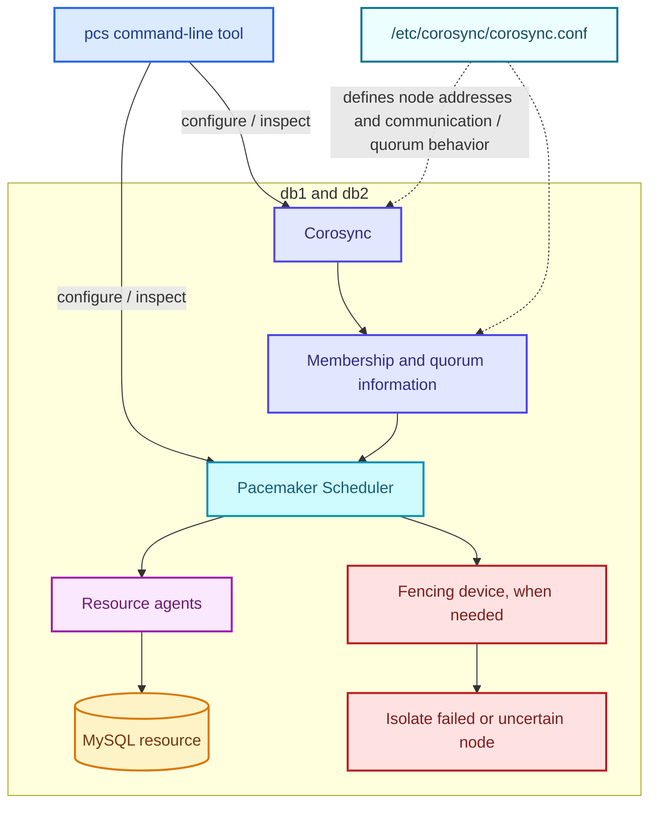
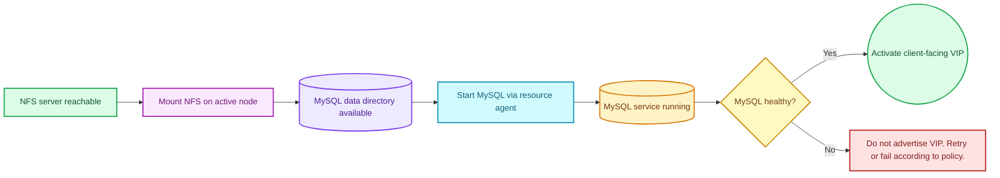
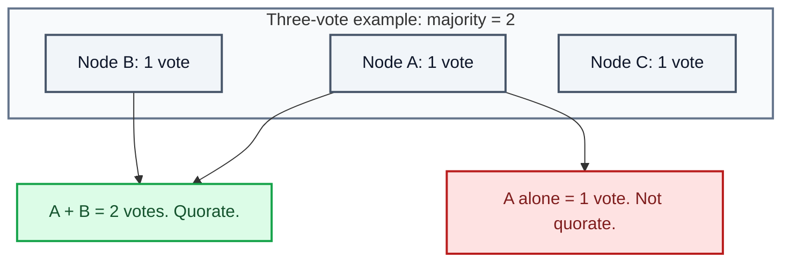
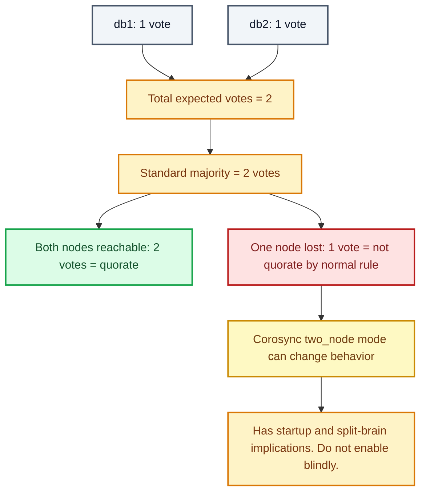
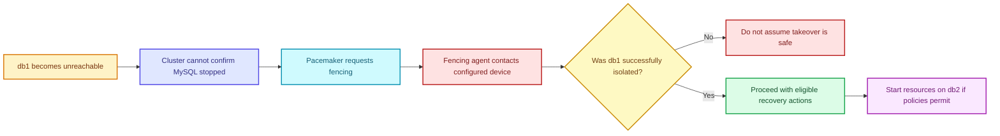
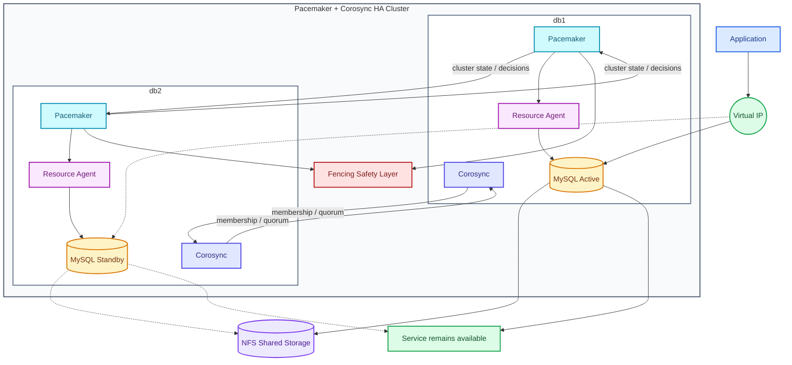
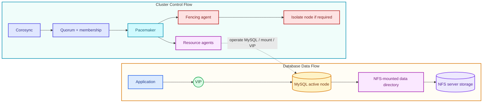
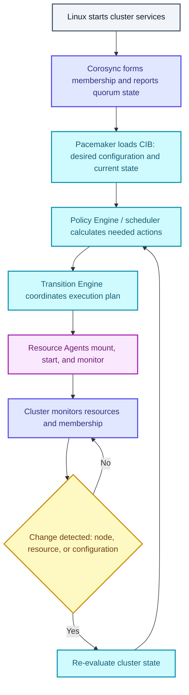
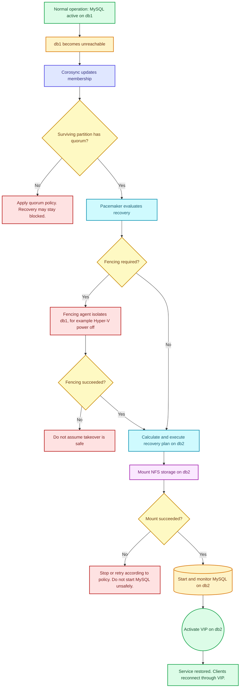
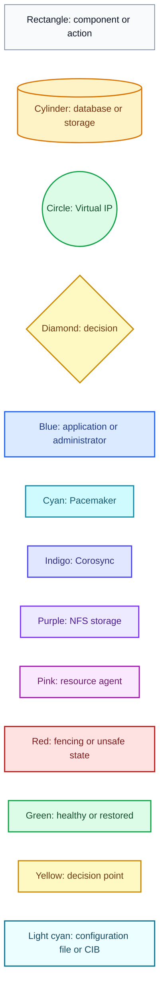

# Pacemaker + Corosync High Availability Cluster Guide for MySQL on AlmaLinux and Hyper-V

> **Beginner-friendly DevOps documentation**
>
> This document explains how a two-node MySQL High Availability cluster works using Pacemaker, Corosync, `pcs`, resources, quorum, fencing, failover, and recovery.
>
> It is based on the supplied raw notes and preserves the technical information, commands, paths, IP addresses, component names, concepts, diagram labels, and unresolved items. Where information is not proven by the notes, it is marked as **Unclear / Needs Verification**.

---

## Preservation and Correction Note

The raw notes contained rendered Mermaid/SVG CSS fragments instead of valid Mermaid source code. Those CSS fragments are browser rendering output, not commands, configuration, logs, or technical state.

The visible diagram labels from those fragments have been recovered and preserved in corrected Mermaid diagrams and in **Appendix A**.

No substantive technical information from the supplied notes has been omitted.

Some terminology varies between older and newer Pacemaker descriptions:

- The notes mention **Local Resource Manager (LRMD)** and also **Local Resource Manager (LRM)**.
- The notes mention **Policy Engine (PE)**, **Transition Engine (TE)**, and also **Pacemaker scheduler**, **CRM**, and **LRM**.

These are treated as conceptual component names. Exact internal process names and implementation details can vary by Pacemaker version. The document preserves both naming styles and explains the relationship.

---

# 1. Overview

This documentation explains Pacemaker, Corosync, `pcs`, resources, quorum, fencing, failover, and the complete runtime flow of a High Availability cluster.

It uses a two-node MySQL HA lab on AlmaLinux and Hyper-V as the running example.

The guide is written for a complete beginner. It explains not only **what** each command does, but also **why** it is needed, **how** the underlying mechanism works, and **how** all components work together.

---

## 1.1 The basic problem: a single database server can fail

Imagine you have a database server called `db1`. Your application connects to it to read and write data.

```text
Application
    |
    | Needs database access
    v
db1: MySQL
Running
```

Everything works until one of these happens:

- `db1` crashes.
- MySQL stops.
- The server becomes unreachable.
- The network fails.
- The operating system freezes.
- The VM hosted on Hyper-V fails.

When that happens, your application may lose access to the database.

---

## 1.2 One solution: add a second server

One solution is to have a second server, `db2`, ready to take over.

```text
db1                  db2
10.10.10.101         10.10.10.102
```

Two servers are available, but something must coordinate them.

We need a system that can answer these questions:

- Is `db1` alive and communicating?
- Is MySQL actually running?
- If `db1` fails, is it safe to start MySQL on `db2`?
- Which server should run the database?
- How can the application find the database after a failover?

This is the problem that **High Availability (HA)** tries to solve.

> **High availability** means designing a service to recover from failures with as little interruption as practical. It does **not** automatically guarantee zero downtime or zero data loss.

---

# 2. Objectives

After reading this document, you should understand:

1. What problem a Pacemaker/Corosync HA cluster solves.
2. What a cluster, node, resource, resource agent, VIP, quorum, fencing, and failover are.
3. What Pacemaker does and what it does **not** do.
4. What Corosync does and why communication failure does not automatically mean a server crashed.
5. What `pcs` and `pcsd` are used for.
6. The main Corosync components:
   - Messaging and communication
   - Membership service
   - Quorum service
   - Configuration in `/etc/corosync/corosync.conf`
7. The main Pacemaker components:
   - Pacemaker scheduler
   - Cluster Resource Manager (CRM)
   - Local Resource Manager (LRM / LRMD)
   - Resource agents
   - STONITH / fencing
   - CIB, the Cluster Information Base
8. How Pacemaker internally evaluates state and plans actions.
9. How resources depend on each other in a MySQL HA design.
10. Why quorum exists and how two-node clusters are special.
11. Why fencing is required for safe shared-storage HA.
12. How normal operation works from boot to monitoring.
13. How a complete node failure is detected, evaluated, fenced, and recovered.
14. The difference between control flow and data flow.
15. Which commands from the notes inspect the cluster.
16. What is configured, what is only illustrative, and what still needs verification.

---

# 3. Background and Concepts

## 3.1 What exactly is a cluster?

A **cluster** is a group of computers that cooperate to provide a service.

In this case, the computers are two AlmaLinux VMs:

| Node  | IP address     | Intended role       |
| ----- | -------------- | ------------------- |
| `db1` | `10.10.10.101` | Normally runs MySQL |
| `db2` | `10.10.10.102` | Can take over MySQL |

A **node** simply means a machine participating in the cluster.

Both machines run cluster software. They communicate with each other and share information about the cluster's state.

However, creating a cluster does **not** automatically make every application highly available. You must tell the cluster which services it should manage and how they depend on each other.

For example, the cluster might manage:

- An NFS mount that provides database storage.
- A MySQL service that uses that storage.
- A virtual IP (VIP) that applications use to reach the database.

These are called **resources**.

---

## 3.2 What is Pacemaker?

**Pacemaker** is the cluster resource manager. It decides which resources should run, where they should run, and what actions are needed when something changes or fails.

Think of Pacemaker as the coordinator of the HA system.

It asks questions such as:

- Should MySQL run on `db1` or `db2`?
- Is the MySQL service healthy?
- Should a failed resource be restarted?
- Should a resource move to another node?
- Is a node safe to use after a failure?
- Which actions must happen first?

Pacemaker does **not** perform every operation itself. It coordinates other components that perform the actual work.

For example, if Pacemaker decides that MySQL should start on `db2`, it asks the appropriate resource agent to start it. That agent executes the operation and reports the result.

This distinction is important:

> **Pacemaker decides what should happen; resource agents perform the configured operations.**

Pacemaker also does **not** automatically synchronize database data. It manages availability, not database replication.

---

## 3.3 What is Corosync?

**Corosync** provides the cluster communication and membership layer. It helps nodes exchange cluster messages and determine which nodes are participating in the cluster. Its quorum service also reports whether the cluster has enough votes under the configured voting rules.

Imagine `db1` and `db2` are both running.

Corosync allows them to exchange cluster information. If `db1` suddenly stops communicating, the cluster detects a membership change.

But Corosync cannot automatically conclude that `db1` has physically crashed. There are several possibilities:

- The VM crashed.
- The operating system is frozen.
- The network connection failed.
- A firewall blocked communication.
- The server is still running, but the other node cannot reach it.

This is why cluster communication, quorum, and fencing are separate concepts.

> **Corosync detects and communicates cluster membership changes. Pacemaker then uses the available cluster state and policies to determine what to do.**

---

## 3.4 What is `pcs`?

`pcs` is the command-line administration tool used to configure and inspect the cluster.

The notes include commands such as:

```bash
pcs host auth db1 db2 -u hacluster
pcs cluster setup dbcluster db1 db2
pcs cluster start --all
pcs status
```

Each command has a different purpose:

| Command             | Purpose                                                    |
| ------------------- | ---------------------------------------------------------- |
| `pcs host auth`     | Establishes node authentication for cluster administration |
| `pcs cluster setup` | Configures the cluster and its participating nodes         |
| `pcs cluster start` | Starts cluster services                                    |
| `pcs status`        | Displays cluster and resource status                       |

`pcs` is **not** the component continuously deciding when to fail over MySQL. It is the tool used to tell the cluster what configuration is wanted and to inspect its state.

There is also `pcsd`, a service used by `pcs` for cluster administration and authentication. It is distinct from Pacemaker and Corosync.

---

## 3.5 Corosync components in easy English

In the Pacemaker cluster with `db1` and `db2`, Corosync and Pacemaker are two different software systems that work together.

Corosync handles communication between the cluster nodes and tracks which nodes are participating.

The main Corosync functions to understand first are:

### 3.5.1 Messaging and communication

Allows `db1` and `db2` to exchange cluster messages and detect communication failures.

### 3.5.2 Membership service

Tracks which nodes are currently part of the cluster membership.

### 3.5.3 Quorum service

Helps determine whether the cluster has enough votes to make cluster decisions. It uses the configured quorum rules.

### 3.5.4 Configuration

`/etc/corosync/corosync.conf` defines settings such as node addresses, cluster communication, and quorum behavior.

> These are the main functions to understand first, rather than a complete list of Corosync's internal modules.

---

## 3.6 Pacemaker components in easy English

Pacemaker manages the resources running on the cluster, such as MySQL and a virtual IP address.

The main Pacemaker-related components to understand are:

### 3.6.1 Pacemaker scheduler

Decides what actions are needed, where resources should run, and how to recover from failures.

In other Pacemaker descriptions, this decision-making role is closely related to the **Policy Engine (PE)**.

### 3.6.2 Cluster Resource Manager (CRM)

Coordinates cluster management, maintains cluster configuration, and coordinates resource-management actions.

### 3.6.3 Local Resource Manager (LRM)

Coordinates resource operations on an individual node, including operations carried out through resource agents.

The original notes also use the name **LRMD**, meaning Local Resource Manager daemon. For beginner understanding, **LRM** and **LRMD** refer to the same conceptual local resource-management role, though exact implementation names can vary by version.

### 3.6.4 Resource Agents

Scripts or programs that know how to start, stop, and monitor a service such as MySQL.

### 3.6.5 STONITH / Fencing

Allows Pacemaker to isolate a node through a configured fencing device when necessary to protect the cluster.

STONITH stands for **Shoot The Other Node In The Head**. It is a memorable but aggressive name for a safety mechanism: make sure the failed or uncertain node cannot keep using shared resources.

### 3.6.6 CIB, Cluster Information Base

Stores the cluster's configuration and status information, including resources, constraints, and properties.

Think of the CIB as the cluster's desired configuration plus current reported state.

---

## 3.7 Where does `pcs` fit in?

`pcs` is the command-line management tool. It lets you configure and inspect the cluster; it is not the component that makes the failover decisions.

For example:

```bash
pcs status
pcs resource config
pcs property config
pcs quorum status
pcs stonith config
```

These commands help an administrator see what the cluster is configured to do and what state it is currently in.

---

## 3.8 How Corosync, Pacemaker, resources, and fencing work together

There are two kinds of activity happening:

1. **Configuration activity:** You use `pcs` to configure the cluster, resources, constraints, quorum settings, and fencing.
2. **Runtime activity:** Corosync tracks membership and quorum, Pacemaker evaluates events and coordinates recovery, and resource agents perform the requested actions.

Once configured, the cluster can respond to events without manually issuing a `pcs` command for every recovery action.

The following diagram is a simplified conceptual diagram, not a literal sequence of network messages.



### Explanation

- The administrator uses `pcs`.
- `pcsd` helps administer and authenticate the cluster.
- The cluster configuration is stored and used by Corosync and Pacemaker.
- Corosync provides membership, communication, and quorum information.
- Pacemaker evaluates state and policies.
- Pacemaker plans resource actions.
- Resource agents operate MySQL, NFS mounts, and VIPs.
- The fencing subsystem uses configured fencing agents to isolate a node if required.
- `/etc/corosync/corosync.conf` defines important Corosync settings such as node addresses and communication/quorum behavior.

---

## 3.9 What happens inside Pacemaker?

Pacemaker itself has several internal components. You do not normally configure each one individually, but understanding their roles helps explain how the system works.

### CIB: Cluster Information Base

The **CIB** holds the cluster's configuration and reported state.

The configuration includes:

- Resources
- Constraints
- Properties
- Related settings

Cluster state records information such as:

- Node status
- Resource status

Think of it as the cluster's configuration and state database.

### Policy Engine (PE)

The **Policy Engine** evaluates the current state against the desired configuration and policies.

It calculates what actions are needed, such as:

- Starting MySQL on a suitable node
- Stopping a resource before moving it
- Applying ordering and colocation rules

In the newer component breakdown, this role is described as the **Pacemaker scheduler**.

### Transition Engine (TE)

The **Transition Engine** executes the recovery plan calculated by the Policy Engine.

It coordinates the actions and their dependencies, responding to their results and to new events.

### Local Resource Manager (LRM / LRMD)

The **Local Resource Manager** coordinates local resource agents on a node.

These agents perform operations such as:

- Starting MySQL
- Stopping MySQL
- Monitoring MySQL
- Managing a filesystem mount
- Managing a virtual IP

### Fencing subsystem

The **fencing subsystem** coordinates fencing requests through configured fencing agents.

It handles a different kind of operation from ordinary resource agents: isolating a node so that it cannot continue running resources unsafely.

> These are conceptual roles within the Pacemaker architecture. Exact internal process names and implementation details vary by version. The official Pacemaker documentation describes these components and how they cooperate.

### Simplified Pacemaker decision process

1. Something changes, such as a node joining or a resource failing.
2. The cluster's state is updated.
3. Pacemaker evaluates the new state against its configuration.
4. The Policy Engine calculates the actions needed.
5. The Transition Engine coordinates their execution.
6. Resource or fencing agents perform the operations.
7. The results update the cluster's state, and Pacemaker reacts if further action is needed.

Pacemaker repeats this process as the cluster changes.

### Pacemaker internal component diagram

```mermaid
flowchart TD
  classDef default fill:#F8FAFC,stroke:#64748B,stroke-width:1px,color:#0F172A;
  classDef config fill:#ECFEFF,stroke:#0E7490,stroke-width:2px,color:#164E63;
  classDef pacemaker fill:#CFFAFE,stroke:#0891B2,stroke-width:2px,color:#155E75;
  classDef agent fill:#FAE8FF,stroke:#A21CAF,stroke-width:2px,color:#701A75;
  classDef db fill:#FEF3C7,stroke:#D97706,stroke-width:2px,color:#78350F;
  classDef storage fill:#EDE9FE,stroke:#7C3AED,stroke-width:2px,color:#4C1D95;
  classDef vip fill:#DCFCE7,stroke:#16A34A,stroke-width:2px,color:#14532D;
  classDef fence fill:#FEE2E2,stroke:#B91C1C,stroke-width:2px,color:#7F1D1D;
  classDef node fill:#F1F5F9,stroke:#475569,stroke-width:2px,color:#0F172A;

  CIB[("CIB: Cluster Information Base")]:::config
  SCHED["Pacemaker Scheduler / Policy Engine"]:::pacemaker
  CRM["Cluster Resource Manager (CRM)"]:::pacemaker
  TE["Transition Engine"]:::pacemaker
  LRM["Local Resource Manager (LRM / LRMD)"]:::pacemaker
  RA["Resource Agents"]:::agent
  MYSQL[("MySQL resource")]:::db
  NFS[("NFS storage resource")]:::storage
  VIP(("Virtual IP resource")]:::vip
  FENCE["STONITH / Fencing subsystem"]:::fence
  NODE["Cluster node: db1 / db2"]:::node

  CIB --> SCHED
  SCHED --> CRM
  CRM --> TE
  TE --> LRM
  LRM --> RA
  RA --> MYSQL
  RA --> NFS
  RA --> VIP
  TE --> FENCE
  FENCE --> NODE
```

### Beginner explanation

- The CIB stores what the cluster should look like and what is currently reported.
- The scheduler or Policy Engine decides what needs to happen.
- The CRM coordinates cluster management.
- The Transition Engine turns the plan into ordered actions.
- The Local Resource Manager works on a specific node.
- Resource agents perform the real start/stop/monitor operations.
- The fencing subsystem isolates unsafe nodes.

---

## 3.10 What is a resource, exactly?

A **resource** is something that Pacemaker manages to provide the service you want to keep available.

For the database lab, the resources might be:

| Resource        | Responsibility                               |
| --------------- | -------------------------------------------- |
| `mysql-storage` | Mounts the NFS export                        |
| `mysql-service` | Starts, stops, and monitors MySQL            |
| `mysql-vip`     | Adds or removes the client-facing virtual IP |

> These names are illustrative. They are **not proof** that these resources have been created.

---

## 3.11 What is a resource agent?

A **resource agent** is the mechanism Pacemaker uses to perform operations on a resource.

For example, a suitable MySQL resource agent might implement operations such as:

- `start`: start the database service.
- `stop`: stop the database service.
- `monitor`: check whether the service is healthy.
- `validate`: check whether the supplied configuration is valid, where supported.

Pacemaker does not simply guess how to operate every application. You must use a suitable agent and configure its parameters correctly.

For example:

- A service resource might use a systemd service definition.
- An NFS mount might use a filesystem or NFS-related resource agent.
- A virtual IP might use an IP address resource agent.

The available agents depend on the installed packages and software version.

---

## 3.12 How do resources depend on one another?

The MySQL service needs its data directory to be available before it starts.

If that directory is on NFS, the intended dependency is:



> This is the desired startup workflow, not an automatic behavior just because NFS and MySQL are installed. You must configure the appropriate resource relationships and checks.

Pacemaker uses three important kinds of constraints:

| Constraint type | Meaning |
| --- | --- |
| **Ordering** | Specifies which operation should happen before another. |
| **Colocation** | Specifies that resources should run on the same node or in a defined placement relationship. |
| **Location** | Specifies where a resource is allowed or preferred to run. |

These constraints help Pacemaker create a valid recovery plan.

---

## 3.13 Quorum, explained from the beginning

**Quorum** is one of the most important concepts in a multi-node cluster.

A quorum service uses voting rules to determine whether a cluster partition has enough votes to make cluster decisions. The standard votequorum model generally requires a majority of the expected votes.

### Why do votes exist?

Imagine that two nodes lose communication.

`db1` cannot tell whether `db2` has crashed or merely become unreachable. `db2` faces the same uncertainty.

Without coordination, both nodes might try to take over the same resources.

Quorum helps prevent both sides of a partition from independently operating as the authoritative cluster.

This unsafe condition is commonly called **split-brain**.

### Example: three votes

Suppose a cluster has three votes.

\[
\text{Majority}=\left\lfloor\frac{3}{2}\right\rfloor+1=2
\]

Plain-text version:

```text
Majority = floor(3 / 2) + 1 = 2
```

A partition with two votes has a majority. A partition with one vote does not.

Example: three voting members

| Member | Votes |
| --- | ---: |
| Node A | 1 vote |
| Node B | 1 vote |
| Node C | 1 vote |

Possible partitions:

| Partition | Votes | Result |
| --- | ---: | --- |
| A + B | 2 votes | Meets the two-vote majority. |
| A alone | 1 vote | Does not meet the two-vote majority. |

A third vote may come from an additional cluster node or a quorum device, depending on the design. A quorum device is not necessarily another database server.



### Your case: two database nodes

The cluster has two nodes, so the voting behavior needs special consideration.

With two nodes, each normally has one vote. A standard majority of two votes requires both nodes.

Corosync supports a `two_node` mode that changes the quorum calculation so one surviving node can remain quorate. This mode has important startup and split-brain implications; it is not something to enable blindly.



> The key point is that quorum is not simply a count of how many machines are switched on. It depends on the configured votes and which members can participate in the same cluster partition.

### What happens when a node disappears?

There are two separate questions:

1. Does the surviving partition have quorum under the configured voting rules?
2. Can the cluster safely manage resources that might still be running on the missing node?

Quorum addresses the first question. Fencing addresses the second.

A node can be unreachable while its MySQL process continues to run. Even if the surviving node has quorum, it must still handle the resource takeover safely.

### How to inspect quorum

Run these read-only commands:

```bash
pcs quorum status
corosync-quorumtool -s
```

They help inspect the current quorum state and voting information. They do **not** configure quorum.

---

## 3.14 Fencing: how the cluster isolates a node

**Fencing** is a safety mechanism used when the cluster needs to ensure that a node cannot continue running resources.

Suppose `db1` becomes unreachable. Pacemaker cannot assume that the database has stopped merely because it cannot contact the node.

A configured fencing mechanism can, for example, request that the virtualization platform power off the `db1` VM. The cluster waits for the fencing operation to succeed before treating that node as safely isolated for the relevant recovery.

Pacemaker treats fencing devices as special resources and uses fencing agents to perform the operation.

### Fencing flow



> Fencing is not the same as restarting MySQL. It isolates the node that may still be running resources.

Also, merely enabling fencing in Pacemaker is insufficient. You need:

- A working fencing device.
- Correct credentials where required.
- Correct permissions where required.
- A tested configuration.

---

## 3.15 Easy way to remember

- **Corosync:** Who is in the cluster, and who can communicate?
- **Quorum:** Does the cluster have enough votes?
- **Pacemaker:** What should happen to the resources?
- **Resource agent:** How do I start, stop, or monitor MySQL?
- **Fencing:** How do I ensure a problematic node cannot interfere?
- **CIB:** What is the cluster configured to do?
- **pcs:** How does the administrator configure and inspect it?

---

# 4. Architecture

The lab architecture is a two-node MySQL HA cluster on AlmaLinux VMs hosted by Hyper-V.

| Component | Value / role |
| --- | --- |
| Cluster name | `dbcluster` |
| Node 1 | `db1` |
| Node 1 IP | `10.10.10.101` |
| Node 2 | `db2` |
| Node 2 IP | `10.10.10.102` |
| Operating system | AlmaLinux |
| Hypervisor | Hyper-V |
| Shared storage | NFS server/storage |
| Database service | MySQL |
| Client access method | Virtual IP (VIP) |
| Cluster administration user | `hacluster` |
| Corosync configuration file | `/etc/corosync/corosync.conf` |

---

## 4.1 Main architecture diagram



### Explanation

- The application connects to the VIP, not directly to `db1` or `db2`.
- Normally, MySQL runs on `db1`.
- MySQL reads and writes database files through an NFS-mounted data directory.
- Corosync on `db1` and `db2` exchanges membership and quorum-related information.
- Pacemaker coordinates resource state and recovery decisions.
- Resource agents perform actual operations such as mounting NFS, starting MySQL, and moving the VIP.
- Fencing agents can isolate a node if the cluster cannot confirm that it is safely stopped.

---

## 4.2 Data flow versus control flow

This distinction is very important in the MySQL lab.

### Control flow

Control flow is how the cluster coordinates and manages the system.

For example:

- Corosync exchanges membership information.
- Quorum evaluates voting status.
- Pacemaker decides what actions are needed.
- Resource agents start and stop MySQL.
- Fencing agents isolate nodes when necessary.

### Data flow

Data flow is how the actual database information is stored and accessed.

In the design:

- MySQL reads and writes database files.
- Those files reside on the NFS share.
- The active MySQL server accesses the files through its mounted data directory.
- Clients send database requests to the active database endpoint.



> Pacemaker does not transfer the database contents between the nodes.

Plain-text combined view:

```text
DATABASE DATA FLOW:

Application -> VIP -> MySQL on active node -> NFS-mounted data directory -> NFS server storage


CONTROL FLOW:

Corosync -> Quorum and membership -> Pacemaker
Pacemaker -> Resource agents -> start/stop/monitor MySQL
Pacemaker -> Fencing agent -> isolate node if required
```

The two flows interact, but they solve different problems.

> HA does not automatically mean data replication or backup. If the NFS server fails, Pacemaker cannot recover the database files simply by moving MySQL to another node. The design still needs appropriate storage resilience and independent backups.

---

# 5. Prerequisites and Environment

The following prerequisites are present or implied by the notes.

| Item | Value / status |
| --- | --- |
| Operating system | AlmaLinux |
| Nodes | `db1`, `db2` |
| Node IPs | `10.10.10.101`, `10.10.10.102` |
| Hypervisor | Hyper-V |
| Cluster name | `dbcluster` |
| Cluster administration user | `hacluster` |
| Cluster software | Pacemaker, Corosync, `pcs`, `pcsd` |
| Database | MySQL |
| Shared storage | NFS |
| Client access method | Virtual IP (VIP) |
| Corosync configuration file | `/etc/corosync/corosync.conf` |

---

## 5.1 Additional prerequisites that need verification

The notes do not provide all production details. The following remain **Unclear / Needs Verification**:

- Exact installed package versions for Pacemaker, Corosync, `pcs`, MySQL, and NFS clients.
- Whether the cluster resources `mysql-storage`, `mysql-service`, and `mysql-vip` actually exist.
- The real resource IDs, if they differ from the illustrative names.
- The VIP address.
- The NFS server hostname or IP address.
- The NFS export path.
- The local mount point used for MySQL data.
- The MySQL data directory path.
- Whether fencing is configured.
- Which fencing agent is used for Hyper-V.
- Whether fencing credentials are configured.
- Whether fencing has been tested.
- Whether Corosync `two_node` mode is enabled.
- The current quorum configuration.
- The current ordering, colocation, and location constraints.
- The actual contents of `/etc/corosync/corosync.conf`.
- The actual output of the inspection commands.
- Which node the initial `pcs` commands were run from.

Do not assume the lab is complete or production-ready until these items are verified.

---

# 6. Implementation: Step by Step

This section documents the commands from the notes. These commands configure or inspect the cluster foundation.

> **Important:** The notes say these commands were used, but they do not include actual command output. Therefore, success is not proven by the supplied material. Verification still requires running the inspection commands and reviewing their output.

---

## Step 1: Authenticate the cluster nodes

### Goal

Establish authentication between the cluster nodes so `pcs` can administer them.

### Why it is required

`pcs` uses `pcsd` to communicate with cluster nodes. Before `pcs` can configure or inspect the cluster, the nodes must trust the administration credentials.

### Command

Run from an administrative shell where `pcs` is available. The notes do not specify whether this was run on `db1`, `db2`, or another admin host.

```bash
pcs host auth db1 db2 -u hacluster
```

### Explanation

| Part | Meaning |
| --- | --- |
| `pcs` | Cluster administration command-line tool. |
| `host auth` | Authenticate hosts for cluster administration. |
| `db1` | First cluster node hostname. |
| `db2` | Second cluster node hostname. |
| `-u hacluster` | Use the `hacluster` user for authentication. |

### What happens internally

`pcs` contacts `pcsd` on the specified hosts and validates the provided credentials. Once authenticated, `pcs` can send configuration and status requests to those nodes.

### Expected result

A successful authentication result would allow later `pcs cluster setup` and status commands to operate on both nodes. The notes do not include the actual output, so the exact success message is not documented.

### Verification

```bash
pcs status
```

If authentication failed, later cluster setup or status commands may report permission or connection problems.

### Common mistakes

- Wrong `hacluster` password.
- `pcsd` not running on one or both nodes.
- Firewall blocking `pcsd` communication.
- Hostnames `db1` and `db2` not resolvable.
- Running the command from a machine that cannot reach the nodes.

### How this step connects to the next step

Authentication must exist before `pcs cluster setup` can configure the cluster across both nodes.

---

## Step 2: Set up the cluster

### Goal

Create the cluster configuration for `dbcluster` using nodes `db1` and `db2`.

### Why it is required

The nodes need a shared cluster configuration that defines membership and communication settings.

### Command

```bash
pcs cluster setup dbcluster db1 db2
```

### Explanation

| Part | Meaning |
| --- | --- |
| `pcs cluster setup` | Configure the cluster and its participating nodes. |
| `dbcluster` | Name of the cluster. |
| `db1` | First node to include in the cluster. |
| `db2` | Second node to include in the cluster. |

### What happens internally

`pcs` generates and distributes Corosync configuration. The nodes are defined as members of the cluster named `dbcluster`.

The Corosync configuration file is located at:

```text
/etc/corosync/corosync.conf
```

This file defines settings such as node addresses, cluster communication, and quorum behavior.

### Expected result

The cluster configuration should exist on the nodes. The notes do not include actual output, so the exact result is not verified.

### Verification

```bash
pcs status
```

You should be able to see cluster information, including the cluster name `dbcluster`, if the cluster services are running.

### Common mistakes

- Incorrect node names.
- IP address or hostname resolution problems.
- Existing conflicting Corosync configuration.
- Authentication not completed successfully.
- Firewall blocking Corosync communication.

### How this step connects to the next step

After the cluster is configured, the cluster services must be started.

---

## Step 3: Start the cluster services

### Goal

Start Corosync and Pacemaker on all cluster nodes.

### Why it is required

The cluster cannot exchange membership information or manage resources until the cluster services are running.

### Command

```bash
pcs cluster start --all
```

### Explanation

| Part | Meaning |
| --- | --- |
| `pcs cluster start` | Starts cluster services. |
| `--all` | Apply the command to all cluster nodes. |

### What happens internally

Corosync starts and begins communicating with other configured nodes. Pacemaker starts and begins evaluating the cluster configuration and state.

### Expected result

Both nodes should become active cluster members. The notes do not include actual output, so this is not verified by supplied evidence.

### Verification

```bash
pcs status
```

### Common mistakes

- One node fails to start Corosync.
- Network/firewall prevents Corosync communication.
- Configuration was not distributed correctly.
- Services are masked or disabled in systemd.

### How this step connects to the next step

Once the cluster is running, you can inspect its status.

---

## Step 4: Check basic cluster status

### Goal

Display cluster and resource status.

### Why it is required

This is the first broad check that the cluster exists, nodes are visible, and resources are in a known state.

### Command

```bash
pcs status
```

### Explanation

| Part | Meaning |
| --- | --- |
| `pcs status` | Displays cluster and resource status. |

### What happens internally

`pcs` queries the cluster state and presents a summary of nodes, resources, and cluster health.

### Expected result

A normal result would show the cluster name, node states, and any configured resources. The notes do not include the actual output.

### Verification

This command is itself a verification command.

### Common mistakes

- Expecting resources to exist before they are configured.
- Misreading offline, standby, or failed states.
- Ignoring quorum warnings.

### How this step connects to later steps

Basic status tells whether the cluster foundation is running. Detailed inspection comes later.

---

## Step 5: Inspect quorum

### Goal

Check the current quorum state and voting information.

### Why it is required

Quorum determines whether a cluster partition is allowed to make decisions. In a two-node cluster, quorum behavior is especially important.

### Commands

```bash
pcs quorum status
corosync-quorumtool -s
```

### Explanation

| Command | Purpose |
| --- | --- |
| `pcs quorum status` | Shows quorum status through `pcs`. |
| `corosync-quorumtool -s` | Shows Corosync quorum status directly. |

### What happens internally

The commands query the quorum service and report current voting information.

### Expected result

You should see whether the cluster is quorate, expected votes, configured votes, and node vote information. The notes do not include actual output.

### Verification

These commands are verification commands.

### Important note

> They help inspect the current quorum state and voting information. They do **not** configure quorum.

---

## Step 6: Inspect the actual cluster configuration

### Goal

Determine what is actually configured in the cluster.

### Why it is required

The notes explain the intended architecture, but some resource names are illustrative. To connect theory to the real system, inspect the live configuration.

### Commands

Run these on a cluster node:

```bash
# 1. Overall cluster and node state
pcs status --full

# 2. Configured resources
pcs resource config

# 3. Resource ordering, placement, and colocation rules
pcs constraint config

# 4. Fencing configuration
pcs stonith config

# 5. Cluster properties
pcs property config

# 6. Current quorum state
pcs quorum status
corosync-quorumtool -s
```

### Explanation

| Command | Purpose |
| --- | --- |
| `pcs status --full` | Shows detailed cluster, node, and resource state. |
| `pcs resource config` | Shows configured resources. |
| `pcs constraint config` | Shows ordering, placement, and colocation rules. |
| `pcs stonith config` | Shows fencing configuration. |
| `pcs property config` | Shows cluster properties. |
| `pcs quorum status` | Shows current quorum state. |
| `corosync-quorumtool -s` | Shows Corosync quorum status. |

### What happens internally

These commands read cluster configuration and runtime state. They do not create resources or change cluster behavior.

### Expected result

The output will tell:

- Whether resources exist.
- What resource IDs are actually configured.
- Whether ordering constraints exist.
- Whether colocation constraints exist.
- Whether fencing is configured.
- Whether cluster properties include quorum-related settings.
- Whether the cluster is quorate.

The notes do not include the actual output, so the current real state remains **Unclear / Needs Verification**.

### Important note

> These are inspection commands; they do not create or change resources.

With those outputs, you can determine what is already configured, what remains missing, and how the actual cluster will behave during a failure. This is the bridge between understanding Pacemaker theoretically and understanding the system you built.

---

# 7. Complete Workflow

This section explains how all components interact from beginning to end.

> Assume the cluster configuration and resources have already been created correctly. This is an assumption from the notes, not a verified fact.

---

## 7.1 Normal operation

### Stage 1: Linux starts the cluster services

Corosync starts communicating with the other configured nodes. The cluster membership and quorum services determine the current membership and voting state.

### Stage 2: Pacemaker loads the cluster configuration

Pacemaker reads the desired resource configuration and current state. It evaluates which resources should run and where they should run.

### Stage 3: Pacemaker calculates a plan

The Policy Engine evaluates resource requirements, placement rules, constraints, and the current cluster state.

### Stage 4: Resource agents perform the actions

If the configured plan calls for MySQL to run on `db1`, the appropriate agents mount the required storage, start MySQL, and manage the VIP in the configured order.

### Stage 5: The cluster monitors resources

Configured monitoring operations check whether the resources remain healthy. Corosync continues tracking membership and quorum.

### Stage 6: The cluster reacts to new events

If MySQL fails, a node disappears, a constraint changes, or an administrator modifies the configuration, Pacemaker reevaluates what actions are required.

This is an ongoing control loop, not a one-time sequence of commands.



### Explanation

The cluster repeatedly evaluates state and acts when needed. It is not a script that runs once and finishes.

---

## 7.2 Intended MySQL resource startup order

For a MySQL HA service using NFS storage and a VIP, the intended startup dependency is:

```text
NFS storage -> MySQL data directory -> MySQL start -> MySQL health check -> VIP activation
```

This must be enforced by resource configuration and constraints. It does not happen automatically just because NFS and MySQL are installed.

---

# 8. Failure Handling and Recovery

This is where all the components work together.

Imagine that `db1` is running MySQL and suddenly becomes unreachable.

---

## 8.1 Stage 1: Corosync detects a membership change

Corosync stops receiving the expected communication from `db1` and updates the cluster membership view.

At this point, the cluster knows that communication has changed. It does not necessarily know why the node disappeared.

Possible causes include:

- The VM crashed.
- The operating system is frozen.
- The network connection failed.
- A firewall blocked communication.
- The server is still running, but the other node cannot reach it.

---

## 8.2 Stage 2: Quorum evaluates the surviving partition

The quorum service evaluates the votes available to the surviving partition.

- If the partition lacks quorum, the cluster's quorum policy may prevent resource management or recovery actions.
- If the partition has quorum, it may be allowed to make cluster decisions, subject to the other safety rules.

> Having quorum does not prove that MySQL has stopped on `db1`.

---

## 8.3 Stage 3: Pacemaker evaluates the situation

Pacemaker receives the cluster state change and evaluates the configured resources, their current state, and the relevant policies.

It must determine which actions are permitted and what is required before the resources can safely run elsewhere.

---

## 8.4 Stage 4: Fencing may be required

If `db1` might still be running MySQL, Pacemaker may request fencing.

The fencing agent attempts to isolate `db1` through the configured device. If the operation fails, the cluster must not treat the node as successfully fenced.

---

## 8.5 Stage 5: Pacemaker plans resource recovery

Once the required safety conditions are met, Pacemaker calculates an action plan.

For example, it may need to:

1. Ensure the old resource instance is stopped or safely isolated.
2. Mount the NFS storage on `db2`, if it is not already mounted there.
3. Start MySQL on `db2`.
4. Verify that MySQL is running according to its configured monitoring operation.
5. Activate the VIP so clients can reconnect.

The actual sequence depends on the resource configuration and dependencies.

---

## 8.6 Stage 6: Resource agents execute the actions

The resource agents perform the operations requested by Pacemaker. They report success or failure.

If a mount fails, for example, Pacemaker should not simply ignore the dependency and start MySQL against an unavailable data directory. The configured dependencies and recovery policies determine what happens next.

---

## 8.7 Stage 7: The cluster continues monitoring

Once recovery succeeds, Pacemaker continues managing the resources, while Corosync continues tracking membership and quorum.

The service is restored when the database and required networking are functioning. Existing client connections may still be lost, and the database may take time to recover.

---

## 8.8 Complete failure-handling flowchart



> This diagram represents the general logic, not every internal Pacemaker state transition. A resource failure while the node remains online can follow a different recovery path from a complete node failure.

---

# 9. Verification and Testing

The notes provide inspection commands, but not actual command outputs. Therefore, the current verified state of the cluster is limited.

---

## 9.1 Available verification commands

```bash
pcs status
pcs status --full
pcs resource config
pcs constraint config
pcs stonith config
pcs property config
pcs quorum status
corosync-quorumtool -s
```

---

## 9.2 What these commands verify

| Command | What it helps verify |
| --- | --- |
| `pcs status` | Basic cluster and resource status. |
| `pcs status --full` | Detailed cluster, node, and resource state. |
| `pcs resource config` | Whether resources exist and how they are configured. |
| `pcs constraint config` | Whether ordering, colocation, and location rules exist. |
| `pcs stonith config` | Whether fencing devices are configured. |
| `pcs property config` | Cluster-wide properties, which may include quorum-related settings. |
| `pcs quorum status` | Current quorum state through `pcs`. |
| `corosync-quorumtool -s` | Current Corosync quorum state. |

---

## 9.3 What is not verified by the supplied notes

The following are not proven by the supplied material:

- That MySQL resources are actually configured.
- That the VIP is configured.
- That NFS storage is configured as a cluster resource.
- That ordering constraints exist.
- That colocation constraints exist.
- That fencing is configured.
- That fencing works.
- That failover was tested.
- That the application successfully reconnects after failover.
- That the cluster is safe for production use.

---

## 9.4 Planned or conceptual tests not supplied as completed

The notes discuss failure recovery conceptually. They do not include evidence that a live failover test was performed.

Logical next tests would include:

- Inspect full configuration.
- Verify resources exist.
- Verify constraints exist.
- Verify fencing configuration exists.
- Safely test fencing according to an approved lab procedure.
- Safely test node failover.
- Verify application connectivity through the VIP.
- Verify MySQL data directory accessibility after failover.

Specific test commands beyond the supplied inspection commands are not documented in the notes and should not be assumed to have been run.

---

# 10. Troubleshooting

The notes do not include actual error logs or failed command outputs. Therefore, the table below separates **possible causes from the notes** from **confirmed causes**, of which none are supplied.

| Problem | Possible cause / confirmed cause | Solution | Verification |
| --- | --- | --- | --- |
| Node appears offline or unreachable | VM crashed, OS frozen, network failure, firewall blocked communication, or server still running but unreachable. Confirmed cause: not supplied. | Investigate network, VM state, firewall, and cluster communication. Corrective commands are not supplied in the notes. | `pcs status --full`, `pcs quorum status`, `corosync-quorumtool -s` |
| Cluster cannot make recovery decisions | Partition may lack quorum under configured voting rules. Confirmed cause: not supplied. | Review quorum configuration and cluster properties. For two-node clusters, understand `two_node` implications before changing anything. | `pcs quorum status`, `corosync-quorumtool -s`, `pcs property config` |
| Resources do not move to `db2` after `db1` fails | Fencing may be missing, misconfigured, or failed. Recovery may remain blocked until isolation is confirmed. Confirmed cause: not supplied. | Verify fencing configuration. A working fencing device, credentials, permissions, and tested configuration are required. | `pcs stonith config`, `pcs status --full` |
| MySQL starts but application cannot connect | VIP may not be active, may be on the wrong node, or may not be configured correctly. Confirmed cause: not supplied. | Verify VIP resource configuration and status. | `pcs resource config`, `pcs status --full` |
| MySQL fails to start after failover | NFS mount may have failed, data directory may be unavailable, or dependencies may be wrong. Confirmed cause: not supplied. | Verify storage resource, mount status indirectly through cluster resource state, and ordering constraints. | `pcs resource config`, `pcs constraint config`, `pcs status --full` |
| Both nodes might try to run MySQL | Split-brain risk if quorum/fencing safety is not correctly configured. Confirmed cause: not supplied. | Do not rely on HA without tested fencing and correct quorum design. | `pcs quorum status`, `corosync-quorumtool -s`, `pcs stonith config` |
| `pcs` commands fail with authentication or connection issues | `hacluster` credentials, `pcsd`, hostname resolution, or firewall issues may exist. Confirmed cause: not supplied. | Re-check authentication and node reachability. The notes include `pcs host auth db1 db2 -u hacluster`, but do not include a troubleshooting output. | `pcs status`, `pcs status --full` |
| Corosync behavior is unexpected | `/etc/corosync/corosync.conf` defines node addresses, communication, and quorum behavior. Confirmed cause: not supplied. | Review the actual Corosync configuration after verification. Do not edit blindly. | `pcs status --full`, `pcs quorum status`, `corosync-quorumtool -s` |

---

## Important troubleshooting principle

Do not treat Corosync communication loss as proof that a node is safely stopped. The node may still be running MySQL. That is why fencing exists.

---

# 11. Security and Reliability Considerations

## 11.1 Fencing is safety-critical

For shared-storage HA, fencing is not optional in a serious design. Without working fencing, the cluster cannot safely prove that an unreachable node has stopped using shared storage.

A node can be unreachable but still running. If the surviving node starts MySQL against the same NFS storage while the old node is still running, data corruption can occur.

---

## 11.2 Credentials must be protected

The `hacluster` user is used for cluster administration. Fencing agents may also require credentials for Hyper-V or another fencing device.

These credentials should be protected and not exposed in logs, repositories, or shared notes.

---

## 11.3 Network reliability matters

Corosync communication can fail for reasons other than a node crash:

- Network outage.
- Firewall rule.
- VM network misconfiguration.
- Switch or virtual switch problem.

In production, cluster communication should be designed with reliable networking and, where appropriate, redundant channels.

---

## 11.4 HA is not backup

Pacemaker does not copy database data between nodes. It does not provide database replication by itself.

If the NFS storage fails, moving MySQL to another node does not recover the data.

You still need:

- Storage resilience appropriate to the risk.
- Independent backups.
- Tested restore procedures.
- Clear recovery objectives.

---

## 11.5 Lab is not proven production-ready

The notes describe a lab and conceptual flow. They do not provide evidence that:

- Fencing is configured.
- Fencing has been tested.
- Resources are correctly constrained.
- Failover has been validated.
- Application reconnect behavior has been validated.
- Backups and restore procedures exist.

Therefore, do not treat this configuration as production-ready without verification.

---

# 12. Final Configuration and Current State

## 12.1 What the notes say was used

The notes include these cluster foundation commands:

```bash
pcs host auth db1 db2 -u hacluster
pcs cluster setup dbcluster db1 db2
pcs cluster start --all
pcs status
```

These commands indicate an intended two-node cluster named `dbcluster` using nodes `db1` and `db2`.

---

## 12.2 What is illustrative, not proven

The following resource names are illustrative:

| Resource | Status |
| --- | --- |
| `mysql-storage` | Illustrative only; not proven configured. |
| `mysql-service` | Illustrative only; not proven configured. |
| `mysql-vip` | Illustrative only; not proven configured. |

---

## 12.3 What is unknown or needs verification

| Item | Status |
| --- | --- |
| Actual resource IDs | Unclear / Needs Verification |
| VIP address | Unclear / Needs Verification |
| NFS server address | Unclear / Needs Verification |
| NFS export path | Unclear / Needs Verification |
| Local mount point | Unclear / Needs Verification |
| MySQL data directory | Unclear / Needs Verification |
| Ordering constraints | Unclear / Needs Verification |
| Colocation constraints | Unclear / Needs Verification |
| Location constraints | Unclear / Needs Verification |
| Fencing device | Unclear / Needs Verification |
| Fencing agent | Unclear / Needs Verification |
| Fencing credentials | Unclear / Needs Verification |
| Fencing test result | Unclear / Needs Verification |
| `two_node` quorum mode | Unclear / Needs Verification |
| Actual `/etc/corosync/corosync.conf` contents | Unclear / Needs Verification |
| Actual `pcs status --full` output | Not supplied |
| Actual `pcs resource config` output | Not supplied |
| Actual `pcs constraint config` output | Not supplied |
| Actual `pcs stonith config` output | Not supplied |
| Actual `pcs property config` output | Not supplied |
| Actual quorum output | Not supplied |

---

## 12.4 Current documented state

Based only on the notes:

- A two-node HA concept is documented.
- Basic `pcs` cluster foundation commands are documented.
- The intended architecture includes MySQL, NFS storage, and a VIP.
- The runtime behavior of Pacemaker, Corosync, quorum, fencing, and resource agents is explained.
- Corosync components are documented: messaging, membership, quorum, and configuration.
- Pacemaker components are documented: scheduler, CRM, LRM/LRMD, resource agents, STONITH/fencing, and CIB.
- The actual configured resources, constraints, fencing, and quorum settings are not proven by supplied output.

---

# 13. Important Commands Reference

All commands below are from the notes. They are grouped by purpose.

---

## 13.1 Cluster administration

```bash
pcs host auth db1 db2 -u hacluster
```

Establishes node authentication for cluster administration.

```bash
pcs cluster setup dbcluster db1 db2
```

Configures the cluster and its participating nodes.

```bash
pcs cluster start --all
```

Starts cluster services on all nodes.

---

## 13.2 Basic status

```bash
pcs status
```

Displays cluster and resource status.

```bash
pcs status --full
```

Displays detailed cluster and node state.

---

## 13.3 Resource inspection

```bash
pcs resource config
```

Shows configured resources.

---

## 13.4 Constraint inspection

```bash
pcs constraint config
```

Shows resource ordering, placement, and colocation rules.

---

## 13.5 Fencing inspection

```bash
pcs stonith config
```

Shows fencing configuration.

---

## 13.6 Cluster property inspection

```bash
pcs property config
```

Shows cluster properties.

---

## 13.7 Quorum inspection

```bash
pcs quorum status
```

Shows current quorum state through `pcs`.

```bash
corosync-quorumtool -s
```

Shows Corosync quorum status.

---

# 14. Key Takeaways

1. A cluster is a group of cooperating computers providing a service.
2. Creating a cluster does not automatically make an application highly available.
3. Resources are the services and components Pacemaker manages.
4. Pacemaker decides what should happen.
5. Resource agents perform the actual operations.
6. Corosync handles cluster communication and membership.
7. Corosync also provides quorum information.
8. `/etc/corosync/corosync.conf` defines node addresses, cluster communication, and quorum behavior.
9. Quorum determines whether a partition has enough votes to make decisions.
10. Two-node clusters need careful quorum design because a normal majority requires both nodes.
11. `two_node` mode can allow one surviving node to remain quorate, but it has important implications and should not be enabled blindly.
12. Fencing isolates a node so the cluster does not assume an unreachable server has stopped running resources.
13. Fencing is not the same as restarting MySQL.
14. Merely enabling fencing is insufficient; the fencing device, credentials, permissions, and behavior must be tested.
15. Normal operation is a continuous control loop.
16. Failure handling involves membership detection, quorum evaluation, Pacemaker policy evaluation, fencing if required, resource recovery, and continued monitoring.
17. Control flow manages the cluster. Data flow moves actual database reads and writes.
18. Pacemaker does not transfer database contents between nodes.
19. HA does not automatically mean replication or backup.
20. If NFS storage fails, moving MySQL to another node does not recover the data.
21. The resource names `mysql-storage`, `mysql-service`, and `mysql-vip` are illustrative unless verified in the live cluster.
22. The next practical step is to run the inspection commands and compare the real configuration to the intended architecture.

---

## Easy memory summary

- **Corosync:** Who is in the cluster, and who can communicate?
- **Quorum:** Does the cluster have enough votes?
- **Pacemaker:** What should happen to the resources?
- **Resource agent:** How do I start, stop, or monitor MySQL?
- **Fencing:** How do I ensure a problematic node cannot interfere?
- **CIB:** What is the cluster configured to do?
- **pcs:** How does the administrator configure and inspect it?

---

# 15. Further Work / Pending Items

The following items remain unresolved or need verification.

---

## 15.1 Capture actual cluster state

Run and save the output of:

```bash
pcs status --full
pcs resource config
pcs constraint config
pcs stonith config
pcs property config
pcs quorum status
corosync-quorumtool -s
```

---

## 15.2 Verify resources

Confirm whether these resources actually exist, or what their real IDs are:

- NFS storage mount resource.
- MySQL service resource.
- Virtual IP resource.

---

## 15.3 Verify constraints

Confirm whether the cluster enforces the intended order:

```text
NFS storage -> MySQL -> VIP
```

Also confirm colocation so the VIP and MySQL run on the same active node where required.

---

## 15.4 Verify quorum configuration

Check whether the cluster uses standard majority voting, `two_node` mode, or another design.

Do not change quorum settings without understanding the split-brain and startup implications.

---

## 15.5 Verify fencing

Confirm:

- Whether a fencing device is configured.
- Which fencing agent is used.
- Whether it can isolate `db1` and `db2`.
- Whether credentials and permissions are correct.
- Whether fencing has been safely tested.

---

## 15.6 Verify Corosync configuration

Review the actual contents of:

```text
/etc/corosync/corosync.conf
```

This file defines node addresses, cluster communication, and quorum behavior.

Do not modify it blindly. Verify the current configuration first.

---

## 15.7 Verify storage resilience and backups

Because this design uses NFS shared storage, confirm:

- NFS server availability.
- NFS export correctness.
- Client mount behavior.
- Backup strategy.
- Restore procedure.
- Whether storage failure is a single point of failure.

---

## 15.8 Plan safe failover testing

Only after configuration and fencing are verified, plan a controlled test that answers:

- Does the VIP move?
- Does MySQL start on the surviving node?
- Does the application reconnect?
- Are existing connections lost as expected?
- Is data integrity preserved?
- Is fencing successful before recovery?

---

# Appendix A: Recovered Diagram Labels from Raw Mermaid Export

The raw notes contained rendered Mermaid CSS/SVG fragments. The fragments did not contain valid Mermaid source code, but they did contain diagram labels. Those labels are preserved below and are represented in the corrected diagrams above.

## A.1 Component relationship labels

```text
Administrator
pcs command
pcsd / cluster administration
Cluster configuration
Corosync
Membership and communication
Quorum information
Pacemaker
Evaluate state and policies
Plan resource actions
Resource agent
MySQL / NFS mount / VIP
Fencing subsystem
Configured fencing agent
Isolate a node if required
```

## A.2 New component relationship labels

```text
db1 and db2
Corosync
Membership and quorum information
Pacemaker Scheduler
Resource agents
Fencing device, when needed
MySQL resource
Isolate failed or uncertain node
pcs command-line tool
```

## A.3 Resource dependency workflow labels

```text
NFS server is reachable
Mount NFS on active node
Verify MySQL data directory is available
Start MySQL
Verify MySQL is healthy
Activate client-facing VIP
```

## A.4 Fencing flow labels

```text
db1 becomes unreachable
Cluster cannot confirm db1 is stopped
Pacemaker requests fencing
Fencing agent contacts configured device
Was db1 successfully isolated?
Do not assume takeover is safe
Proceed with eligible recovery actions
Start resources on db2 if policies permit
No
Yes
```

## A.5 Complete failure handling labels

```text
Normal operation: MySQL on db1
db1 becomes unreachable
Corosync updates membership
Evaluate quorum
Does partition have quorum?
Apply quorum policy
Pacemaker evaluates recovery
Is fencing required?
Attempt fencing of db1
Fencing succeeds?
Recovery may remain blocked
Calculate and execute recovery plan
Mount storage on db2 if required
Start and monitor MySQL
Activate VIP when appropriate
Service restored
No
Yes
```

## A.6 Data flow and control flow labels

```text
Database data flow
Control flow
Application
VIP
MySQL on active node
NFS-mounted data directory
NFS server storage
Corosync
Quorum and membership
Pacemaker
Resource agents
Fencing agent
```

---

# Appendix B: Source Reference / Image Artifacts Preserved

The notes included small reference/image artifacts. They are preserved here for completeness.

```text
[image](https://www.google.com/s2/favicons?domain=https://clusterlabs.org\&sz=32)
ClusterLabs

[image](https://www.google.com/s2/favicons?domain=https://github.com\&sz=32)
GitHub

+1
```

These artifacts appeared near conceptual explanations referencing ClusterLabs and GitHub. They do not represent commands, configuration, logs, or verified system state.

---

# Appendix C: Mermaid Color Legend



---

# Appendix D: Suggested Diagram Placement

| Document section | Recommended diagram |
| --- | --- |
| Top of README | Main architecture diagram |
| Background and Concepts | Component relationship diagram |
| Pacemaker internals | Internal component diagram |
| Resource dependency | Startup workflow diagram |
| Normal operation | Control loop diagram |
| Failure handling | Complete failure flowchart |
| Fencing | Fencing safety flow |
| Quorum | Three-vote and two-node warning diagrams |
| Data flow vs control flow | Combined data/control diagram |
| Reference | Color legend |